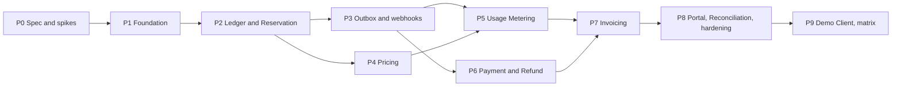
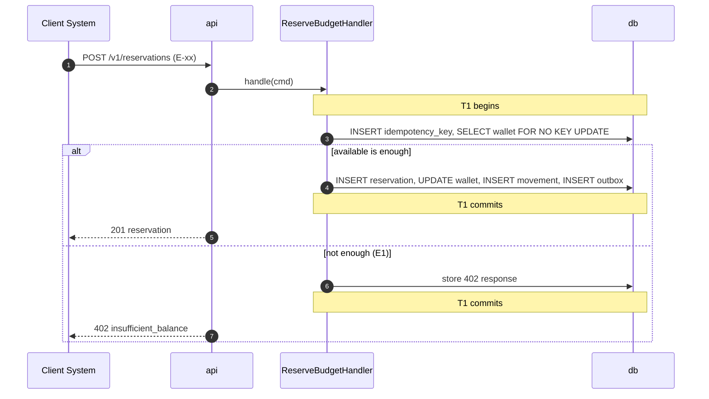

# Master Plan: building Generic Billing System end to end

> Status: **Review** · Updated: 2026-11-07 · Accompanies: [00-decision-register.md](00-decision-register.md) · Source: `generic-billing-system-sdd.md` (**original SDD**)

This plan contains four things: the gaps found in the original SDD (§1, with detail in the decision register); every document to write, with its required content and gate (§3); every task by phase, with acceptance criteria (§4, §5); and traceability from requirements to tasks and verification (§6).

Goal: when a task starts, everything needed for it is already in the docs. Nobody has to ask.

## 0. How to use this document

### 0.1 Language

| | |
| --- | --- |
| Documents (`docs/`, decision register, master plan) | English (`en`) · vocabulary: shipped `locales/en.md` |
| Code, UI strings, logs, API errors, commits, PR titles | English |
| Decided | 2026-11-06, Owner |

### 0.2 Reading order

Newcomers read §1 → §4 → the current phase in §5 → the documents that phase references.

### 0.3 Doc gate rule

Every phase has a task `Pn-00` that reviews documents. A phase starts only when the documents it needs are `Approved` (§3.3).

### 0.4 Identifiers

Each prefix has one meaning in the whole project. Numbers are never reused; a dropped item is struck through with the reason.

| Prefix | Meaning | Defined in |
| --- | --- | --- |
| `FR-xx`, `FR-xx.y` | Functional requirement, sub-requirement (keeps the SDD's numbers) | DOC-03 |
| `NFR-xx` | Non-functional requirement (keeps the SDD's numbers) | DOC-03 |
| `UC-xx` | Use case (UC-01…21 from the SDD; later ones added here) | §3.4, DOC-04 |
| `PS-x`, `J-x` | Persona, journey | DOC-02 |
| `F-<GROUP>-xx` | Feature | DOC-05 |
| `DOC-xx` | Document | §3.1 |
| `ADR-xxxx` | Architecture decision | §3.2, `04-adr/` |
| `DR-xx` | Decision register entry | `00-decision-register.md` |
| `Pn-xx` | Task of phase n; `Pn-00` is always the doc gate | §5 |
| `Mn` | Milestone that closes phase n | §4.1 |
| `S-xx` | Spike | §5, Phase 0 |
| `E-xx` | API endpoint | DOC-53 |
| `FL-xx`, `FL-xx.y` | Detailed flow, sub-flow | §3.2, `06-design/flows/` |
| `DQ-xx` | Data quality rule | DOC-18 |
| `EXP-xx` | Experiment (keeps the SDD's numbers) | §3.2, `10-testing/experiments/` |
| `RB-xx` | Runbook | §3.2, `09-operations/runbooks/` |
| `<X>-xx` | Required test of one document; one prefix per document, indexed in DOC-80 | The document's "Required tests" |

The SDD's stages `S0`…`S8` map to phases in §4.1. They have no hyphen and are not spike IDs.

### 0.5 Document status

`Draft` → `Review` → `Approved` → `Superseded`. ADR: `Proposed` → `Accepted` → `Superseded by ADR-yyyy`. Only the Owner moves a document to `Approved`, except small questions recorded as delegated (DR-103).

## 1. Analysis of the original SDD

### 1.1 What is already good and stays

- The top invariant: every journal balances, every business fact posts at most once, balance equals the sum of postings (SDD 2.1). Every mechanism in this plan serves it.
- The wallet row lock as the only arbiter of money, with pricing computed before the lock, and the Wallet Gate bounding waiters (SDD 6.5, 7.4).
- Memo holds, with no postings until settlement, plus an append-only movement log and no event sourcing (SDD 6.6, 6.8, 6.9).
- The idempotency claim in the same transaction as the business change, with business state as a second layer (SDD 8.1).
- WAL-based outbox relay with one topic per version, and a stated order scope from the first release (SDD 8.3).
- Cumulative rating with `ReplacingMergeTree` read through `FINAL`, keeping usage load off the money database (SDD 10.2, 10.3).
- "Billing describes facts and never instructs", enforced in the build (SDD 2.1, 8.4).
- Rules enforced by the build rather than by a document (SDD 5.5), and the framework-free core with explicit `UnitOfWork` (SDD 5.1).
- A Demo Client that uses only the public contract, with hand-written fixtures and no fake clock (SDD 11.7, 11.8).

### 1.2 Main gaps

| # | Gap | Consequence if left open | DR |
| --- | --- | --- | --- |
| 1 | `delivery UNIQUE (event_id, subscription_id)` on a table partitioned by month | PostgreSQL rejects the constraint. Partitioning by insert time instead would let a replay in a later month deliver a webhook twice | DR-56 |
| 2 | VOLUME pricing falls at a tier boundary, while rating "never produces a negative delta" and a law says `A` never decreases | The hybrid matrix cell fails at random, and every VOLUME plan overcharges until a person acts | DR-45 |
| 3 | ID-addressed calls (commit, release, `GET` charge, PSP callback) cannot find their tenant, since RLS returns zero rows with no tenant set | Commit cannot read its own reservation; a shortcut around RLS would undo tenant isolation | DR-62, DR-63 |
| 4 | Events and the feed are per account, while "neither Client System can read the other's reservations" | One Client reads another Client's reservations and charges through a webhook or the feed | DR-38 |
| 5 | Replication slot behavior on failover is not designed | Each primary failover loses events or replays 30 days of them, breaking NFR-07 and NFR-08 | DR-37 |
| 6 | One connector "per cluster", but a Debezium connector reads one database, and stores and shards are databases | The outbox of every other database is never relayed | DR-11 |
| 7 | Freezing is based on ingest age, while usage can wait 7 days in Kafka | Late-arriving events fall behind `frozen_until` and are never charged, breaking NFR-05 | DR-51 |
| 8 | A `FAILED` payment cannot become `SUCCEEDED`, and a `CREATED` row is never polled | The customer's real money arrives and is not credited | DR-71 |
| 9 | A top-up that does not fire `balance.restored` never retries an unpaid fee | A funded subscription stays unpaid forever | DR-78 |
| 10 | Tax added on top of charges has no ledger account, and payment of an invoice credits the wallet | A postpaid wallet ends positive after paying; the matrix's "balance is 0" fails | DR-03 |
| 11 | Reversal key allows one per journal, a change's proration reuses the cycle key | The second proration or partial reversal is silently a no-op: money not moved | DR-74, DR-77 |
| 12 | "Available at time T" needs `credit_limit`, which the movement log omits; version bumps with no movement raise false alerts | FR-31 cannot be met, and a false critical page fires on a limit change | DR-21 |
| 13 | Balance invariant scans all postings, forever | The check stops being runnable within a year or two, and the safety net disappears unnoticed | DR-24 |
| 14 | `reservation` and `charge` have no partitioning or retention at 8.6 million rows per day; `journal` hash cannot be pruned by public ID | Hot-path reads degrade with age; the commit's first read probes 64 partitions | DR-13, DR-97 |
| 15 | Pool sizes ignore per-pod and per-database multiplication; Wallet Gate permits ignore autoscaling | Connections exceed the plan under load; one hot wallet exhausts the pool, breaking NFR-17 | DR-18, DR-23 |
| 16 | The catalog lacks endpoints its own screens need | The portal and seed job cannot be built from the contract | DR-87 |
| 17 | Stage order: expiry needs Kafka before Kafka, tests need funding before funding, audit starts after the data it must cover | Stage exit criteria cannot be met as written; audit history has a hole | DR-99 |

### 1.3 Adjustments to the plan in the original SDD

| Adjustment | Reason |
| --- | --- |
| Add Phase 0: specification and spikes, before S0 | The design has 111 open decisions, and 9 spikes decide schemas and contracts. **The 9 spikes are deferred** (Owner, 2026-11-07): see §5, Phase 0 |
| `billing.jobs.v1` and its consumer move from S2 to P2 | Expiry goes through Kafka (DR-99) |
| Outbox writes begin at P2; the relay stays at P3 | Reservations must record events from their first commit (DR-99) |
| Platform admin endpoints and manual adjustment move to P2 | Tests need accounts and funding (DR-99) |
| Audit writes begin at P2, the consumer at P3, digests stay at P8 | An audit log cannot be backfilled (DR-99) |
| EXP-17 is staged over P1–P3; EXP-02 is provisional at P2 and final at P8 | Each stage smoke-tests what exists; production-size runs need an environment that comes later (DR-99) |
| Each store is its own database, with one connector each | Debezium reads one database (DR-11) |
| New tables: `wallet_checkpoint`, `adjustment`, `subscription_change`, `endpoint_state`, `tenant_billing_profile`, `client_inbound_secret`, `shard_map`, `usage_rejection`, `account_settings`, `fee_rule`; one `idempotency_key` per module | The SDD's flows need them (DR-24, 69, 77, 58, 81, 60, 14, 50, 75, 82, 32) |
| New topics: `billing.audit.v1`, `usage.exceptions.v1` | Audit detail must not reach webhook subscribers, and `ingest` has no database (DR-83, DR-40, DR-53) |
| New Poolers: `pool-ingest`, `pool-locator`, `pool-reconcile-rw` | Their paths are otherwise impossible (DR-18) |
| New use cases UC-22…26 | Subscriptions, administration and operator work appear in the SDD with no use case (§3.4) |
| **New requirements A, B and C (Owner, 2026-11-07):** (A) entitlement per pricing mode for each Client, per-mode rights for each Client user, revocation that only expires a Client's mode but cuts a user at once; (B) permission-based access by group, function and action as a bitmask, with no named roles; (C) the platform and each Client are two separate spaces, with separate users, permissions, endpoints and dashboards, addressed by host or by path, and the same email reusable across spaces. Adds FR-34…39, UC-27…32, DR-104…111, DOC-83…89, ADR-0026, 0027, FL-34…37, tasks P2-27…29, P4-10, P8-30…35 | The SDD has three fixed roles, one portal and no users that belong to a Client. Per the Owner there are no admin or staff roles, and the two spaces share code but not use cases. One rule set is needed before the admin endpoints of P2 are written (DR-104…111) |
| Pricing modes become an enum on the plan (`pricing_mode`) | Entitlement needs something to check; rating still ignores it (DR-104) |
| P2 grows from 5 to 6 weeks, P8 from 5 to 6 | P2: permission kernel, users, mode grants and spaces (P2-27…29) come before the first admin endpoints. P8: a Client dashboard of five screens and a platform users screen (P8-30…35) |
| Resilience4j narrows to PSP calls; webhook breaker state is shared in a table | A per-process breaker cannot serve several replicas (DR-58) |

## 2. Working principles

1. The core comes first: Ledger, Reservation, Idempotency, Outbox and invariant checks are right before anything is built on them. These are never cut.
2. Every phase ends with something that runs and can be demonstrated, and with an experiment or test that measures it.
3. Docs travel with code: a behavior change edits the doc in the same PR; a decision change gets a new ADR.
4. Every threshold is configuration, and every configuration key is in DOC-43.
5. Every rule that matters fails the build. A rule only in a document is a wish.
6. Money paths are proven by forcing the failure (kill, race, retry, duplicate) and then running the invariant checks, never by asserting the happy path. Mocking the database on a money path is forbidden.
7. Every effect is idempotent by business key, and has a run-twice test.
8. Numbers in documents say whether they are **planned** or **measured**, with date, machine and script (DR-100).
9. The Billing side never gains knowledge of a resource action. Adding one fails the build.

## 3. Documents to write

### 3.1 The docs/ tree

```text
docs/
├── README.md
├── 00-master-plan.md
├── 00-decision-register.md
├── 01-product/
│   ├── vision-and-scope.md                  # DOC-01
│   ├── personas-and-journeys.md             # DOC-02
│   ├── requirements.md                      # DOC-03
│   ├── use-cases.md                         # DOC-04
│   └── feature-catalog.md                   # DOC-05
├── 02-glossary.md                           # DOC-06
├── 03-architecture/
│   ├── system-context-and-containers.md     # DOC-07
│   ├── data-flows.md                        # DOC-08
│   ├── messaging-contracts.md               # DOC-09
│   ├── quality-attributes.md                # DOC-10
│   ├── tech-stack-and-versions.md           # DOC-11
│   └── code-architecture.md                 # DOC-12
├── 04-adr/
│   ├── README.md                            # DOC-13
│   └── NNNN-*.md                            # ADR table in §3.2
├── 05-data/
│   ├── ledger-model.md                      # DOC-14
│   ├── ops-model.md                         # DOC-15
│   ├── delivery-model.md                    # DOC-16
│   ├── usage-store.md                       # DOC-17
│   ├── data-quality-rules.md                # DOC-18
│   ├── db-roles-and-grants.md               # DOC-19
│   └── data-lifecycle.md                    # DOC-20
├── 06-design/
│   ├── wallet-and-ledger.md                 # DOC-21
│   ├── balance-reservation.md               # DOC-22
│   ├── idempotency.md                       # DOC-23
│   ├── outbox-and-relay.md                  # DOC-24
│   ├── shard-routing.md                     # DOC-25
│   ├── multi-tenancy.md                     # DOC-26
│   ├── pricing-engine.md                    # DOC-27
│   ├── usage-ingestion.md                   # DOC-28
│   ├── usage-rating.md                      # DOC-29
│   ├── webhook-dispatcher.md                # DOC-30
│   ├── catch-up-feed.md                     # DOC-31
│   ├── payment-and-refund.md                # DOC-32
│   ├── invoicing-and-subscription.md        # DOC-33
│   ├── reconciliation.md                    # DOC-34
│   ├── audit-and-digests.md                 # DOC-35
│   ├── erp-export.md                        # DOC-36
│   ├── scheduler-and-jobs.md                # DOC-37
│   ├── api-gateway.md                       # DOC-38
│   ├── demo-client.md                       # DOC-39
│   ├── coverage-matrix.md                   # DOC-40
│   ├── security.md                          # DOC-41
│   ├── observability.md                     # DOC-42
│   ├── configuration-reference.md           # DOC-43
│   ├── error-handling.md                    # DOC-44
│   ├── access-control.md                    # DOC-83
│   ├── spaces-and-routing.md                # DOC-84
│   └── flows/
│       ├── README.md                        # DOC-45
│       ├── budget-control.md                # DOC-46
│       ├── usage-and-rating.md              # DOC-47
│       ├── integration.md                   # DOC-48
│       ├── payments-and-refunds.md          # DOC-49
│       ├── invoicing.md                     # DOC-50
│       └── administration.md                # DOC-51
├── 07-api/
│   ├── api-guidelines.md                    # DOC-52
│   ├── api-endpoints.md                     # DOC-53
│   ├── webhook-events.md                    # DOC-54
│   └── client-integration-guide.md          # DOC-55
├── 08-ux-ui/
│   ├── ux-principles-and-ia.md              # DOC-56
│   ├── design-system.md                     # DOC-57
│   ├── ui-states-and-copy.md                # DOC-58
│   └── screens/
│       ├── README.md                        # DOC-59
│       ├── account-overview.md              # DOC-60
│       ├── top-up.md                        # DOC-61
│       ├── transactions.md                  # DOC-62
│       ├── invoices.md                      # DOC-63
│       ├── refunds.md                       # DOC-64
│       ├── finance-overview.md              # DOC-65
│       ├── price-plans.md                   # DOC-66
│       ├── refund-approvals.md              # DOC-67
│       ├── reconciliation.md                # DOC-68
│       ├── tenants-and-limits.md            # DOC-69
│       ├── client-systems.md                # DOC-70
│       ├── webhook-deliveries.md            # DOC-71
│       ├── client-overview.md               # DOC-85 (Client dashboard)
│       ├── client-users.md                  # DOC-86 (Client dashboard)
│       ├── client-price-plans.md            # DOC-87 (Client dashboard)
│       ├── client-catalog.md                # DOC-88 (Client dashboard)
│       ├── client-resources.md              # DOC-89 (Client dashboard)
│       └── platform-users.md                # DOC-90 (Platform dashboard)
├── 09-operations/
│   ├── local-dev.md                         # DOC-72
│   ├── deploy-mini.md                       # DOC-73
│   ├── deploy-staging.md                    # DOC-74
│   ├── deploy-production.md                 # DOC-75
│   ├── ci-cd.md                             # DOC-76
│   ├── backup-restore.md                    # DOC-77
│   ├── scaling-playbook.md                  # DOC-78
│   └── runbooks/
│       ├── README.md                        # DOC-79
│       └── RB-xx-*.md                       # DOC-79 / RB-xx, table in §3.2
└── 10-testing/
    ├── test-strategy.md                     # DOC-80
    ├── experiments/
    │   ├── README.md                        # DOC-81
    │   └── EXP-xx-*.md                      # DOC-81 / EXP-xx, table in §3.2
    └── demo-script.md                       # DOC-82
```

The `11-report` group is omitted: there is no thesis or formal report. `source-data.md` is omitted: Billing has no external source dataset, and PSP report formats live in DOC-34.

### 3.2 Required content of each document

The Gate column is the phase that needs the document `Approved` before it starts. "Skeleton at P1" means the sections known then are `Approved` at P1, and later sections are added and approved at the gate named. Bold marks items most likely to be forgotten.

#### Product and glossary

| DOC | Document | Required content | Gate |
| --- | --- | --- | --- |
| DOC-01 | Vision and scope | Context and five real-world problems (SDD 1). Core problem and both invariant statements. Three vision layers. **Measurable goals**: the target table of SDD 2.1 tied to NFRs and EXPs. In scope, Later, Out of scope with reasons (SDD 2.3). Investment per module (SDD 2.2). Assumptions: Vietnam and VND first (DR-01), 10-year retention (DR-02), invoice not a tax document (DR-04). **What v1.0 promises and what gates real money** (DR-05). Constraints: 1–2 people, 8 vCPU and 16 GB machine. Cut order | P1 |
| DOC-02 | Personas and journeys | `PS-1` Client System integrator, `PS-2` Customer finance user, `PS-3` Finance Admin, `PS-4` Operator/developer (runs mini, matrix, runbooks). Goals, pains, what each does not need. Journeys: `J-1` integrate a new Client from credentials to first settled job, `J-2` top up and read an invoice, `J-3` month-end review and refund approval, `J-4` respond to an invariant alert | P1 |
| DOC-03 | Requirements | FR-01…39 split into `FR-xx.y` with Given/When/Then with real numbers (use the examples of SDD 7.2, 11.8), MoSCoW, verification. FR-24 restated per DR-33, FR-27 per DR-83, FR-19 extended per DR-69. NFR-01…20 with target, how measured (DR-100), tool, EXP. FR-34…39 added (Owner, 2026-11-07), each with Given/When/Then at requirement level; the mechanism is in DOC-83 (DR-104…109). **FR → UC → F → design DOC matrix**. Design targets marked planned | P1 |
| DOC-04 | Use cases | Overview diagram. Every UC of §3.4 (UC-01…32) per template A.2, including error flows with the exact `code` from SDD 17.3 and DR-28. Rule stated on every Client UC: it asks or reports, and Billing never acts on a resource. UC-27…32 state who may act (permission code and space) and what a revoke leaves behind | P1 |
| DOC-05 | Feature catalog | Groups `F-LED`, `F-RES`, `F-IDP`, `F-EVT`, `F-PRC`, `F-USG`, `F-WHK`, `F-TEN`, `F-PAY`, `F-INV`, `F-REC`, `F-AUD`, `F-API`, `F-POR`, `F-OPS`, `F-DEMO`. Per feature: FR, UC, phase, MoSCoW, flag, dependencies, role, **cut step** from §4.3 | P1 |
| DOC-06 | Glossary | Written **first**. Minimum terms: Client System, Tenant, Billing Account, Wallet, ledger account, Journal, Posting, Charge, memo hold, Reservation, hold, commit, late commit, release, extend, expiry, `balance`, `held`, `available`, `credit_limit`, standing, movement, Idempotency Guard, Idempotency-Key, business key, source key, Wallet Gate, outbox, relay, replication slot, event envelope, descriptive event, order scope, feed, cursor, Product, Meter, PricePlan, PricePlanVersion, PriceComponent, PriceAssignment, charge model (PER_UNIT, GRADUATED, VOLUME, PACKAGE, FLAT), pricing mode (six), rating, rating cursor, cumulative rating, watermark, freeze, lateness horizon, quarantine, tier repricing, rating credit, Billing Cycle, Subscription, proration, Invoice, statement, overdue, Payment, PSP, `FakePsp`, Refund, refund hold, reconciliation exception, digest, logical shard, physical shard, logical store, Shard Router, Tenant Locator, process role, RLS, PgBouncer, Pooler, mini profile, Demo Client, coverage matrix, cell, fixture, prepaid, postpaid, plus tools: CloudNativePG, Strimzi, Debezium, ClickHouse, `FINAL`, KEDA, jMolecules, Spring Modulith | P1 |

#### Architecture

| DOC | Document | Required content | Gate |
| --- | --- | --- | --- |
| DOC-07 | System context and containers | C4 level 1 and 2 kept in step with `c4.html`, including the reading rules of SDD 4.5. Modules, process roles, deployment units, **role × adapter × pool × topic table** (DR-40, DR-18). **Data ownership table**: every table, topic and bucket with writer and readers. Trust boundaries: edge, PSP, Client endpoints, Kafka listener. States that the Demo Client is one Client | P1 |
| DOC-08 | Data flows | Sequence diagrams for: reserve and commit; expiry through Kafka; usage from ingest to charge; event from outbox to webhook and feed; payment to wallet credit; refund saga; account saga; cycle close. **Failure flows**: process killed mid-transaction, killed after commit before response, primary failover with slot (DR-37), Kafka down during reserve, ClickHouse down past the horizon (DR-51), worker killed during webhook call, lost PSP callback | P1 skeleton, final P3 |
| DOC-09 | Messaging contracts | Topic table of SDD 8.3 plus DR-40 additions, DLQs, keys, partitions, retention, ACLs per role. Envelope and outbox mapping (DR-35). JSON Schema per event type and `api_version` rules (DR-39). **Visibility table** (DR-38). Job messages (DR-41). Usage event contract (DR-50). Headers, including `traceparent`. Compatibility rules. Descriptive-name rule and regex | P3 |
| DOC-10 | Quality attributes | Per NFR: tactic → mechanism → where implemented → verification. Latency budget per hop for reserve (gateway, locator, gate, pricing, lock, commit with sync replication). **Capacity estimate**: rows and GB per day per table, at target and ×10, with real row sizes after S-02. Resources per role (DR-96), pool math (DR-18). The growth path of SDD 19.6. Quorum reading (DR-92) | P1 |
| DOC-11 | Tech stack and versions | Pinned versions with license and reason, from S-01. Compatibility table from spikes S-01…06, S-09. Library choices: HTTP client (DR-59), PDF (DR-81), portal (DR-89, three front-ends per DR-111). Named fallbacks. Update policy | P1 |
| DOC-12 | Code architecture | Layer table of SDD 5.1 plus `adapter.config` (DR-07). **Module map with allowed dependencies** (DR-08). Package layout with a complete example. DDD markers. CQRS rules. Which aggregates use which persistence (DR-09). Sealed results, not exceptions, for expected outcomes. Every rule of SDD 5.5 with its check, and additions from DR-07, DR-23, DR-26, DR-62, DR-63, DR-101. Review checklist. Shared code templates | P1 |
| DOC-13 | ADR index | Table: ADR, title, status, gate, source | P1 |

**ADRs**

| ADR | Subject | Source | Gate |
| --- | --- | --- | --- |
| ADR-0001 | Record architecture decisions | Skill default | P1 |
| ADR-0002 | Modular monolith, one artifact, process roles | SDD 4, 4.4 | P1 |
| ADR-0003 | Framework-free core, explicit `UnitOfWork`, no `@Transactional`, module map | SDD 5.1, DR-07, DR-08 | P1 |
| ADR-0004 | Row records with explicit mappers; explicit SQL on money paths | SDD 5.4, DR-09 | P1 |
| ADR-0005 | Wallet row lock with a bounded Wallet Gate | SDD 6.5, DR-23 | P2 |
| ADR-0006 | Holds as memo entries, including refund holds | SDD 6.6, DR-30 | P2 |
| ADR-0007 | State tables, append-only ledger and movement log; no event sourcing | SDD 6.8, 6.9, DR-21 | P2 |
| ADR-0008 | Idempotency claimed in the business transaction, one table per module | SDD 8.1, DR-32 | P2 |
| ADR-0009 | Debezium outbox relay, one connector per database, failover slots | SDD 8.3, DR-11, DR-36, DR-37 | P3 |
| ADR-0010 | One event topic, order scope and event visibility | SDD 8.3, DR-38 | P3 |
| ADR-0011 | Descriptive events only | SDD 2.1, 8.4 | P3 |
| ADR-0012 | Usage deduplication with `ReplacingMergeTree` and `FINAL` | SDD 10.2 | P5 |
| ADR-0013 | Cumulative rating, tier repricing and lag-safe freezing | SDD 10.3, DR-45, DR-51 | P5 |
| ADR-0014 | Shared schema with RLS and a narrow Tenant Locator | SDD 12.2, DR-62, DR-63 | P1 |
| ADR-0015 | 1,024 logical shards, shard-bearing IDs, partitioning by `logical_shard` | SDD 19.6, DR-12, DR-13, DR-15 | P1 |
| ADR-0016 | Logical stores as separate databases | SDD 16.1, DR-11 | P1 |
| ADR-0017 | PgBouncer transaction mode, one Pooler per pool | SDD 19.7, DR-18 | P1 |
| ADR-0018 | Kubernetes in every environment, one chart set, mini profile | SDD 19.8, DR-96 | P1 |
| ADR-0019 | Quorum synchronous replication with `dataDurability: required` | SDD 19.3, DR-92 | P1 |
| ADR-0020 | Demo Client outside Billing, on the public contract only | SDD 11.7 | P9 |
| ADR-0021 | Coverage matrix with hand-written fixtures and compressed cycles; no fake clock | SDD 11.8 | P9 |
| ADR-0022 | Invoices are tax-inclusive with no ledger effect | DR-03 | P7 |
| ADR-0023 | Keycloak and the token claim contract (including `billing_client_id` for Client user) | SDD 22.2, DR-64, DR-107 | P1 |
| ADR-0024 | Persisted payment state machine and credit by event | SDD 13.1, DR-70, DR-71 | P6 |
| ADR-0025 | Audit log scope and its own topic | SDD 15.2, DR-83 | P2 |
| ADR-0026 | Permission bitmask by group, function and action in two catalogs; pricing-mode entitlement that expires without touching resources; user revoke with resource hand-over | DR-104…106, DR-108, DR-109 | P2 |
| ADR-0027 | Platform and each Client are separate spaces: a realm per space, host and path addressing, three front-ends | DR-107, DR-110, DR-111 | P2 |

#### Data

| DOC | Document | Required content | Gate |
| --- | --- | --- | --- |
| DOC-14 | Ledger model | Mermaid ERD. **Complete runnable DDL, tried on PostgreSQL 18 through PgBouncer**, for `billing_account`, `wallet`, `ledger_account`, `reservation`, `reservation_archive`, `charge`, `journal`, `posting`, `wallet_movement`, `wallet_checkpoint`, `daily_rollup`, `adjustment`, `idempotency_key`, `outbox`, `debezium_heartbeat`. Partitions (DR-13), `logical_shard`, indexes with reasons, every constraint of SDD 16.2 as amended (DR-27, 30). Journal templates (SDD 6.1, DR-19, DR-74). Ledger account IDs (DR-20). **State diagrams** for `Reservation` including refund holds (DR-30) and `adjustment`. Movement kinds (DR-21). Sample statements for each step of SDD 6.3 | P1 |
| DOC-15 | Ops model | DDL per schema. `platform`: `tenant`, `tenant_billing_profile`, `client_system`, `client_product`, `client_grant`, `client_inbound_secret`, `platform_user`, `client_user`, `account_directory`, `shard_map`, ShedLock. `pricing`: tables of DR-44, with `pricing_mode` and `managed_by` (DR-104, DR-108); `managed_by` also on `client_product` and `meter`. `metering`: `rating_cursor` (DR-52), `usage_quarantine`, `usage_rejection`. `invoicing`: `account_settings`, `subscription`, `subscription_change`, `billing_cycle`, `invoice`, `invoice_line`, `invoice_charge`, `invoice_counter`. `payment`: `payment` with `captured_amount`, `refund`, `psp_event`. `reconciliation`: `run`, `exception`, `fee_rule`. `audit`: `log`. One `idempotency_key` and `outbox` per schema. **State diagrams**: plan version, subscription (DR-77), invoice, payment (DR-71), refund (DR-72), exception. RLS policy per table and **the three exempt tables** (DR-63) and why `client_pricing_mode`, `platform_user` and `client_user` need none (no `tenant_id`). Exclusion constraint on mode periods (needs `btree_gist`) | P1 skeleton (`platform`; `client_pricing_mode`, `platform_user` and `client_user` of DR-105 and DR-107 are added at the P2 gate, with DOC-83), P4 (`pricing`), P5 (`metering`), P6 (`payment`), P7 (`invoicing`), P8 (rest) |
| DOC-16 | Delivery model | DDL for `webhook.subscription`, `secret`, `delivery`, `attempt`, `event_log`, `endpoint_state`, `idempotency_key`, `outbox`, per DR-56, DR-58, DR-60. Delivery state diagram with all rows of SDD 11.3. Index reasons, claim SQL | P3 |
| DOC-17 | Usage store | ClickHouse DDL for `usage.event`, `event_hourly` and its view (DR-55). Query catalog: rating per aggregation (DR-46), `DISTINCT account_id`. `dimension_key` rule. TTL. Users. Why plain `SELECT` is unsafe for money. Timing from S-05 | P5 |
| DOC-18 | Data quality rules | `DQ-xx`: usage validation at ingest (all rejection codes of DR-50, with severity and action). Invariant catalog: every check of SDD 19.4 as `DQ-xx` with SQL in `deploy/sql/invariants/`, schedule, checkpoints (DR-24), recheck-on-primary rule. Duplicate `event_id` with changed `occurred_at` monitor (SDD 22.1) | P2, usage rules P5 |
| DOC-19 | DB roles and grants | Role × table × privilege matrix down to columns (DR-17), per database. **`billing_locator` column grants** (DR-62). Which app, pool and Pooler use which role (DR-18). Migration user. Secret provisioning. ClickHouse users, Kafka users. **Permission test matrix**: each forbidden action has a test. Rows for `platform.client_pricing_mode`, `platform.platform_user` and `platform.client_user` (DR-105, DR-107) are added at the P2 gate: `UPDATE` only on the three expiry columns of the first | P1 |
| DOC-20 | Data lifecycle | Retention per object (DR-97). `PartitionMaintenance` families and rules (DR-16). `reservation_archive` move. Tablespaces. Personal data inventory and treatment (DR-98). Object lock | P1 skeleton, final P8 |

#### Design

The common skeleton of this group (template B.1): Purpose and scope → Components and interfaces (real code signatures) → Algorithm (numbered pseudo-code) → Transactions and concurrency → Configuration → Metrics and logs → Errors and handling → Required tests (table with IDs) → Open questions (empty when `Approved`).

| DOC | Document | Required content | Gate |
| --- | --- | --- | --- |
| DOC-21 | Wallet and Ledger | Balance Policy formula and worked examples for both modes (SDD 6.4). Posting Engine statements (SDD 6.3) and `moved_at` guard (DR-15). `Journal.balanced`. Trigger (DR-26). Standing table and event rules (SDD 6.7, DR-22). Movement rules and past-time query (DR-21). Mode and limit change (DR-25). Wallet Gate implementation and config test (DR-23). Reversal (DR-74). Manual adjustment and dual control (DR-69). Hot-wallet striping seam. Tests: property test against a model wallet | P2 |
| DOC-22 | Balance Reservation | Request semantics (DR-27). Full lifecycle with all rows (SDD 7.2). **Edge-state table** (DR-28). Settlement rules with `ALLOW` and `CAP_AT_HOLD`. Zero usage. Refund holds (DR-30). Snapshot of Client parameters (DR-31). **Race table** (SDD 7.4) with a test per row. Expiry SQL and repeat rule (SDD 7.5). Rating scope on commit (DR-29) | P2 |
| DOC-23 | Idempotency | Guard code path. Table per module and `caller` (DR-32). Hash, stored statuses, endpoint table (DR-33). Lock order and `lock_timeout` first (DR-34). Case table of SDD 8.1. Business-state second layer. Cleanup. Module exceptions (PSP flows use state machines). Commit-storm expected results | P2 |
| DOC-24 | Outbox and relay | Writer in `eventing`. Outbox DDL mapping (DR-35). Connector config per database (DR-36). Publication via Flyway. Heartbeats. Failover slots and **lost-slot procedure** (DR-37). Relay failure behavior from SDD 19.3, WAL limits. Consumer dedupe obligations. Polling baseline for EXP-07. Results of S-03 | P2, relay final P3 |
| DOC-25 | Shard routing | Hash and vectors (DR-12). Public ID codec. Shard map loading, refresh and last-good behavior (DR-14). `UnitOfWork` and `TxScope`. Per-store and per-shard data sources. ArchUnit rule. Costs of sharding (SDD 19.6). **Shard move mechanism**, fencing and failure handling (DR-15) | P1 |
| DOC-26 | Multi-tenancy | Two axes (tenant, Client). Token → tenant derivation per actor (SDD 12.1). All five layers (SDD 12.3). **Tenant Locator sequence** (DR-62). Exempt tables (DR-63). Grant check cache and revocation time. Finance Admin naming, queues (DR-65). `billing_system` limits. Kafka and ClickHouse tenancy. Noisy-neighbor table (SDD 12.4, DR-67). Event visibility as it touches tenancy (DR-38). **Users are outside tenancy**: they act on a Client's catalog and people, never on a tenant's money (DR-109). Detail of staff rows and revocation timing is in DOC-83 (P2) | P1 |
| DOC-27 | Pricing Engine | Model tables (SDD 9.1). `RatingFunction` for five models with `unit_quantity` and exact arithmetic (DR-44). **Input → expected output test table per model**, including tier edges. Parameter scope (DR-29). Laws per model (DR-45). Plan resolution (DR-47). Estimate flow and caches. Draft preview. Version states, publish validation, retirement (DR-48). Meter names (DR-43). What is not offered (SDD 9.5). Six modes expressed as data, with one JSON each. **Mode label and publish checks** (DR-104); mode entitlement at create and publish (DR-105); managers on plans (DR-108) | P4 |
| DOC-28 | Usage Ingestion | One `IngestUsage` handler, channels (SDD 11.1, DR-50). Reference snapshot (DR-49). Validation order. Kafka signature, rejections path. Late routing (DR-53). Writer batching and token (DR-55). Reservation-linked usage rule (SDD 10.5). Rate limit by events (DR-67). Throughput math | P5 |
| DOC-29 | Usage Rating | Formula and algorithm (SDD 10.3). Cursor lifecycle (DR-52). Crash points with expected result at each. Aggregations and components (DR-46). **Freeze rule and proof** (DR-51). Tier repricing and corrections (DR-45). Trigger query (DR-54). Sanity pause. Cross-cycle events. Exposure statement. Test table with crash and duplicate cases | P5 |
| DOC-30 | Webhook Dispatcher | Subscriber and worker split. Subscription model. Visibility match (DR-38). Claim SQL with blocked set (DR-58). State machine. Retry schedule. Signature and vectors (SDD 11.4). Secrets (DR-60). Endpoint isolation. HTTP client and blocked ranges (DR-59). Allow-list rule. Headers, loop guard, auto-disable (DR-61). Version downgrading (DR-39). Throughput math | P3 |
| DOC-31 | Catch-up feed | Writer transaction with deliveries, cursor format, pages, filters, `410` (DR-57). Duplicate handling after replay (DR-37). Recommended Client pattern (SDD 11.6). Retention | P3 |
| DOC-32 | Payment and Refund | Payment state machine with DR-71 additions and arbiter SQL. Callback pipeline. `PaymentGateway` (DR-70). PSP capability table and verified results for the chosen PSP. `FakePsp` scripted failures and report. Postpaid and overpayment rules (DR-73). Refund state machine (DR-72), saga, resume jobs, dual control (DR-69). Circuit breaker. Credit through the Ledger consumer. **Crash table**: what happens after each commit | P6 |
| DOC-33 | Invoicing and Subscription | Cycle calculator and calendar rules (DR-76). Account settings (DR-75). Subscription machine, keys, proration formula with worked numbers (DR-77). Fee rules and retry (DR-78). Projection. **Completeness check algorithm** (DR-79). Invoice lifecycle, numbers, zero and negative totals, void, overdue (DR-80). Mode snapshot (DR-25). Tax representation (DR-03). PDF and profile (DR-81). Non-tax wording (DR-04). Negative lines (DR-74) | P7 |
| DOC-34 | Reconciliation | Run definition, tolerances, report fetching per PSP (DR-82). Difference table with handling (SDD 15.1). Exception states. Fee rule. Auto-resolve path. Reads through query ports, writes through its pool. False-success alert. Report format of the chosen PSP and `FakePsp` | P8 |
| DOC-35 | Audit and digests | Audit scope table (DR-83), event shape, consumer, "explain" union query. Digest form, chain per logical shard, manifest, verification schedule (DR-84). What a shard move does to chains. Object lock. Explainability path, from balance to rating snapshot, with one worked example | P2 |
| DOC-36 | ERP export | Batch layout, columns, manifest, sequence and control totals (DR-86). Mapping of `customer_wallet` to receivable and credit (SDD 6.4). `ErpExporter`. How the legal e-invoice flow uses it (DR-04) | P8 |
| DOC-37 | Scheduler and jobs | Full job catalog (DR-85). ShedLock use. Job message and topic routing (DR-41). Sweep drain loop. Job timings per environment (SDD 19.8). `PartitionMaintenance`. Why a duplicate fire is harmless, per job | P2 |
| DOC-38 | API Gateway | Routes by path to role, including `/v1/usage`, `/v1/inbound/*`, `/v1/psp/*/callback`, which paths need no token. JWT validation. Bucket4j by route (DR-67). CORS from the enabled address forms of each space (DR-110). **Space door**: issuer → space map and `403 wrong_space` (DR-107). Header handling, `traceparent`. No business logic rule. Graceful shutdown | P2 |
| DOC-39 | Demo Client | Every table of SDD 11.7: services, boundaries, job lifecycle, keys, reaction policy, fault switches, parameters. Meter names (DR-43). Plans as products (DR-47). Seed job with natural keys (DR-87). `/demo/*` API. Pending-call loop. Secret handling. Staging reachability (DR-102). Page behavior | P9 |
| DOC-40 | Coverage matrix | The 12 cells with fixtures, pass conditions (with DR-45 net wording, DR-34 final outcomes), scenarios, time compression, runner, cleanup and sweep on staging, **what this does not prove**. Enum-coverage test. Sabotage runs. Fixture format (DR-102). One added scenario, "Mode expiry and user revoke" (DR-105, DR-108): after the Client's mode expires, a new plan and a publish are refused while an open reservation commits, a running subscription is invoiced and old plans rate; a revoked user is refused on the next call while their plans keep billing. The enum-coverage test also reads `pricing_mode` (DR-104) | P9 |
| DOC-41 | Security | Authn and authz. **Endpoint × role matrix** (DR-66). Rate limits (DR-67). CORS and CSP. Secrets per environment, rotation (DR-60, DR-68). TLS map (DR-68). SSRF (DR-59). Dual control (DR-69). PSP callback verification. Personal data (DR-98). Lightweight STRIDE per trust boundary. CI scanning (DR-95). MFA: every platform user, and any Client user holding an `access.*` bit (DR-107). **Space separation** (DR-107, DR-110). **Permission-based authorization**: summary and pointer to DOC-83; the endpoint × role matrix of DR-66 as amended by DR-109, with the permission code of every operation | P2 |
| DOC-42 | Observability | **Metric catalog** with name, type, labels, role. Required log fields and what is forbidden. Spans and propagation through the outbox header (DR-35). Dashboards: money flow, integration health per Client, webhook state. **All alerts of SDD 19.2 plus DR-16, DR-46, DR-54, DR-85 in real PromQL**, linked to `RB-xx`. Channels. SLI and burn rates (DR-94) | P1 skeleton, each phase adds |
| DOC-43 | Configuration reference | Per role: key, type, default, environment variable, profile, description. Timings and floors per environment from SDD 19.8. All parameters of SDD 6.5, 7.2, 9.3, 10.4, 11.5, 11.7, 12.4, 19.7 and every DR value. Build tests on rendered values | P1 skeleton, each phase adds |
| DOC-44 | Error handling | Error classes (expected result, transient, fatal). Sealed result → HTTP status → `code` table (SDD 17.3 plus DR-27, 28, 69, 71, 73, 74, 80). Kafka error handling (DR-40). Retries. Logging rules | P1 |

**Detailed flows.** `flows/README.md` (DOC-45, gate P2) holds the index and the single naming of participants. Each flow follows template A.8. Each file's gate is the first phase that builds its backend.

| FL | Flow | UC | File | Gate |
| --- | --- | --- | --- | --- |
| FL-01 | Client estimates a cost | UC-01 | DOC-46 | P2, final P4 |
| FL-02 | Client reserves budget, including `402` and `503` | UC-02 | DOC-46 | P2 |
| FL-03 | Client commits actual usage | UC-03 | DOC-46 | P2 |
| FL-04 | Commit after expiry, both orders of the race | UC-03 | DOC-46 | P2 |
| FL-05 | Client releases a reservation | UC-04 | DOC-46 | P2 |
| FL-06 | Client extends a reservation | UC-04 | DOC-46 | P2 |
| FL-07 | System expires reservations | UC-17 | DOC-46 | P2 |
| FL-08 | Client reports usage by REST | UC-05 | DOC-47 | P5 |
| FL-09 | Client reports usage by Kafka or inbound webhook | UC-05 | DOC-47 | P5 |
| FL-10 | System rates usage into charges | UC-18 | DOC-47 | P5 |
| FL-11 | Finance Admin resolves quarantined usage | UC-15 | DOC-47 | P5 |
| FL-12 | System delivers a webhook, Client receives it | UC-06, UC-20 | DOC-48 | P3 |
| FL-13 | Client registers an endpoint and rotates a secret | UC-08 | DOC-48 | P3 |
| FL-14 | Client redelivers a dead delivery | UC-08 | DOC-48 | P3 |
| FL-15 | Client queries status and catches up from the feed | UC-07 | DOC-48 | P3 |
| FL-16 | Customer tops up through the PSP | UC-09 | DOC-49 | P6 |
| FL-17 | Customer pays an invoice | UC-11 | DOC-49 | P7 |
| FL-18 | Customer requests a refund | UC-12 | DOC-49 | P6 |
| FL-19 | Finance Admin approves or rejects a refund, with dual control | UC-14 | DOC-49 | P6 |
| FL-20 | System reconciles against the PSP | UC-21 | DOC-49 | P8 |
| FL-21 | Finance Admin resolves a reconciliation exception | UC-15 | DOC-49 | P8 |
| FL-22 | System starts a cycle and posts fees, including skip and retry | UC-19 | DOC-50 | P7 |
| FL-23 | System closes a cycle and issues an invoice | UC-19 | DOC-50 | P7 |
| FL-24 | Client creates, changes and cancels a subscription | UC-22 | DOC-50 | P7 |
| FL-25 | Finance Admin registers a Client System and grants access | UC-23 | DOC-51 | P2 |
| FL-26 | Finance Admin creates a tenant and account, the saga | UC-23 | DOC-51 | P2 |
| FL-27 | Finance Admin sets mode and credit limit | UC-16 | DOC-51 | P2 |
| FL-28 | Finance Admin drafts and publishes a price plan | UC-13 | DOC-51 | P4 |
| FL-29 | Finance Admin posts an adjustment, with dual control | UC-15 | DOC-51 | P2 |
| FL-30 | Customer views balance, history and a charge explanation | UC-10 | DOC-51 | P2, final P8 |
| FL-31 | Operator runs the coverage matrix | UC-24 | DOC-51 | P9 |
| FL-32 | Operator moves a logical shard | UC-25 | DOC-51 | P8 |
| FL-33 | System runs invariant checks and digests | UC-26 | DOC-51 | P2, digests P8 |
| FL-34 | A platform user grants a pricing mode to a Client, and later expires it | UC-27 | DOC-51 | P2 |
| FL-35 | A user creates another user in their own space and sets their permissions and modes, within the no-escalation rule | UC-28, UC-31 | DOC-51 | P2 (platform side), P4 (console) |
| FL-36 | A Client user revokes another Client user and reassigns the resources they managed | UC-29, UC-30 | DOC-51 | P4 |
| FL-37 | A user signs in to their own space by host or by path, including a wrong-space attempt | UC-32 | DOC-51 | P2 (door), P8 (dashboards) |

| DOC | Document | Required content | Gate |
| --- | --- | --- | --- |
| DOC-45 | Flows index | Table of all `FL-xx`. Participant names: one per screen, role, class, table, topic | P2 |
| DOC-46 | Flows: budget control | FL-01…07 | Per table above |
| DOC-47 | Flows: usage and rating | FL-08…11 | Per table above |
| DOC-48 | Flows: integration | FL-12…15 | Per table above |
| DOC-49 | Flows: payments and refunds | FL-16…21 | Per table above |
| DOC-50 | Flows: invoicing | FL-22…24 | Per table above |
| DOC-51 | Flows: administration and operations | FL-25…37 | Per table above |

#### API

| DOC | Document | Required content | Gate |
| --- | --- | --- | --- |
| DOC-52 | API guidelines | All of SDD 17.3 and DR-88. Versioning, `api_version` (DR-39). IDs (DR-12), meters (DR-43). Idempotency table (DR-33). OpenAPI pipeline (DR-10) | P1 |
| DOC-53 | API endpoints | One `E-xx` per endpoint of SDD 17.1 **and DR-87**, per template A.4: authorization (DR-66), parameters, a complete JSON example, every error `code`, data source with table and index, read mode (primary or replica, SDD 5.3), cache, performance target. Every `/v1/admin/*` and `/v1/console/*` operation carries `x-permission` (DR-109), and DR-104…109 endpoints and error codes | P2 for reservation, account, charge, platform, access; each phase adds its group |
| DOC-54 | Webhook events | One complete JSON per event type (DR-42), visibility (DR-38), headers (DR-61), signature vectors in at least two languages, how to verify, how to dedupe | P3 |
| DOC-55 | Client integration guide | Added document; SDD 10.5 refers to it. How to integrate from credentials to first settled job: estimate, reserve, commit, retries (`Idempotency-Key`, `503`, `Retry-After`), `reservation_id` rule on usage, `occurred_at` immutable, order scope, feed as truth, deciding about Billing being unreachable. No policy prescribed | P3, final P9 |

#### UX and UI

Each screen follows template A.5 and has an acceptance section with E2E test IDs.

| DOC | Document | Required content | Gate |
| --- | --- | --- | --- |
| DOC-56 | UX principles and IA | Numbered principles, **three front-ends and their separation** (DR-111), sitemap by space, URL map in both host and path form (DR-110), URL map with search params, responsive rules (SDD 18.2), account selector (DR-90), performance budget | P8 |
| DOC-57 | Design system | Tokens, components from DR-89, money and quantity display, colors for standing and every status, WCAG 2.2 AA criteria | P8 |
| DOC-58 | UI states and copy | Loading, empty, error (with `trace_id`), stale, forbidden patterns. **All microcopy** in English through i18next keys. "Confirming payment" rules. Number and time formats through `Intl` | P8 |
| DOC-59 | Screens index | Screen, front-end (platform dashboard, Client dashboard, Customer portal), required permission, DOC, endpoints, UCs | P8 |
| DOC-60 | Screen: Account overview | Balance, held, available, standing, active holds (including "Refund pending"), per-Client spending, 10 s refetch. E2E | P8 |
| DOC-61 | Screen: Top up and payment result | Amount, method, redirect, polling; never trusts the return URL. Postpaid behavior (DR-73) | P8 |
| DOC-62 | Screen: Transactions | History and movements with filters, past-time balance query, link to charge explanation | P8 |
| DOC-63 | Screen: Invoices | List, detail, negative lines, PDF with `pdf_not_ready`, pay | P8 |
| DOC-64 | Screen: Refunds | Request, track every state of DR-72, refusal message | P8 |
| DOC-65 | Screen: Finance overview | Counts from `GET /v1/admin/overview`, links to queues, no tenant data | P8 |
| DOC-66 | Screen: Price plans | Draft editor per model, tier preview through estimates (DR-47), publish with `effective_from`, version history | P8 |
| DOC-67 | Screen: Refund approvals | Queue (DR-65), payment and wallet context, second approver flow (DR-69) | P8 |
| DOC-68 | Screen: Reconciliation | Runs, exceptions, resolve with reason, adjustment with dual control | P8 |
| DOC-69 | Screen: Tenants and limits | Tenants, accounts, mode, limits, settings, billing profile, quarantined usage with resolve (DR-53) | P8 |
| DOC-70 | Screen: Client Systems and grants | Added (DR-90): register, parameters, products and meters, grants, inbound secret; **pricing modes (grant, expire), Client users and the Client's realm** (DR-107, DR-109) | P8 |
| DOC-71 | Screen: Webhook deliveries | Attempts per delivery, dead list, redeliver | P8 |
| DOC-85 | Screen (Client dashboard): Overview | Own Client's pricing modes with expiry, user count, resources needing a manager. Banner when a mode has expired. No tenant or money data | P8 |
| DOC-86 | Screen (Client dashboard): Users and permissions | List, create, deactivate, permission editor by group, function and action (wildcards expand on save), pricing modes per user within the Client's active modes. No-escalation messages (DR-106) | P8 |
| DOC-87 | Screen (Client dashboard): Price plans | Draft editor per model through `packages/pricing-editor`, tier preview, publish with `effective_from`, version history; extending actions disabled on an expired mode; manager shown | P8 |
| DOC-88 | Screen (Client dashboard): Products and meters | Create and edit within the Client's namespace (DR-43); manager shown | P8 |
| DOC-89 | Screen (Client dashboard): Resources and reassignment | Resources by manager, "needs a manager" list, bulk reassign with the assignee checks of DR-108 | P8 |
| DOC-90 | Screen (Platform dashboard): Platform users and permissions | List, create, deactivate, permission editor of the platform catalog, bootstrap note | P8 |

#### Operations

| DOC | Document | Required content | Gate |
| --- | --- | --- | --- |
| DOC-72 | Local development | Machine requirements. Tools with versions. `make` targets: `deps-up`, `mini-up`, `mini-test`, `demo-test`, `mini-down`. Fast loop with `billing.role=all`. Port table. Seeded Keycloak accounts: one realm per space, the same email in two realms (DR-107). Path-mode addresses on `localhost` (DR-110). Reset data. Common problems | P1 |
| DOC-73 | Deploy: mini | k3d definition, install order through helmfile, values of `values-mini.yaml`, all Poolers, 4 Debezium connectors, resources from S-06 (DR-96), job timings, allow-list rule, health checks, teardown, EXP-17 steps. `billing.routing.mode=PATH` on mini (DR-110) | P1 |
| DOC-74 | Deploy: staging | Differences from mini per SDD 19.8, sync standby, PSP sandbox plus `FakePsp`, cost cap and stop procedure (DR-91), secret paths, temporary scale-up with `values-prod.yaml` for EXPs, Demo Client DNS (DR-102). Wildcard DNS and certificate for `HOST` mode, and the `PATH` fallback (DR-110) | P8 |
| DOC-75 | Deploy: production | Component table of SDD 19.1 with final sizes. Node pools, zones, PodDisruptionBudgets, NetworkPolicies, HPA and KEDA rules, `preStop`, Flyway expand and contract, rollout order (`webhook-delivery`, `worker` before `api`), quorum settings (DR-92), go-live gate (DR-05). Wildcard certificate by DNS-01 and `billing.routing.mode=HOST` (DR-110) | P8 |
| DOC-76 | CI/CD | Workflows and triggers (DR-95), merge-blocking checks, k3d job, oasdiff, scans, signing, image tags, caching, smoke, what runs from P9 | P1 |
| DOC-77 | Backup and restore | Table of DR-93, step-by-step restore per store, PITR follow-up including relay replay, drill schedule, how each drill is verified, measured times | P8 |
| DOC-78 | Scaling playbook | Added. Unit and limit table, move order with triggers (SDD 19.6), each move as steps: Delivery DB, Ops DB, logical shard (DR-15), add ClickHouse shard. What is deliberately not added | P8 |
| DOC-79 | Runbooks index | Common format per template A.7; table below | P2 |

| RB | Runbook | Alert or operation | Gate |
| --- | --- | --- | --- |
| RB-01 | Invariant violation or digest mismatch | Critical | P2 |
| RB-02 | Reconciliation false success | Critical | P8 |
| RB-03 | Outbox relay lag | Critical | P3 |
| RB-04 | Replication slot WAL | Critical | P3 |
| RB-05 | Reservation latency | High | P2 |
| RB-06 | Hot account | Medium | P2 |
| RB-07 | Pool saturation | High | P2 |
| RB-08 | Expiry backlog | High | P2 |
| RB-09 | Usage consumer lag | High | P5 |
| RB-10 | Rating staleness | High | P5 |
| RB-11 | Webhook dead rate | Medium | P3 |
| RB-12 | PSP circuit open | High | P6 |
| RB-13 | Lost replication slot (DR-37) | Dangerous operation | P3 |
| RB-14 | DLQ message and replay | High | P3 |
| RB-15 | Cycle close stuck | High | P7 |
| RB-16 | Rating sanity pause (DR-54) | High | P5 |
| RB-17 | Move a logical shard | Dangerous operation | P8 |
| RB-18 | Restore from backup | Dangerous operation | P8 |
| RB-19 | Rotate secrets and keys | Dangerous operation | P8 |
| RB-20 | Primary failover and standby loss | Critical | P8 |
| RB-21 | Job stale or partition missing (DR-16, DR-85) | High | P2 |

#### Testing

| DOC | Document | Required content | Gate |
| --- | --- | --- | --- |
| DOC-80 | Test strategy | All types of SDD 20.1. Module × test level. Tools, with the version answers from S-01. Naming, fixtures. Coverage targets: `ledger`, `pricing` line ≥ 90%, others ≥ 80%. Fault injection and barrier patterns. `experiment` source set (DR-101). CI stage per test type. **Index of every document's test-ID prefix** | P1 |
| DOC-81 | Experiments index | Common protocol: environment, 3 runs, median, data seed, overrides, what counts as measured (DR-100). Baselines (DR-101). Result recording. Table below, one file each per template A.6 | P1 for README |
| DOC-82 | Demo script | The 9 steps of SDD 21 with narration, action, expected numbers, fallback, pre-demo checklist, reset, staging differences | P9 |
| DOC-83 | Access control | Added (2026-11-07). **Concepts:** space, platform user, Client user, machine Client, mode entitlement, permission, manager; no roles. **Two catalogs:** every group, function, action with its bit number in the platform and in the Client catalog, the two `*-permission-catalog.lock` files (DR-106). **Bit layout:** 256 bits per catalog, `bit(256)` ↔ `long[4]`, conversion test; mode bits (DR-104). **Evaluation:** the space door, then the `allowed` function with worked examples, one per denial code (`wrong_space`, `permission_denied`, `pricing_mode_not_granted`, `not_resource_manager`, `grant_exceeds_own_permissions`, `cannot_edit_self`). **Tables:** DDL of `client_pricing_mode`, `platform_user`, `client_user` and the managers columns (DR-105, 107, 108), with email uniqueness among `ACTIVE` rows per space. **Rules:** extending vs wind-down actions; wildcard expansion at write; no-escalation; why checks are uncached. **State diagrams:** pricing-mode period, user. **Revocation:** Client mode expiry versus user deactivation, with a table of what each leaves intact; resources needing a manager; reassignment. **Endpoint × permission table** (generated from `x-permission`). **Required tests `ACL-xx`:** lock files, round-trip, wildcard, escalation, mode × bit × active/expired matrix, immediate revocation, resource survival, space crossing | P2 skeleton (kernel, users, modes, spaces), P4 final (managers, console) |
| DOC-84 | Spaces and routing | Added (2026-11-07). **Spaces** and their addresses by host and by path (DR-110). `billing.routing.mode`. One build for both, `<base href>` and `/config.js` per request. **URL never grants access:** space from issuer only. Client `code` rules and reserved list. Realms per space and the provisioning saga step (`billing-realm-provisioner`), OIDC redirect registration and re-registration, CORS table, ingress rules, wildcard certificate. Path-mode shared-origin caveat. **Sequence diagrams:** sign in by host, sign in by path, wrong-space token. **Required tests `SPC-xx`:** same email in platform and two Clients; wrong-space; reserved codes; both modes pass the same Playwright suite | P2 skeleton (realms, issuer map, door), P8 final (dashboards, ingress) |

| EXP | Experiment | Proves | Provisional or staged | Gate |
| --- | --- | --- | --- | --- |
| EXP-01 | Contention on the last balance | NFR-01 | | P2 |
| EXP-02 | Hot account saturation and gate | NFR-03, NFR-17 | Provisional at P2, final at P8; slow both standbys (DR-92) | P2 |
| EXP-03 | Whole-system load | NFR-02 | | P8 |
| EXP-04 | Idempotency storm | NFR-04 | | P2 |
| EXP-05 | Process-kill chaos | NFR-01 | | P2 |
| EXP-06 | Commit against expiry | NFR-01 | | P2 |
| EXP-07 | Outbox relay comparison | NFR-07 | | P3 |
| EXP-08 | Usage accuracy under duplicates | NFR-05, NFR-06 | Adds the freeze case (DR-51) | P5 |
| EXP-09 | Cumulative rating precision | NFR-13 | | P5 |
| EXP-10 | Webhook delivery under failure | NFR-08 | | P3 |
| EXP-11 | Endpoint isolation | NFR-09 | | P3 |
| EXP-12 | Tenant isolation and RLS cost | NFR-10 | Reruns as tables are added; covers the Tenant Locator; also asserts that Client user reach no tenant data (DR-109) | P2 |
| EXP-13 | Reconciliation and tamper detection | NFR-14, NFR-16 | | P8 |
| EXP-14 | Primary failover | NFR-11, NFR-12 | Adds relay resume (DR-37) | P8 |
| EXP-15 | Architecture conformance | NFR-15 | Rules added per phase | P1 |
| EXP-16 | Shard move rehearsal | NFR-18 | | P8 |
| EXP-17 | Mini profile | NFR-19 | Staged P1–P3 (DR-99), and Demo Client from P9 | P1 |
| EXP-18 | Billing-type coverage | NFR-20 | Adds the scenario "Mode expiry and user revoke" (DR-105, DR-108) and the `pricing_mode` enum-coverage rule (DR-104) | P9 |

### 3.3 Definition of "Approved" for a document

A document is `Approved` when all five hold:

1. It has every item of its required content in §3.2.
2. "Open questions" is empty ("None."), or each question has a DR in the decided state.
3. Every term is in DOC-06; every ID (FR, UC, DR, E…) points to an existing item.
4. The documents it depends on are listed in its header.
5. Every place that could be read two ways has a concrete example (payload, SQL, test table).

### 3.4 Use cases to write

| UC | Name | Main actor | FR |
| --- | --- | --- | --- |
| UC-01 | Estimate the cost of a workload | Client System | FR-03 |
| UC-02 | Reserve budget before enqueuing work | Client System | FR-04 |
| UC-03 | Commit actual usage | Client System | FR-05, FR-09 |
| UC-04 | Release or extend a reservation | Client System | FR-06, FR-07 |
| UC-05 | Report usage by REST, Kafka or signed webhook | Client System | FR-10 |
| UC-06 | Receive signed status webhooks | Client System | FR-21, FR-22, FR-30 |
| UC-07 | Query status and catch up on missed events | Client System | FR-20, FR-23 |
| UC-08 | Register endpoints, rotate secrets, redeliver | Client System | FR-22 |
| UC-09 | Top up a wallet | Customer | FR-13, FR-18 |
| UC-10 | View balance, holds and history | Customer | FR-20, FR-29, FR-31 |
| UC-11 | View and pay invoices | Customer | FR-17, FR-18, FR-29 |
| UC-12 | Request a refund | Customer | FR-19, FR-29 |
| UC-13 | Draft and publish a price plan version | Finance Admin | FR-02, FR-29 |
| UC-14 | Approve or reject a refund | Finance Admin | FR-19, FR-29 |
| UC-15 | Resolve exceptions and quarantined usage; post adjustments | Finance Admin | FR-14, FR-26, FR-27, FR-29 |
| UC-16 | Set account mode and credit limit | Finance Admin | FR-12, FR-29 |
| UC-17 | Expire reservations past their TTL | System | FR-08 |
| UC-18 | Rate streaming usage into charges | System | FR-11, FR-15 |
| UC-19 | Close billing cycles and issue invoices | System | FR-16, FR-17 |
| UC-20 | Deliver webhooks with retry and tracking | System | FR-22 |
| UC-21 | Reconcile Ledger against PSP daily | System | FR-26 |
| UC-22 | Create, change and cancel a subscription (added) | Client System | FR-16 |
| UC-23 | Register tenants, accounts, Client Systems and grants (added) | Finance Admin | FR-01, FR-12, FR-25 |
| UC-24 | Run the coverage matrix (added) | Operator | FR-32, FR-33 |
| UC-25 | Move a logical shard (added) | Operator | NFR-18 |
| UC-26 | Run invariant checks, digests and exports (added) | System | FR-27, FR-28, FR-31, NFR-16 |
| UC-27 | Grant and expire a Client's pricing modes (added) | Platform user | FR-34, FR-37 |
| UC-28 | Create a Client user and set their permissions and pricing modes (added) | Client user with `access.user.*`, or platform user with `users.client_user.*` | FR-35, FR-36, FR-38 |
| UC-29 | Revoke a Client user and reassign their resources (added) | Client user with `access.*`, or platform user with `users.client_resource.reassign` | FR-35, FR-37 |
| UC-30 | Manage plans, assignments, products and meters within granted permissions and modes (added) | User | FR-02, FR-35, FR-36 |
| UC-31 | Create platform users and set their permissions (added) | Platform user with `users.platform_user.*` | FR-36, FR-38 |
| UC-32 | Sign in to the dashboard of one's own space by host or by path (added) | Any user | FR-38, FR-39 |

## 4. Roadmap

### 4.1 Phase overview

The phases keep the stages of original SDD §21, adding Phase 0. Numbers are for planning, and are recalibrated after every milestone.

| Phase | SDD stage | Name | Estimate (1 person, full time) | Milestone |
| --- | --- | --- | --- | --- |
| P0 | New | Specification (spikes deferred) | 3 weeks, less the spike time; recalibrate at M0 | M0: every P1-gated document `Approved`; every P1-blocking and P2-blocking DR decided. Spikes S-01…S-09 are deferred and do not block M0 |
| P1 | S0 | Foundation and rules | 3 weeks | M1: `make mini-up` works from clean in ≤ 15 minutes; empty modules build; every injected rule violation fails the build |
| P2 | S1 | Ledger and Reservation | 6 weeks | M2: reservation API with a fixed price survives contention and kills with 0 invariant violations |
| P3 | S2 | Outbox, webhooks and feed | 4 weeks | M3: events reach a WireMock endpoint in order with 0 lost under worker kills; the feed recovers an outage |
| P4 | S3 | Pricing and estimates | 3 weeks | M4: real prices on reservations; all five charge models pass their property tests |
| P5 | S4 | Usage Metering | 4 weeks | M5: streaming charges are exact under 10% duplicates at 5,000 events per second |
| P6 | S5 | Payment and Refund | 4 weeks | M6: top-up and refund work through `FakePsp` and one real PSP sandbox, surviving scripted failures |
| P7 | S6 | Invoicing and Subscription | 3 weeks | M7: invoices are correct for both account modes, including proration and a close race |
| P8 | S7 | Portal, Reconciliation and hardening | 6 weeks | M8: main system complete on staging; load, failover, tamper and shard-move results recorded |
| P9 | S8 | Demo Client and coverage matrix | 4 weeks | M9: 12 of 12 cells pass; demo script runs; `v1.0.0` tagged |
| **Total** | | | **40 weeks** | |

The original SDD's durations assume 1–2 developers. For one person, plan a factor of 1.3 (about 52 weeks), because writing the later phases' documents runs alongside the phase before and is not listed separately. Part-time at half hours doubles that. These are planned numbers.

### 4.2 Phase dependencies



With two people, P3 and P4 run in parallel, then P5 and P6, and portal work (P8-01…13) can start alongside P6 once `DOC-53` covers its endpoints.

### 4.3 Cut order when time runs short

Trigger: any milestone more than 50% late. Cut from the first item onward, as in original SDD §21. Cutting a Billing feature removes its cell or scenario from EXP-18 and nothing else.

ERP export (P8-17) → Portal admin screens down to a CLI (P8-07…13, DR-90) → subscription proration (P7-05) → Kafka inbound channel (part of P5-04) → catch-up feed (P3-12). Within P9: the page, down to its `/demo/*` API (P9-09) → the Kafka scenario (part of P9-12). The shard-move rehearsal (P8-28, EXP-16) may wait for its first real need.

**Must not be cut:** Ledger, Reservation, Idempotency Guard, Outbox and invariant checks (P2-01…13, P2-19, P3-01); shard-bearing IDs and per-module outboxes, which are part of the contract; and the matrix itself (P9-11…13).

## 5. Tasks per phase

Each table has the columns **ID · Task · Output and acceptance · Depends on · Documents**.

### Phase 0: Specification and spikes

Goal: every decision and experiment that fixes schemas and contracts is settled, and the P1-gated documents are `Approved`.

**Spikes.** A spike is at most 2 days, and leaves a note in `spikes/S-xx/` with evidence.

> **All nine spikes are deferred** (Owner, 2026-11-07). Nothing below is dropped: the IDs, questions, pass conditions and fallbacks stay valid for when a spike runs.
>
> Rules while deferred:
> 1. P0-02…P0-10 have status `Deferred`. They do not gate P0-13, P0-14 or M0.
> 2. A document that says "from S-xx" or "results of S-xx" is written from the proposed value of the linked DR. Each such value carries the tag `unverified (S-xx)` so it can be found by search. No number is invented to replace a measurement; write "not measured" instead.
> 3. A DR marked 🔬 keeps its proposed decision. The Owner may decide it now; the spike then confirms it later.
> 4. Each spike must run before the task named in the table below. If it fails, use its fallback or open a new DR, and revise the documents tagged `unverified (S-xx)`.

| S | Must run before | Why that point |
| --- | --- | --- |
| S-01 | P1-01 | The Gradle build is the first use of the whole toolchain; its result sets DOC-11 versions |
| S-04 | P1-11 | The 9 Poolers and CloudNativePG are installed here |
| S-06 | P1-11 | `make mini-up` ≤ 15 minutes on 8 vCPU and 16 GB is the M1 criterion |
| S-02 | P2-02 | First ledger migrations: partitions, RLS and the `posting` trigger |
| S-03 | P3-01 | Publications, connectors and failover slots |
| S-09 | P3-10 | The SSRF client |
| S-05 | P5-01 | ClickHouse schema and rating query |
| S-07 | P6-00 (DR-70 decided) | The first real PSP; `FakePsp` carries P6 until then |
| S-08 | P8-28 (EXP-16) | The shard move under load; also needs S-02 |

| S | Question | Pass condition | Updates | Fallback |
| --- | --- | --- | --- | --- |
| S-01 | Does the named toolchain work together? Thin slice: Boot 4.1.2, Modulith 2.1, jMolecules, Spring Data JDBC with records, Jackson 3, Error Prone and NullAway on JDK 25, jqwik, ArchUnit, Testcontainers, OpenAPI generator, Gateway Server WebMVC, ShedLock, Resilience4j, Bucket4j | Slice builds; each library's test passes; versions recorded | DR-06, DR-10, DOC-11 | Named replacement per library, or a new DR |
| S-02 | Does the partition scheme work on PostgreSQL 18? `logical_shard` partitions, RLS, PgBouncer transaction mode, deferred trigger on `posting`; hold transaction time | DDL of DR-13 and DR-26 runs; a hold under lock ≤ 10 ms on a laptop-class machine, recorded | DR-13, DR-26, DOC-14 | Per-partition trigger; keep hash partitioning with a locator table |
| S-03 | Does Debezium 3.7 route a partitioned outbox, in order, with headers, and resume after a primary kill? | Config of DR-36 publishes in commit order with `traceparent` header; a primary kill under load loses no event | DR-36, DR-37, DOC-24 | Automated lost-slot procedure as part of failover |
| S-04 | Do one Pooler per pool and `any 1` quorum work in CloudNativePG? | 9 Poolers route per (database, role); memory recorded; slow-one and slow-both standby behavior observed | DR-18, DR-92, DOC-10 | Fewer Poolers with per-user pool settings |
| S-05 | How long does `FINAL` take on a hot account? | 13 million rows on one prefix: rating query p95 ≤ 2 s on staging node size | DR-55, DOC-17 | Shorter horizon, or a longer interval for that account |
| S-06 | Does the mini profile fit on 8 vCPU and 16 GB, and on the CI runner? | All components ready ≤ 15 minutes; peak recorded | DR-96, DR-95, DOC-73 | Reduce Poolers or JVM sizes; a larger CI runner |
| S-07 | Which PSP passes the five capabilities of SDD 13.2? | One candidate verified on its sandbox, or the gaps listed in writing | DR-70, DOC-32 | Rules for a partial PSP in DR-70 |
| S-08 | Can one logical shard move with row filters on k3d? | Steps of DR-15 run between two databases; block ≤ 30 s; checks pass | DR-15, DR-13, DOC-25 | Move by range of partitions with a longer block; then revise NFR-18 |
| S-09 | Does the SSRF client hold? | Rebinding test fails to connect; TLS verification on original name; 400 concurrent calls on virtual threads | DR-59, DOC-30 | Connect by checked IP with a custom `SSLContext` |

| ID | Task | Output and acceptance | Depends on | Documents |
| --- | --- | --- | --- | --- |
| P0-00 | Doc gate: none required; inputs are the original SDD, the register and this plan | Both files in `Review` | — | — |
| P0-01 | Owner reviews the decision register, starting with P1-blocking and ⚠ entries | Every P1-blocking and P2-blocking DR is `Decided` or `Changed`; decision log updated | P0-00 | Register |
| P0-02 | **Deferred.** Run S-01 before P1-01 | Spike note; DOC-11 versions confirmed. Until then DOC-11 is `unverified (S-01)` | P0-01 | DOC-11 |
| P0-03 | **Deferred.** Run S-02 before P2-02 | Spike note; DDL in DOC-14 proved. Until then `unverified (S-02)` | P0-01 | DOC-14 |
| P0-04 | **Deferred.** Run S-03 before P3-01 | Spike note; connector JSON in DOC-24 confirmed. Until then `unverified (S-03)` | P0-01 | DOC-24 |
| P0-05 | **Deferred.** Run S-04 before P1-11 | Spike note; numbers in DOC-10 confirmed. Until then `unverified (S-04)` | P0-01 | DOC-10 |
| P0-06 | **Deferred.** Run S-05 before P5-01 | Spike note; numbers in DOC-17 confirmed. Until then `unverified (S-05)` | P0-01 | DOC-17 |
| P0-07 | **Deferred.** Run S-06 before P1-11 | Spike note; resource table in DOC-73 confirmed. Until then `unverified (S-06)` | P0-01 | DOC-73 |
| P0-08 | **Deferred.** Run S-07 before P6-00 | Spike note; PSP named | P0-01 | DOC-32 |
| P0-09 | **Deferred.** Run S-08 before P8-28 | Spike note; steps in DOC-25 confirmed. Until then `unverified (S-08)` | P0-03 | DOC-25 |
| P0-10 | **Deferred.** Run S-09 before P3-10 | Spike note; client in DOC-11 confirmed. Until then `unverified (S-09)` | P0-02 | DOC-30 |
| P0-11 | Write DOC-06 | Minimum term list complete | P0-01 | DOC-06 |
| P0-12 | Write DOC-01…05 | `FR-xx.y` with real numbers; UC-01…26 per template; feature catalog with cut steps | P0-11 | DOC-01…05 |
| P0-13 | Write DOC-07, DOC-08 skeleton, DOC-10, DOC-11, DOC-12, DOC-13, and ADR-0001…0004, 0014…0019, 0023 | Data ownership table complete; each ADR `Accepted`; values that rest on a deferred spike are tagged `unverified (S-xx)` | P0-12 | DOC-07…13 |
| P0-14 | Write DOC-14, DOC-15 (`platform`), DOC-19, DOC-20 skeleton, DOC-25, DOC-26 | DDL applies cleanly on PostgreSQL 18 (hold time and PgBouncer behavior not measured: `unverified (S-02)`); permission test matrix listed | P0-13 | DOC-14, 15, 19, 20, 25, 26 |
| P0-15 | Write DOC-42 and DOC-43 skeletons, DOC-44, DOC-52, DOC-72, DOC-73, DOC-76, DOC-80, DOC-81 with EXP-15 and EXP-17 | Local commands listed; CI stages listed; test prefixes indexed | P0-14 | DOC-42, 43, 44, 52, 72, 73, 76, 80, 81 |
| P0-16 | Review M0 | `python3 check_docs.py docs` has no E1 or E2 for written documents; Owner approves plan to `Approved v1.0` | P0-15 | This plan |

**Exit criteria (M0):** every P1-gated document `Approved`; every P1-blocking and P2-blocking DR decided. Spikes S-01…S-09 are deferred: no spike note is required, and each has the "must run before" task above.

### Phase 1: Foundation and rules

Goal: the repository, every build rule and the mini profile exist before any business code.

| ID | Task | Output and acceptance | Depends on | Documents |
| --- | --- | --- | --- | --- |
| P1-00 | Doc gate: DOC-01…07, DOC-08 skeleton, DOC-10…14, DOC-15 skeleton, DOC-19, DOC-20 skeleton, DOC-25, DOC-26, DOC-42 skeleton, DOC-43 skeleton, DOC-44, DOC-52, DOC-72, DOC-73, DOC-76, DOC-80, DOC-81 (README, EXP-15, EXP-17); ADR-0001…0004, 0014…0019, 0023 | `Approved` | M0 | — |
| P1-01 | Gradle Kotlin DSL multi-project with `build-logic` and version catalog: `billing`, `gateway`, `api`, `portal`, later `demo-client` | `./gradlew check` green; a deliberate null dereference fails under NullAway | P1-00 | DOC-11, DOC-12 |
| P1-02 | Module skeleton: 11 modules with `package-info.java`, `@NullMarked`, `@ApplicationModule(allowedDependencies)`, `@NamedInterface("api")`, `adapter.config` | `ApplicationModules.verify()` passes; generated module diagram matches the DR-08 table | P1-01 | DOC-12 |
| P1-03 | Architecture rules of SDD 5.5 that can apply to an empty codebase, plus `adapter.config`, `billing.role=all` not in values | Test suite in `architecture/` green | P1-02 | DOC-12 |
| P1-04 | EXP-15 harness: `experiment` source set, one violation patch per rule, CI job | Each patch makes `./gradlew check` fail; a new rule without a patch fails a meta-test | P1-03 | DOC-81, DOC-80 |
| P1-05 | OpenAPI pipeline: skeleton contract, server interfaces, TypeScript client, `oasdiff` | Generating twice gives no diff; a breaking change in the contract fails CI | P1-01 | DOC-52 |
| P1-06 | Process roles: `billing.role`, `@ActiveInRoles`, health and metrics endpoints per role | Starting with each of 9 roles activates only its adapters (test per role) | P1-02 | DOC-07 |
| P1-07 | Docker Compose with dependencies only; `make deps-up` | All dependencies healthy ≤ 3 minutes; the app runs in the IDE | P1-01 | DOC-72 |
| P1-08 | Databases of DR-11, roles of DR-17, migration job with `billing.role=migrate` | `billing_ledger_00`, `_01`, `billing_ops`, `billing_delivery` created; permission tests of DOC-19 pass | P1-06 | DOC-19, DOC-14 |
| P1-09 | `platform` schema, `account_directory`, `shard_map`, `ShardRouter`, `UnitOfWork`, `TxScope`, last-good map | Test: an account routes per vectors; map failure keeps the last copy; ArchUnit rejects a direct `DataSource` | P1-08 | DOC-15, DOC-25 |
| P1-10 | Tenancy hook: `ScopedValue` binding, `JdbcTransactionManager` subclass, RLS coverage test with the 3 exemptions | Test: no tenant returns 0 rows; a new table without a policy fails the build; a pooled connection keeps nothing | P1-09 | DOC-26 |
| P1-11 | Helm charts, 9 Poolers, CloudNativePG, Strimzi, ClickHouse operator, MinIO, `values-mini.yaml`, k3d definition, `make mini-up`, `mini-down` | EXP-17 first stage: ready from clean ≤ 15 minutes on 8 vCPU and 16 GB | P1-08 | DOC-73 |
| P1-12 | Keycloak with seeded realm, clients, roles, `tenant_id` mapper | Tokens carry the claims of DR-64; test accounts documented | P1-11 | DOC-72, DOC-26 |
| P1-13 | CI workflows of DR-95, integration tests through PgBouncer, k3d job | PR on `dev` blocks on tests; merge to `main` runs k3d; a session-level `SET` fails the suite | P1-11 | DOC-76 |
| P1-14 | Metrics, logs and traces skeleton: Micrometer, OpenTelemetry, JSON logs, Prometheus and Grafana on mini | `trace_id` in logs; one dashboard shows role health | P1-11 | DOC-42 |
| P1-15 | Test scaffolding: base classes with Testcontainers, barriers, `billing_readonly` access for checks | One example per test type of SDD 20.1 runs in CI | P1-10 | DOC-80 |

**Exit criteria (M1):** EXP-15 passes for every rule so far. `make mini-up` is ready ≤ 15 minutes from clean, measured. Permission tests pass. CI is green on `main`.

### Phase 2: Ledger and Reservation

Goal: the financial core runs and survives kills before anything is built on it.

| ID | Task | Output and acceptance | Depends on | Documents |
| --- | --- | --- | --- | --- |
| P2-00 | Doc gate: DOC-18, 21, 22, 23, 24, 35, 37, 38, 41, 45; DOC-83 (kernel, users, mode grants); DOC-84 (skeleton: realms, issuer map, door); DOC-46 (FL-02…07); DOC-51 (FL-25, 26, 27, 29, 30, 33, 34, 35, 37); DOC-53 (reservation, account, charge, platform); DOC-79 with RB-01, 05, 06, 07, 08, 21; EXP-01, 02, 04, 05, 06, 12; ADR-0005…0008, 0025, 0026, 0027 | `Approved` | M1 | — |
| P2-01 | `shared.kernel`: `Money`, `Currency`, `TenantId`, `AccountId`, public ID codec, shard vectors | Property test: `Money` never loses a minor unit; ID codec round-trips; vectors pass in two languages | P2-00 | DOC-25, DOC-14 |
| P2-02 | Ledger migrations of DOC-14; `PartitionMaintenance` | Applies on both shard databases; next-month partition appears; a missing trigger fails a test | P2-01 | DOC-14, DOC-20, DOC-37 |
| P2-03 | `Wallet` aggregate: `hold`, standing, Balance Policy; sealed results | Test table: example of SDD 6.4 gives 7,000,000; jqwik sequences match a model wallet | P2-01 | DOC-21 |
| P2-04 | Posting Engine, templates, `Journal.balanced`, movement log, `ledger_account` lazy insert, `moved_at` guard | Test: unbalanced factory call fails; DB trigger rejects a hand-written unbalanced journal; duplicate source inserts 0 rows and returns the first | P2-02, P2-03 | DOC-21 |
| P2-05 | `IdempotencyGuard` and table per module | Test: all 7 cases of SDD 8.1; `lock_timeout` first; path in hash | P2-02 | DOC-23 |
| P2-06 | `WalletGate`, plus the rendered-values test of DR-23 | Test: permit overflow returns `503 account_busy` without a connection; entries removed at 0; a too-large `permits × maxReplicas` fails the build | P2-03 | DOC-21 |
| P2-07 | `TenantLocator`, `PlatformDirectory`, grant cache | Test: another Client's reservation is `404`; revoked grant refuses within 30 s; ArchUnit limits the port | P2-02 | DOC-26 |
| P2-08 | `Outbox` writer; audit event writes from admin handlers | Test: a rollback leaves no outbox row; every money transaction writes its events | P2-04 | DOC-24, DOC-35 |
| P2-09 | Reserve: handler, REST, `FixedPriceEngine`, buffer, `max_amount`, zero estimate | 3,600 `gpu_seconds` at the fixed price holds 1,100,000; `402` stores and replays | P2-04…08 | DOC-22, DOC-45, DOC-46, DOC-53 |
| P2-10 | Commit: charge, journal, snapshot, `ALLOW`, `CAP_AT_HOLD`, zero usage, late commit | Test: 870,000 charged, 230,000 released; `CAP_AT_HOLD` reports `absorbed_amount`; window edge per DR-28 | P2-09 | DOC-22, DOC-46 |
| P2-11 | Release and extend, with every edge state of DR-28 | Test per table row, including `402` on increase and lifetime limit | P2-09 | DOC-22 |
| P2-12 | Expiry: sweep drain, `billing.jobs.v1`, `ledger-jobs` consumer | Test: 2,000 expired drain in repeated batches; a lost message delays only; `reservation.expired` written once | P2-09, P2-22 | DOC-22, DOC-37, DOC-46 |
| P2-13 | Race suite: every row of SDD 7.4 with barriers | All rows pass 1,000 times; 0 invariant violations | P2-10…12 | DOC-22 |
| P2-14 | Platform admin: tenants, Client Systems with parameters, grants, account saga, mode and limit. Each endpoint declares its permission code (P2-27); the Client-creation saga also creates the Client's realm (P2-29) | Crash at each saga step resumes; `LIMIT_CHANGE` written; natural key returns `409` with `id` | P2-04, P2-27 | DOC-51, DOC-53, DOC-15 |
| P2-15 | Manual adjustment, debit and credit, and reversal, partial | Debit and credit post per templates; second reversal over the amount is `409 reversal_exceeds_charge` | P2-04 | DOC-21, DOC-51 |
| P2-16 | Gateway: routes, JWT, Bucket4j by client and tenant, CORS | Invalid token `401`; limit `429` with `Retry-After`; unauthenticated paths limited to the named two | P2-00 | DOC-38 |
| P2-17 | Error mapping: sealed results to RFC 9457, `code`, `trace_id` | Each code of SDD 17.3 so far has a test | P2-09 | DOC-44, DOC-52 |
| P2-18 | Authorization of DR-66 as amended by DR-109 so far, per-account limit, Finance Admin header and queue rule | One allow and one deny test per matrix row, and per permission bit used so far | P2-07, P2-27, P2-28 | DOC-41, DOC-26 |
| P2-19 | Invariant checks in `deploy/sql/invariants`, `wallet_checkpoint`, recheck-on-primary | Injected corruption of each kind raises a row and the alert; checkpoint run is idempotent | P2-04, P2-22 | DOC-18, DOC-14 |
| P2-20 | Read APIs: account, list, transactions, movements with `at`, charge with snapshot, reservations | `GET` reconstructs `balance`, `held` and `available` at a past time after a limit change | P2-10 | DOC-53, DOC-51 |
| P2-21 | Metrics, dashboards, alerts, runbooks RB-01, 05, 06, 07, 08, 21 | Each alert fires in a test; each runbook's commands run verbatim | P2-19 | DOC-42, DOC-79 |
| P2-22 | `scheduling`: ShedLock, job framework, `billing_job_last_success_timestamp`, cleanup job | Duplicate fire harmless; staleness alert fires | P2-02 | DOC-37 |
| P2-23 | Run EXP-01, EXP-04, EXP-05, EXP-06 | Results recorded: 0 violations; baselines fail as predicted | P2-13, P2-19 | DOC-81 |
| P2-24 | Run EXP-12 | 0 rows across tenants; RLS overhead reported | P2-20 | DOC-81 |
| P2-25 | Run EXP-02 provisionally on a rented machine | `FOR NO KEY UPDATE` p95 at 50 per second recorded and marked provisional; saturation compared; gate holds ≤ 15 connections | P2-13 | DOC-81 |
| P2-26 | Smoke suite: reserve, commit and a pod kill on mini | EXP-17 second stage passes in CI | P2-13 | DOC-73, DOC-81 |
| P2-27 | Permission kernel: `PlatformPermission` and `ClientPermission` enums, the two `*-permission-catalog.lock` files, `PermissionSet` (`long[4]` ↔ `bit(256)`), wildcard expansion, `PermissionService.require`, no-escalation and no-self-edit rules | Tests: a changed, reused or removed bit fails the build in each catalog; Java ↔ SQL round-trip of all 256 bits; `catalog.*` stores bits and a later new permission is not granted; a grant above the setter's own bits is `403 grant_exceeds_own_permissions`; a platform user cannot be given a Client bit and the reverse (type error at compile time) | P2-02, P2-07 | DOC-83, DOC-26, DOC-41 |
| P2-28 | `platform.client_pricing_mode`, `platform.platform_user` and `platform.client_user` migrations; mode grant and expire; platform-user and Client-user endpoints; `GET /v1/me`; `GET /v1/permissions/catalog`; `x-permission` on every `/v1/admin/*` and `/v1/console/*` operation | Tests: overlapping periods refused by the exclusion constraint; only the expiry columns change; the same email is accepted once `ACTIVE` in the platform and in each of two Clients, and refused twice in one space (`409 email_in_use`); an `ENDED` user's email is reusable; build fails if an operation lacks `x-permission` or names an unknown code; a deactivated or narrowed user is refused on the very next call, with no cache | P2-27, P2-14 | DOC-83, DOC-15, DOC-53, DOC-51 |
| P2-29 | Spaces: issuer → space map and JWKS per issuer, the space door (`403 wrong_space`), `billing_client_id` check, `billing-realm-provisioner` and realm creation in the Client saga, reserved and immutable Client `code`, bootstrap command for the first platform user | Tests: a platform token on a Client endpoint and the reverse are `403 wrong_space`; Client 1's token on Client 2's data is refused; reserved codes are refused; a realm exists after the saga and a crash mid-saga resumes; bootstrap refuses to run twice; the same email signs in separately in two realms | P2-14, P2-28 | DOC-84, DOC-83, DOC-26, DOC-41 |

**Exit criteria (M2):** Every space-crossing request is refused (platform ↔ Client, Client 1 ↔ Client 2), and one email works in three spaces. The generated permission matrix passes: for every permission bit used so far, bit set is allowed and bit cleared is `403 permission_denied`; platform user without `finance.refund.approve` cannot approve. EXP-01: exactly 100 of 1,000 succeed. EXP-04: 1 effect per key. EXP-05 after 1 hour: 0 violations. EXP-06: exactly 1 charge each on 10,000. EXP-12: 0 rows. Demo: a Client reserves and commits against a funded account through the gateway on mini.

### Phase 3: Outbox, webhooks and feed

Goal: no event is lost or disordered, and a Client can always recover the truth.

| ID | Task | Output and acceptance | Depends on | Documents |
| --- | --- | --- | --- | --- |
| P3-00 | Doc gate: DOC-08 final, DOC-09, DOC-16, DOC-30, DOC-31, DOC-48, DOC-54, DOC-55; DOC-24 relay section; RB-03, 04, 11, 13, 14; EXP-07, 10, 11; ADR-0009…0011 | `Approved` | M2 | — |
| P3-01 | Publications by Flyway, `KafkaConnector` per database, heartbeats, failover slots | Commit order preserved per account across hundreds of transactions; quiet database's slot keeps advancing | P3-00 | DOC-24 |
| P3-02 | All topics as `KafkaTopic` with DLQs; auto-create off; per-role ACLs | An undeclared topic fails; a role cannot write outside its ACL | P3-00 | DOC-09 |
| P3-03 | Event catalog, schemas per `api_version`, contract test of both rules plus visibility table | `resource.terminate_requested` fails; `refund.requested` passes; payload without a required field fails | P3-00 | DOC-09, DOC-54 |
| P3-04 | Consumer framework: tenant binding, manual commit after transaction, error classes, DLQ | Poison message reaches DLQ after 5 attempts; a database outage blocks and retries without skipping | P3-02 | DOC-09, DOC-44 |
| P3-05 | `webhook` migrations and subscription API | `https` required at registration; allow-list works only on mini | P3-01 | DOC-16, DOC-53 |
| P3-06 | Secrets: AES-256-GCM, key versions, rotation, inbound secrets | Database dump alone reveals nothing; two `v1` values during overlap; purge after 24 h | P3-05 | DOC-30, DOC-41 |
| P3-07 | Subscriber: `event_log` and `delivery` in one transaction, visibility match | Replay inserts nothing new; another Client's reservation is not matched; reprocess after crash is a no-op | P3-04, P3-05 | DOC-30, DOC-31 |
| P3-08 | Delivery workers: claim, sign, state machine, retry schedule, lease | Every row of SDD 11.3 has a test; signature vectors verify in two languages | P3-06, P3-07 | DOC-30 |
| P3-09 | Endpoint isolation: `endpoint_state`, blocked set, limit, trial | A dead endpoint's rows are not updated while its circuit is open; healthy endpoint unaffected | P3-08 | DOC-30 |
| P3-10 | SSRF client | Rebinding, redirect and every blocked range fail; TLS verifies the original name | P3-08 | DOC-30 |
| P3-11 | Redeliver, `webhook_delivery.dead`, loop guard, auto-disable | No event for a dead delivery of a `webhook_*` type; disable after 7 days moves rows | P3-08 | DOC-48, DOC-30 |
| P3-12 | Feed API | Cursor gapless per account; filtered per caller; `410` on an old cursor | P3-07 | DOC-31, DOC-53 |
| P3-13 | `billing.audit.v1`, `audit-writer`, `audit.log` | Every admin action in tests has a row with before and after; no audit event reaches webhooks | P3-02 | DOC-35 |
| P3-14 | Alerts and RB-03, 04, 11, 13, 14; rehearse the lost-slot procedure | On mini, a dropped slot recovers with 0 lost and duplicates deduped | P3-01 | DOC-42, DOC-79 |
| P3-15 | Run EXP-07 | Debezium p99 ≤ 2 s at 1,500 per second with 0 inversions; polling baseline reported | P3-01 | DOC-81 |
| P3-16 | Run EXP-10 and EXP-11 | 0 lost; first-attempt p95 ≤ 5 s; healthy p95 up by ≤ 10% | P3-09 | DOC-81 |
| P3-17 | Smoke delivers to WireMock; first version of integration guide | EXP-17 third stage in CI; guide steps run verbatim | P3-08 | DOC-73, DOC-55 |

**Exit criteria (M3):** EXP-07, EXP-10, EXP-11 recorded. A 1-hour stopped endpoint recovers by retry and by feed with no gap. EXP-15 includes the event rule.

### Phase 4: Pricing and estimates

Goal: real prices replace the fixed price, with no state changed during rating.

| ID | Task | Output and acceptance | Depends on | Documents |
| --- | --- | --- | --- | --- |
| P4-00 | Doc gate: DOC-15 (`pricing`), DOC-27, DOC-83 final, DOC-46 (FL-01), DOC-51 (FL-28, FL-36), DOC-53 (estimates, pricing, console); DR-104 and DR-108 decided | `Approved` | M2 | — |
| P4-01 | `pricing` migrations, `client_product`, meters, publish trigger; `price_plan.pricing_mode` (immutable) and `managed_by` on plan, product and meter | Updating a `PUBLISHED` version fails at the database; changing `pricing_mode` fails; a plan without a mode cannot be inserted | P4-00 | DOC-15, DOC-27 |
| P4-02 | `RatingFunction`: five models, `unit_quantity`, clamps, increments, rounding | Test table per model; matrix numbers reproduced by hand-calculated cases; laws of DR-45; the VOLUME example gives 480,000 | P4-00 | DOC-27 |
| P4-03 | Versions: draft, publish validation, `effective_from`, immutable cache; mode rules of DR-104 and active-mode check of DR-105 | Invalid tiers refuse; past `effective_from` refuses; each mode has a passing and a failing component set (`422 pricing_mode_mismatch`); publish on an expired mode is `403 pricing_mode_not_granted` | P4-01 | DOC-27 |
| P4-04 | Plan resolution with assignment and default; 30 s cache | Each resolution step tested; wrong currency is `422 no_applicable_price` | P4-03 | DOC-27 |
| P4-05 | `POST /v1/estimates`, draft preview | No row changes during an estimate; only a user holding `pricing.price_plan.read` on platform scope previews a draft | P4-02, P4-04 | DOC-53, DOC-46 |
| P4-06 | Replace `FixedPriceEngine`: pin at reserve, rate at commit, write snapshot | Price change during a job keeps the pinned version; snapshot explains the amount | P4-05 | DOC-22, DOC-27 |
| P4-07 | Retirement job, `price_plan.published` | Retired version still rates a pinned commit | P4-03 | DOC-27, DOC-37 |
| P4-08 | Admin endpoints: plans, versions, assignments, products | Allow and deny per permission bit; draft-only `PATCH`; extending actions refused on an expired mode, drafts, deletes and reads not | P4-03 | DOC-53, DOC-51 |
| P4-09 | Rerun EXP-12 and add new tables to permission tests | 0 rows across tenants | P4-08 | DOC-81, DOC-19 |
| P4-10 | Console and managers: `/v1/console/*` family on the same handlers as the `/v1/admin/client-systems/{id}/…` family; effective modes (`client_user.mode_mask` AND the Client's active modes); `managed_by` rule; resources needing a manager; reassign; deactivate with `reassign_to` | Tests: bit without mode is refused, mode without bit is refused; a non-manager is `403 not_resource_manager` unless `access.resource.manage_any`; reassign to a user without the mode is `422 assignee_lacks_permission`; **after the Client's mode expires, a new plan and a publish are refused while an open reservation commits, a running subscription is invoiced and existing plans still rate and estimate**; a deactivated user is refused on the next call while the plans they made keep billing | P4-08, P2-28 | DOC-83, DOC-27, DOC-53, DOC-51 |

**Exit criteria (M4):** The mode × permission matrix of DR-109 passes (six modes, client mode active and expired, user mode set and cleared). Expiring a Client's mode leaves every resource usable, and a revoked user stops on the next call. All five models pass property tests. The SDD's worked examples produce exact amounts through the API. Module tests cover time-based and workload-based on both account modes.

### Phase 5: Usage Metering

Goal: usage is durable on acknowledgment, and money comes only from exact cumulative rating.

| ID | Task | Output and acceptance | Depends on | Documents |
| --- | --- | --- | --- | --- |
| P5-00 | Doc gate: DOC-15 (`metering`), DOC-17, DOC-18 usage rules, DOC-28, DOC-29, DOC-47, DOC-53 (usage); RB-09, 10, 16; EXP-08, 09; ADR-0012, 0013 | `Approved` | M3, M4 | — |
| P5-01 | ClickHouse schema, users, TTL, rollup | Duplicates visible in plain `SELECT`, exact with `FINAL` | P5-00 | DOC-17 |
| P5-02 | `ingest` reference snapshot | New meter accepted within 60 s; requests served through a database outage; `503` after 1 h stale | P5-00 | DOC-28 |
| P5-03 | `IngestUsage` handler and `POST /v1/usage` | Per-event results for every code; `202` only after `acks=all`; `503` when Kafka is down | P5-02 | DOC-28, DOC-53 |
| P5-04 | Inbound webhook and Kafka channels with signatures | One fixture through all channels gives identical events; a wrong signature on Kafka is dropped and counted | P5-03 | DOC-28 |
| P5-05 | `usage.exceptions.v1`, quarantine, rejections, resolve endpoint | Event over 72 h old gives `usage.quarantined`; `CHARGE` rates once; second resolve is `409` | P5-03 | DOC-28, DOC-47 |
| P5-06 | Usage Writer: batches, token, offset after insert | A retried batch writes once; killing it mid-batch loses nothing | P5-01 | DOC-28 |
| P5-07 | Rating query per aggregation, `dimension_key`, cursor table, component assignment | Each aggregation matches a test table; an unmatched row raises the metric and no charge | P5-01 | DOC-29, DOC-17 |
| P5-08 | Rating job: `PostCharge`, advance from Ledger's answer, conditional update | Crash after posting, before the cursor, results in no double charge | P5-07 | DOC-29 |
| P5-09 | Freezing with lag check | Lag over the cap skips freezing; a boundary event held in Kafka past the horizon is still charged | P5-08 | DOC-29 |
| P5-10 | Tier repricing and corrections | Batches crossing a VOLUME bound end at 480,000 net in every order; falling `Q` records a correction and alerts | P5-08 | DOC-29 |
| P5-11 | Cursor lifecycle, final rating with `minimum_amount`, sanity pause | Late event in a closed cycle is priced at that cycle's tier and goes on the next invoice | P5-08 | DOC-29 |
| P5-12 | Analytics writer, `GET /v1/accounts/{id}/usage`, double-charge guard | Commit plus streamed usage with `reservation_id` charges once; response is marked approximate | P5-08 | DOC-17, DOC-53 |
| P5-13 | Quality rules and repeated `event_id` monitor | Each `DQ-xx` has a test; a changed `occurred_at` is counted | P5-03 | DOC-18 |
| P5-14 | Alerts and RB-09, 10, 16; rerun EXP-12 | Alerts fire in tests; 0 rows across tenants | P5-08 | DOC-42, DOC-79 |
| P5-15 | Run EXP-08 including the freeze case | Quantity exact; 0 lost; ack p95 ≤ 50 ms; charge within interval + 2 minutes; hot-account timing recorded | P5-09, P5-12 | DOC-81 |
| P5-16 | Run EXP-09 | Drift below 1 minor unit over one million events; per-window baseline loss reported | P5-08 | DOC-81 |

**Exit criteria (M5):** EXP-08, EXP-09 recorded. Reservations unaffected during a ClickHouse outage, shown by a test. Module tests cover usage-based, event-based and hybrid usage on both modes.

### Phase 6: Payment and Refund

Goal: a wallet is credited only by a verified result, and every crash point can be resumed.

| ID | Task | Output and acceptance | Depends on | Documents |
| --- | --- | --- | --- | --- |
| P6-00 | Doc gate: DOC-15 (`payment`), DOC-32, DOC-49 (FL-16, 18, 19), DOC-53 (payment, refund); RB-12; ADR-0024; DR-70 decided | `Approved` | M3 | — |
| P6-01 | `payment` migrations | `refunded_amount` over `captured_amount` is rejected | P6-00 | DOC-15, DOC-32 |
| P6-02 | `PaymentGateway`, `FakePsp` with scripted failures and settlement report, circuit breaker | Each scripted failure works; open circuit returns `503` | P6-00 | DOC-32 |
| P6-03 | `POST /v1/payments`, row before call, `UNKNOWN`, postpaid rule | Crash before the call resumes; timeout gives `UNKNOWN`; retry reuses reference; `top_up_not_allowed` | P6-01, P6-02 | DOC-32, DOC-49 |
| P6-04 | Callback pipeline: signature on raw bytes, `psp_event`, arbiter, captured amount | Bad signature `401`, no state change; duplicate is a no-op; mismatch raises an exception; unknown reference returns `2xx` | P6-03 | DOC-32 |
| P6-05 | `ledger-events` consumer credits on `payment.succeeded`; `balance.credited` | Duplicate event credits once | P6-04 | DOC-21, DOC-49 |
| P6-06 | Poller: `CREATED`, `UNKNOWN`, window expiry, not-found grace, late success after `FAILED` | Each row of DR-71 has a test; late callback after `EXPIRED` and `FAILED` credits once | P6-04 | DOC-32, DOC-37 |
| P6-07 | Refund request saga with `HOLD_PENDING`, Ledger refund hold | Concurrent refunds never exceed; crash between steps resumes; spent funds is `409`, restored | P6-04 | DOC-32, DOC-22 |
| P6-08 | Approvals and dual control | Same admin twice refused; below limit single; above limit `PENDING_SECOND_APPROVAL` | P6-07 | DOC-32, DOC-41 |
| P6-09 | Refund send, polling, `UNKNOWN`, settle or release | Timeout resolves by query; success posts `refund:<id>` and clears the hold; failure releases | P6-07 | DOC-32 |
| P6-10 | Adjustment dual control on `ledger.adjustment` | Above limit posts only after a second approver; audit has both | P6-08 | DOC-21 |
| P6-11 | First real PSP adapter on sandbox | Top-up and refund work on sandbox; capability table filled with verified results | P6-09 | DOC-32 |
| P6-12 | Fault tests with Toxiproxy on each PSP call | At each cut: no double credit, resumable state | P6-11 | DOC-80 |
| P6-13 | Alerts and RB-12 | Alert fires; runbook verified | P6-02 | DOC-42, DOC-79 |

**Exit criteria (M6):** A real sandbox top-up credits only after a verified callback. Killing processes at each point in DOC-32's crash table leaves a resumable state with 0 invariant violations. EXP-12 rerun passes.

### Phase 7: Invoicing and Subscription

Goal: an invoice is an immutable statement of charges the Ledger already recorded.

| ID | Task | Output and acceptance | Depends on | Documents |
| --- | --- | --- | --- | --- |
| P7-00 | Doc gate: DOC-15 (`invoicing`), DOC-33, DOC-49 (FL-17), DOC-50, DOC-53 (invoice, subscription); RB-15; ADR-0022 | `Approved` | M5, M6 | — |
| P7-01 | `invoicing` migrations, `account_settings`, floors | A floor below the environment value is refused | P7-00 | DOC-15, DOC-33 |
| P7-02 | Cycle calculator | Property tests: month ends, leap years, time zones, sub-day cycles; no gap or overlap | P7-01 | DOC-33 |
| P7-03 | Cycle start and close job over `CrossTenantScan`; mode snapshot | Rerun is harmless; a pending length or mode applies at next start | P7-02 | DOC-33, DOC-37 |
| P7-04 | Subscriptions API and state machine; first fee | Fixture numbers for `storage.basic`; `fee_unpaid` once per cycle; response has `current_cycle`; create and change-to refuse an inactive mode with `403 pricing_mode_not_granted`, cancel never does | P7-03 | DOC-33, DOC-50 |
| P7-05 | Mid-cycle change with proration, upgrades and downgrades | Formula holds at second precision; two changes in one cycle both post; no-proration applies next cycle | P7-04 | DOC-33 |
| P7-06 | Fee retry under the wallet lock | Top-up not changing standing still posts; a race cannot overdraw on `SKIP`; dropped at cycle end | P7-04 | DOC-33, DOC-50 |
| P7-07 | `invoicing-projection` consumer | Replay is a no-op; reversal and credit are negative | P7-01 | DOC-33 |
| P7-08 | Close: completeness check by window, invoice and lines in one transaction, numbers | A charge in flight waits or goes next; alert after 15 minutes; numbers gapless under concurrency | P7-07 | DOC-33, DOC-50 |
| P7-09 | Lifecycle: `invoice.paid` from payment, partial, overpayment, void, overdue, zero and negative totals | Each row of SDD 14.2 and DR-80 has a test; `invoice.overdue` exactly once | P7-08, P6-05 | DOC-33, DOC-49 |
| P7-10 | PDF render job, profile, presigned URL, non-tax line | Object store down: invoice valid, later rendered; Vietnamese glyphs render | P7-09 | DOC-33 |
| P7-11 | Module tests: every pricing mode to invoice, both modes; rerun EXP-12 | A cross-mode defect found here costs less than at P9; 0 rows across tenants | P7-09 | DOC-33, DOC-80 |
| P7-12 | Alerts and RB-15 | Stuck close alert fires; runbook verified | P7-08 | DOC-42, DOC-79 |

**Exit criteria (M7):** Invoices for both modes on a short-cycle test environment; prepaid `PAID` on issue, postpaid `ISSUED` then `PAID`, `balance` 0. Hand-checked totals. Calendar property tests pass.

### Phase 8: Portal, Reconciliation and hardening

Goal: the main system is complete on staging, with every claimed number measured.

| ID | Task | Output and acceptance | Depends on | Documents |
| --- | --- | --- | --- | --- |
| P8-00 | Doc gate: DOC-15 (rest), DOC-20 final, DOC-34, DOC-36, DOC-49 (FL-20, 21), DOC-51 (FL-30 final, 32, 33), DOC-53 (rest), DOC-56…71, DOC-84 final, DOC-85…90, DOC-74, DOC-75, DOC-77, DOC-78; RB-02, 17, 18, 19, 20; EXP-03, 13, 14, 16; DR-91 decided | `Approved` | M7 | — |
| P8-01 | Front-end foundation: monorepo with `apps/platform-dashboard`, `apps/client-dashboard`, `apps/customer-portal` and shared packages (DR-111); stack of DR-89, OIDC per space, generated client per audience, shell, i18n, per-request `<base href>` and `/config.js`, ingress for host and path (DR-110), chart | Login works in each space; tokens in memory; no inline scripts under CSP; the dependency rule fails the build if a Client or Customer bundle imports a platform module or contains `/v1/admin`; the same image serves `HOST` and `PATH` | P8-00, P2-29 | DOC-56, DOC-57, DOC-58, DOC-59, DOC-84 |
| P8-02 | Screen: Account overview | Acceptance of DOC-60 | P8-01 | DOC-60 |
| P8-03 | Screen: Top up and payment result | Acceptance of DOC-61; redirect alone shows "Confirming payment" | P8-01 | DOC-61 |
| P8-04 | Screen: Transactions | Acceptance of DOC-62 | P8-01 | DOC-62 |
| P8-05 | Screen: Invoices | Acceptance of DOC-63 | P8-01 | DOC-63 |
| P8-06 | Screen: Refunds | Acceptance of DOC-64 | P8-01 | DOC-64 |
| P8-07 | Screen: Finance overview | Acceptance of DOC-65 | P8-01 | DOC-65 |
| P8-08 | Screen: Price plans | Acceptance of DOC-66; preview matches rating, computed by the server | P8-01 | DOC-66 |
| P8-09 | Screen: Refund approvals | Acceptance of DOC-67 | P8-01 | DOC-67 |
| P8-10 | Screen: Reconciliation | Acceptance of DOC-68 | P8-15 | DOC-68 |
| P8-11 | Screen: Tenants and limits | Acceptance of DOC-69 | P8-01 | DOC-69 |
| P8-12 | Screen: Client Systems and grants | Acceptance of DOC-70, including pricing-mode grant and expire, Client users and the Client's realm | P8-01 | DOC-70 |
| P8-13 | Screen: Webhook deliveries | Acceptance of DOC-71 | P8-01 | DOC-71 |
| P8-14 | Reconciliation engine: runs, report fetch, comparison, automatic query path, fee rule | Each difference of SDD 15.1 raises or resolves correctly; settlement near midnight raises nothing false | P8-00 | DOC-34 |
| P8-15 | Exceptions API, resolve with reason, adjustment link | Resolve moves money only through an adjustment journal | P8-14 | DOC-34, DOC-49 |
| P8-16 | Digests and verification | A superuser edit of a posting is detected; a shard move keeps the chain | P8-00 | DOC-35 |
| P8-17 | ERP export | Control totals match; a missing batch detected by sequence | P8-00 | DOC-36 |
| P8-18 | Retention: tablespaces, `reservation_archive`, IP truncation | Archived row still explains its charge; old partition still queryable | P8-00 | DOC-20 |
| P8-19 | Backups and first restore drill | Restore on staging; invariant checks pass; time recorded | P8-20 | DOC-77 |
| P8-20 | Staging environment: `values-staging.yaml`, secret manager, TLS, sync standby, PSP sandbox | Release installs from one chart set; failover rehearsal works | P8-00 | DOC-74 |
| P8-21 | `values-prod.yaml` with build tests on floors, `FakePsp`, allow-list | Each forbidden value fails the build | P8-20 | DOC-75 |
| P8-22 | Full observability: Loki, Tempo, dashboards, SLO and burn-rate alerts, channels | A request's trace crosses Kafka to a webhook attempt; every alert has a runbook | P8-20 | DOC-42 |
| P8-23 | Security hardening: scans, signing, NetworkPolicies, STRIDE review, MFA | Scans clean or waived in writing; denied network path fails a test | P8-20 | DOC-41 |
| P8-24 | Playwright E2E: top-up through webhook delivery and all screens' cases of the three front-ends, run in `PATH` mode on mini and in `HOST` mode on staging | Suite green on mini in CI; the same suite passes in both address forms; a wrong-space sign-in ends logged out | P8-02…13, P8-30…35 | DOC-80 |
| P8-25 | Run EXP-03 and EXP-02 final | p95 ≤ 100 ms and p99 ≤ 250 ms at 500 per second; primary limit reported; pool sizes reviewed | P8-20, P8-21 | DOC-81, DOC-10 |
| P8-26 | Run EXP-13 | 100% detected within 24 hours | P8-14, P8-16 | DOC-81 |
| P8-27 | Run EXP-14 | RPO 0, RTO ≤ 5 minutes, relay resumes, 0 violations; RB-20 verified | P8-20 | DOC-81, DOC-79 |
| P8-28 | Run EXP-16 and write the playbook | Block ≤ 30 s, 0 lost events, no API change; RB-17 verified | P8-20 | DOC-81, DOC-78 |
| P8-29 | Remaining runbooks RB-02, 18, 19 | Commands verified on staging | P8-19, P8-14 | DOC-79 |
| P8-30 | Screen (Client dashboard): Overview | Acceptance of DOC-85; shows an expired mode and the banner | P8-01 | DOC-85 |
| P8-31 | Screen (Client dashboard): Users and permissions | Acceptance of DOC-86; a setter cannot grant a bit or mode they lack | P8-01 | DOC-86 |
| P8-32 | `packages/pricing-editor`, and screen (Client dashboard): Price plans; the platform Price plans screen (P8-08) moves onto the same package | Acceptance of DOC-87; extending actions disabled on an expired mode and still refused by the server | P8-01 | DOC-87, DOC-66 |
| P8-33 | Screen (Client dashboard): Products and meters | Acceptance of DOC-88 | P8-01 | DOC-88 |
| P8-34 | Screen (Client dashboard): Resources and reassignment | Acceptance of DOC-89; reassign to a user lacking the mode shows the missing item | P8-01 | DOC-89 |
| P8-35 | Screen (Platform dashboard): Platform users and permissions | Acceptance of DOC-90 | P8-01 | DOC-90 |

**Exit criteria (M8):** The three front-ends are separate builds and the bundle-isolation rule passes; Playwright passes in both `PATH` and `HOST` address forms. All recorded: EXP-02, 03, 13, 14, 16. Portal top-up through webhook delivery passes end to end. Restore drill done. Staging runs a real PSP sandbox.

### Phase 9: Demo Client and coverage matrix

Goal: every billing type works end to end through the public contract only.

| ID | Task | Output and acceptance | Depends on | Documents |
| --- | --- | --- | --- | --- |
| P9-00 | Doc gate: DOC-39, DOC-40, DOC-51 (FL-31), DOC-55 final, DOC-82; EXP-18; ADR-0020, 0021; DR-102 decided | `Approved` | M8 | — |
| P9-01 | `demo-client` project, own database, generated client, boundary build tests | Depending on `billing` or `shared.kernel` fails the build; EXP-15 gains this rule | P9-00 | DOC-39 |
| P9-02 | Seed job on mini and staging | Rerun is harmless; creates everything of SDD 11.7 | P9-01 | DOC-39 |
| P9-03 | Job lifecycle for VM and GPU, pending-call loop | Kill mid-call resends and settles once; webhooks not needed for a job to advance | P9-01 | DOC-39 |
| P9-04 | Metered streams, three channels | Batch stored before sending; a resend has identical fields | P9-01 | DOC-39 |
| P9-05 | Subscription and hybrid services | `POST`, `PATCH`, `DELETE` with keys from its own record | P9-01 | DOC-39 |
| P9-06 | Receiver and feed loop | Signature verified on raw bytes; duplicate returns `200`; counts visible | P9-01 | DOC-39 |
| P9-07 | Reaction policy, `stop-streaming` and `keep-streaming` | One fact gives different reactions; reads `standing` | P9-06 | DOC-39 |
| P9-08 | Fault switches | Each switch shows its stated result | P9-03, P9-04, P9-06 | DOC-39 |
| P9-09 | Page, OIDC login, `/demo/*` API | No access without `demo_operator`; only the receiver is open | P9-03 | DOC-39 |
| P9-10 | Chart on mini and staging; staging DNS; allow-list on mini only | Build test fails if production refers to the chart | P9-09 | DOC-39, DOC-74 |
| P9-11 | Fixtures and runner for 12 cells | All pass; numbers hand-reviewed; cleanup and sweep on staging | P9-05, P9-10 | DOC-40 |
| P9-12 | Scenarios outside the matrix | 9 scenarios of SDD 11.8 and the added "Mode expiry and user revoke" pass; storm per DR-34 | P9-11 | DOC-40 |
| P9-13 | Enum-coverage test (charge model, account mode and `pricing_mode`); EXP-18 with both sabotage runs | Missing cell fails the build; wrong amount and wrong model each fail; 12 of 12 in ≤ 15 minutes | P9-12 | DOC-40, DOC-81 |
| P9-14 | Smoke moves from WireMock to the Demo Client; matrix joins CI | EXP-17 final; EXP-18 on each merge to `main` and each staging release | P9-13 | DOC-73, DOC-76 |
| P9-15 | Rehearse the demo script on mini and staging, with fallback | All 9 steps with expected numbers, on both | P9-14 | DOC-82 |
| P9-16 | Finalize documents, close open questions, tag `v1.0.0` | `check_docs.py` clean; all results recorded; release tag and signed images | P9-15 | DOC-13, DOC-81 |

**Exit criteria (M9):** EXP-18 passes on mini and staging. Both sabotage runs fail as they should. The demo script runs through. `v1.0.0` tagged. Whether to take real money is then the Owner's decision under DR-05.

## 6. Traceability matrix

| Requirement | Design documents | Tasks | Verification |
| --- | --- | --- | --- |
| FR-01 | DOC-15, DOC-51, DOC-53 | P2-14, P4-08, P8-12 | Module test: namespaces per Client; E2E on DOC-70 |
| FR-02 | DOC-15, DOC-27 | P4-01, P4-02, P4-03 | Property tests; publish trigger test; EXP-18 |
| FR-03 | DOC-27, DOC-53 | P4-05 | Module test: no row changes |
| FR-04 | DOC-21, DOC-22 | P2-09 | EXP-01 |
| FR-05 | DOC-22, DOC-27 | P2-10, P4-06 | Module test; EXP-06; EXP-18 |
| FR-06 | DOC-22 | P2-11 | Race suite; EXP-18 scenario "Release" |
| FR-07 | DOC-22 | P2-11 | Edge-state tests; EXP-18 time-based cell |
| FR-08 | DOC-22, DOC-37 | P2-12 | Module test; EXP-06 |
| FR-09 | DOC-22, DOC-46 | P2-10, P2-12 | EXP-06; EXP-18 scenario "Expiry and late commit" |
| FR-10 | DOC-28 | P5-03, P5-04, P5-06, P5-07 | EXP-08; EXP-18 scenario "Three channels" |
| FR-11 | DOC-29 | P5-08, P5-12 | EXP-08; EXP-18 scenario "Reserved work also streamed" |
| FR-12 | DOC-21, DOC-33 | P2-03, P2-14, P7-01 | Module test; EXP-18 account modes |
| FR-13 | DOC-32, DOC-49 | P6-03, P6-04, P6-05, P8-03 | Fault tests; EXP-18 prepaid setup |
| FR-14 | DOC-14, DOC-21 | P2-04, P2-15 | EXP-05; permission tests |
| FR-15 | DOC-21, DOC-27 | P4-06, P5-08 | Module test: snapshot explains amount; EXP-18 condition 1 |
| FR-16 | DOC-33, DOC-50 | P7-04, P7-05, P7-06 | Module tests; EXP-18 subscription and hybrid cells |
| FR-17 | DOC-33, DOC-50 | P7-08, P7-09 | Module tests; EXP-18 condition 3 |
| FR-18 | DOC-32 | P6-02, P6-04, P6-11, P6-12 | Fault tests; signature tests |
| FR-19 | DOC-32, DOC-41 | P6-07, P6-08, P6-09 | Concurrency test; EXP-18 scenario "Refund" |
| FR-20 | DOC-53 | P2-20, P6-03, P7-09 | Contract tests |
| FR-21 | DOC-09, DOC-54 | P3-03 | Contract test; EXP-15 |
| FR-22 | DOC-30, DOC-48 | P3-05…11 | EXP-10; signature vectors |
| FR-23 | DOC-31 | P3-12 | Module test; EXP-18 condition 4 |
| FR-24 | DOC-23 | P2-05 | EXP-04; storm scenario in EXP-18 |
| FR-25 | DOC-19, DOC-26 | P1-10, P2-07, P2-18, P3-07 | EXP-12; visibility tests; Client user reach no tenant data |
| FR-26 | DOC-34 | P8-14, P8-15 | EXP-13 |
| FR-27 | DOC-35 | P2-08, P3-13 | Module test: each admin action has a row; union query test |
| FR-28 | DOC-36 | P8-17 | Control totals and sequence test |
| FR-29 | DOC-56…71, DOC-85…90 | P8-01…13, P8-24, P8-30…35 | Playwright, in both address forms |
| FR-30 | DOC-07, DOC-09 | P3-03, P1-03 | Contract test; OpenAPI review rule; EXP-15 |
| FR-31 | DOC-14, DOC-21 | P2-04, P2-20 | Property test; past-time query test; invariant checks |
| FR-32 | DOC-39 | P9-01…10 | Build tests; EXP-18; demo script |
| FR-33 | DOC-40 | P9-11, P9-12, P9-13 | EXP-18 |
| FR-34 | DOC-15, DOC-27, DOC-83, DOC-53 | P2-28, P4-03, P7-04, P8-12 | Exclusion-constraint test; extending-action refusals on an expired mode; EXP-18 scenario "Mode expiry and user revoke" |
| FR-35 | DOC-15, DOC-83, DOC-53 | P2-28, P4-10 | Mode × bit matrix; effective-mode test; no-escalation test; Client user reaches no tenant data |
| FR-36 | DOC-83, DOC-41, DOC-53 | P2-27, P2-18, P2-28 | Lock-file tests for both catalogs; Java ↔ SQL round-trip; generated permission matrix; every operation has `x-permission` |
| FR-37 | DOC-83, DOC-51, DOC-27 | P2-28, P4-10 | Resource-survival tests for both revocations; immediate-refusal test; reassign test |
| FR-38 | DOC-83, DOC-84, DOC-26, DOC-15 | P2-28, P2-29, P8-01 | Space-crossing tests; same email in three spaces; bundle-isolation rule; no shared tables, catalogs or endpoints |
| FR-39 | DOC-84, DOC-38, DOC-56 | P2-29, P8-01, P8-24 | One Playwright suite in `HOST` and `PATH` mode; token for Client 2 on Client 1's page is refused |
| NFR-01 | DOC-10, DOC-21, DOC-22 | P2-13, P2-23 | EXP-01, EXP-05, EXP-06 |
| NFR-02 | DOC-10 | P8-25 | EXP-03 |
| NFR-03 | DOC-21 | P2-25, P8-25 | EXP-02 |
| NFR-04 | DOC-23 | P2-05, P2-23 | EXP-04 |
| NFR-05 | DOC-28, DOC-29 | P5-03, P5-06, P5-09, P5-15 | EXP-08 |
| NFR-06 | DOC-29 | P5-08, P5-15 | EXP-08 |
| NFR-07 | DOC-24 | P3-01, P3-15 | EXP-07 |
| NFR-08 | DOC-30 | P3-08, P3-16 | EXP-10 |
| NFR-09 | DOC-30 | P3-09, P3-16 | EXP-11 |
| NFR-10 | DOC-19, DOC-26 | P1-10, P2-24 | EXP-12 |
| NFR-11 | DOC-42, DOC-75 | P8-22, P8-27 | SLO monitors; EXP-14 |
| NFR-12 | DOC-75, DOC-77 | P8-19, P8-27 | EXP-14 |
| NFR-13 | DOC-27, DOC-29 | P4-02, P5-16 | EXP-09 |
| NFR-14 | DOC-34 | P8-14, P8-26 | EXP-13 |
| NFR-15 | DOC-12 | P1-03, P1-04 | EXP-15 |
| NFR-16 | DOC-20, DOC-35 | P8-16, P8-18, P8-26 | EXP-13 |
| NFR-17 | DOC-21, DOC-10 | P2-06, P2-25, P8-25 | EXP-02 |
| NFR-18 | DOC-25, DOC-78 | P0-09 (deferred), P8-28 | EXP-16 |
| NFR-19 | DOC-73 | P1-11, P2-26, P3-17, P9-14 | EXP-17 |
| NFR-20 | DOC-40 | P9-11, P9-12, P9-13 | EXP-18 |

## 7. Working conventions

### 7.1 Definition of Ready

- Referenced documents are `Approved`.
- No related DR is still `Proposed`.
- Acceptance is measurable.
- Dependencies are done.

### 7.2 Definition of Done

- Merged and CI green.
- Tests for new behavior; a reproducing test for every bug fix.
- New metrics, logs and configuration recorded in DOC-42 and DOC-43 in the same PR.
- Docs updated in the same PR.
- Runs with `make mini-up`.
- Architecture rules pass, and a new rule comes with an EXP-15 violation patch.
- A new table with `tenant_id` has a policy and permission tests.
- A new money path has a kill or race test and passes the invariant checks.
- A new event is in the catalog, with a schema and a visibility row.

### 7.3 Git and code

- Branches: `feat/*` → PR to `dev` → PR to `main`; tags `vX.Y.Z` (DR-95).
- Conventional Commits, in English. PR template links task, DR and DOC.
- Formatter: Spotless with google-java-format; ESLint and Prettier on the portal.
- Migrations: `V<yyyyMMddHHmm>__<description>.sql`, one location per module, expand and contract.
- Configuration keys: `billing.<module>.<name>` (DR-103).

## 8. Additional risks (beyond the original SDD)

| Risk | Early sign | Mitigation |
| --- | --- | --- |
| The Boot 4 toolchain has an incompatible library (Jackson 3 generators, jqwik, Gateway) | S-01 fails on a library | Named fallbacks in DOC-11; hand-written controllers with a contract test (DR-10) |
| A deferred trigger on partitions cannot be attached to the parent, or is slow under the lock | S-02 errors, or a hold over 10 ms | Per-partition trigger through `PartitionMaintenance`; if slow, rely on the factory plus the invariant check, with a new DR |
| Failover slots do not work with the operator's versions | S-03 loses events on primary kill | Automate the lost-slot procedure in failover (DR-37) |
| Debezium's name or behavior for routing fields differs from DR-36 | S-03 mismatch | Correct DR-36 before P1; only property names change |
| One Pooler per pool costs too much on mini | S-06 over budget | Merge pools on mini only, keeping them separate on staging, and accept the small parity loss, with a new DR |
| Row-filtered publications cannot do a shard move in 30 s | S-08 over target | Rehearse by partition groups, revise NFR-18 with evidence; IDs stay valid either way |
| No Vietnamese PSP passes all five capabilities | S-07 lists gaps | Partial rules in DR-70; `FakePsp` keeps P6 moving |
| A solo developer loses momentum over a 12-month or longer build, or operating Kafka, Debezium, ClickHouse and CloudNativePG takes the time meant for code | Milestones slip over 50% | Cut order in §4.3; recalibrate at M2; mini profile as the only always-on environment |
| Legal duties (e-invoice, data localization, retention) change the scope late | Accountant or counsel disagrees | DR-02, DR-04, DR-91, DR-98 are asked before P8, and nothing in P1–P7 depends on the answer |
| Staging and performance cost exceed the budget | Cloud bill over the cap | Stop outside rehearsals; run EXPs in batches; rented machines by the hour (DR-91, DR-99) |
| `oasdiff` or schema tests miss a breaking change | A Client-facing break after a release | Generated Demo Client from P9 consumes the same contract; EXP-18 fails if it breaks |
| Ten-year retention makes `journal` large in place (DR-97) | Partition sizes in DOC-10 trend over plan | Archive design as a later DR; partition by shard allows moving ranges |
| Hand-written UI tasks wait on endpoints not built | P8 blocked | DR-87 lists endpoints; DOC-53 complete before P8, with `oasdiff` protecting them |
| Spikes are deferred, so P1-gated documents rest on unmeasured values and a spike failure later forces rework of approved documents (DOC-10, 11, 14, 24, 25, 73) | A spike fails at its "must run before" task | Every unmeasured value is tagged `unverified (S-xx)` so the rework set is searchable; run each spike before its named task (§5); fallbacks above; open a new DR and revise the tagged text |
| The permission bitmask is wrong once data exists: a renumbered or reused bit silently changes who may do what | Lock-file test fails, or an unexpected `403` after a deploy | `permission-catalog.lock` build test; retired permissions keep their bit; wildcards expand at write time only (DR-106) |
| A checked rule on revoked users reads a cache, so a revoked person keeps acting | A deactivated user's call succeeds | Mutating and revocation checks read the primary with no cache (DR-107); a test deactivates and calls at once |
| Permission and mode rules multiply the authorization test count | Matrix tests exceed the CI budget | Matrix is generated from `x-permission` and the catalog; run the full six-mode matrix on `main`, a sample per pull request |
| A realm per Client is heavy to operate, or realm creation fails mid-saga | Saga stuck at the realm step, or Keycloak memory over plan | The step is idempotent and resumable (P2-29); at most about 20 Clients; fallback is one shared realm with duplicate emails allowed (DR-107) |
| In `PATH` mode every space shares one browser origin | A script of one dashboard could read another's page | Tokens are memory-only, all scripts are ours, CSP forbids inline scripts, and `HOST` mode is the production default (DR-110) |

## 9. Start now: the first 9 tasks

Spikes S-01…S-09 (P0-02…10) are deferred and are not in this list; see the "must run before" table in §5, Phase 0.

1. Owner decides the P1-blocking and P2-blocking DRs (P0-01), reading ⚠ entries first: DR-11, DR-13, DR-38, DR-45, DR-56, DR-62, DR-37, DR-71. A 🔬 DR is decided on its proposal and tagged `unverified (S-xx)`.
2. Write the glossary DOC-06 (P0-11).
3. Write requirements and use cases, DOC-01…05 (P0-12).
4. Write architecture and P1 ADRs, DOC-07…13 (P0-13).
5. Write the data model with DDL applied on a real database, DOC-14, DOC-15 `platform`, DOC-19, DOC-20, and DOC-25, DOC-26 (P0-14).
6. Write foundation operations and test documents (P0-15).
7. Review M0 (P0-16) and move this plan to `Approved v1.0`.
8. Run S-01 as the first step of P1-01, then start P1 (§5).
9. Write P2's documents (P2-00) in parallel with P1.

## Appendix A: Shared templates

Fill `<…>` with real content. IDs, status values, code, SQL, JSON and file names stay as they are.

### A.1 ADR (short MADR)

```markdown
# ADR-XXXX: <Title that states the decision>

- Status: Proposed | Accepted | Superseded by ADR-YYYY
- Date: YYYY-MM-DD · Related: DR-xx, DOC-xx, FR-xx, NFR-xx

## Context
<The problem, constraints, why decide now. Cite SDD/DR.>

## Options considered
1. **<Name>.** <One-sentence description> — pros / cons.
2. …

## Decision
Option **N** is chosen.
- <Concrete details: mechanism, configuration, boundaries.>

## Consequences
**Positive**
- …

**Negative**
- …

**Follow-up work**
- …
```

### A.2 Use case

```markdown
## UC-XX · <Name>

- **Actor:** <main> (role), <secondary>
- **Trigger:** …
- **Preconditions:** …
- **Main flow:**
  1. …
  2. …
- **Alternative flows:**
  - 2a. …
- **Error flows:**
  - E1. … → <behavior, code "insufficient_balance">
- **Postconditions:** …
- **Business rules:** …
- **Related:** FR-…; screen `screens/<x>.md`; endpoint E-…; event …; detailed flow FL-…
```

### A.3 Requirement with acceptance criteria

G/W/T stand for Given/When/Then.

```markdown
### FR-xx · <Requirement group>

| ID | Requirement | Acceptance criteria | Priority | Verification |
| --- | --- | --- | --- | --- |
| FR-xx.y | Commit settles at actual cost | **G** a reservation holding 1,100,000 **W** commit rates 870,000 **T** `balance` falls 870,000; `held` falls 1,100,000; `available` regains 230,000 | M | Module test, EXP-xx |
```

Full form, when one requirement needs several scenarios:

```markdown
### FR-xx.y <Name>
Priority: Must · Source: SDD x.y · UC: UC-xx
- Given …
- When …
- Then …
- And …
Verification: Pn-xx unit test, EXP-xx
```

NFR:

```markdown
| ID | Requirement | Target | How measured | Verification |
| --- | --- | --- | --- | --- |
| NFR-xx | Reserve and commit latency | p95 ≤ 100 ms at 500 reservations per second | Gatling, at the injector (DR-100) | EXP-xx |
```

### A.4 API endpoint

```markdown
### E-xx `POST /v1/reservations` · `createReservation`

- **Purpose / UC:** …
- **Authorization:** Client System, own grants (rate limit …)
- **Parameters:**

  | Name | In | Type | Required | Default | Constraints |
  | --- | --- | --- | --- | --- | --- |

- **Response 201:** schema + a complete JSON example
- **Errors:** 402 `insufficient_balance`, 409 `idempotency_key_reused`, 503 `account_busy` (RFC 9457)
- **Data source:** tables, main query, index used, read mode
- **Cache:** TTL, key
- **Performance:** p95 ≤ … ms
- **Related real-time events:** …
```

### A.5 Screen specification

```markdown
# Screen: <Name>

> Status: … · DOC-xx
> Depends on: …
> Main readers: Px-xx

## 1. Persona, use cases, permissions
## 2. URL and search params
## 3. Wireframe            (ASCII, desktop and mobile when relevant)
## 4. Regions and components  (refer to the design system)
## 5. Data                 (endpoint E-xx · refetch interval)
## 6. Interactions         (action → endpoint E-xx → result → error)
## 7. States               (loading · empty · error · stale · forbidden)
## 8. Microcopy
## 9. Acceptance criteria  (Given/When/Then, with IDs)
## 10. E2E test cases
## 11. Open questions
```

### A.6 Experiment protocol

```markdown
# EXP-XX: <Name that states the claim being tested>

> Status: … · DOC-81 / EXP-XX
> Depends on: [common protocol](README.md), …
> Main readers: Px-xx

## 1. Hypothesis       (H1 (NFR-xx): … measured by …)
## 2. Variables        (independent · dependent · controlled)
## 3. Baseline
## 4. Environment      (machine, runtime environment, git version)
## 5. Steps            (automated commands)
## 6. Metrics and formulas
## 7. Pass criteria
## 8. Analysis         (scripts, charts)
## 9. Result table template
## 10. Threats to validity
## 11. Results         (empty until run)
## 12. Open questions
```

### A.7 Runbook

```markdown
# RB-XX: <Alert or operation name>

> Status: … · DOC-79 / RB-XX
>
> Alert: `AlertName` (severity, for) · Dashboard: … · Related: DOC-xx §n

## Symptoms and impact
## Checks               (commands, metric queries, SQL — runnable verbatim)
## Remediation          (steps 1, 2, 3)
## On <other environment>  (when it differs)
## Confirm it is resolved
## Prevention and follow-up
```

### A.8 Detailed flow

One file per functional area, with the ordinary header block, then one section per flow:

````markdown
## FL-xx · <Flow name: actor + action, e.g. "Client reserves budget">

- **UC / FR:** UC-…, FR-… · **Screen:** none · **Endpoints:** E-… · **Events:** `reservation.created`
- **Trigger:** <the caller's action, or the job schedule>
- **Preconditions:** …

### Participants

| Participant | Kind | Code | Defined in |
| --- | --- | --- | --- |
| `api` | API | `ReservationController.create` | DOC-xx E-xx |
| `ReserveBudgetHandler` | Handler | `ReserveBudgetHandler.handle(cmd)` | DOC-xx §3 |
| `db` | Data store | `ledger.wallet`, `ledger.reservation` | DOC-xx §5 |

### Sequence diagram



### Step details

| Step | From → To | Call | Data | Rules and checks | Error → handling |
| --- | --- | --- | --- | --- | --- |

### Transactions and concurrency

<What commits together (T1…); which step is the arbiter in a race; idempotency key; what the caller sees if the process dies after each commit.>

### Errors and handling

| Situation | Step | HTTP status / problem type | UI behavior and message |
| --- | --- | --- | --- |

### Required tests

| ID | Scenario | Expected |
| --- | --- | --- |
````

Diagram rules: `autonumber` so the step table refers to arrow numbers; participants are named as in DOC-45; every arrow shows the real call (endpoint with `E-xx`, method, SQL statement, topic); every error flow of the UC is an `alt`/`else` branch; `Note over` marks transaction begin, commit and rollback. A flow longer than about 25 arrows is split into sub-flows that link to each other. Message text in a `sequenceDiagram` is not quoted; avoid `;` and `#` in it.

### A.9 Design document (group 06-design)

```markdown
# <Component name>

> Status: **Draft** · Updated: YYYY-MM-DD · DOC-xx
> Depends on: …
> Main readers: <module>, Pn-xx…

<What the document covers; what belongs to other documents.>

## 1. Purpose and scope        (component table: main class · runs in · trigger · reads · writes · task)
## 2. Components and interfaces (real code signatures)
## 3. Algorithm                (numbered pseudo-code)
## 4. Transactions and concurrency (what commits together; locks; replicas)
## 5. Configuration            (Key · Type · Default · Description)
## 6. Metrics and logs         (Metric · Type · Label; related alerts)
## 7. Errors and handling      (Situation · Behavior)
## 8. Required tests           (ID · Scenario · Expected — the document's own prefix)
## 9. Open questions           ("None." when Approved)
```

Add content-specific sections (state machines, file formats, interaction with other flows) between §3 and §5.

