# Generic Billing System — System Design

Nov 6, 2026 · @ninggiangboy

Generic Billing System is an independent financial core for services that rent out resources. It prices usage under six pricing modes, holds budget before a Client System enqueues work, settles actual cost, and manages wallets, a double-entry ledger, invoices, payments and refunds, for both prepaid and postpaid accounts. Its top requirement is that money is never created, lost or charged twice, even under retries, process crashes and out-of-order events, and it only ever publishes facts: starting, renewing, throttling or stopping a resource stays entirely with the Client System. This phase delivers the core, its API, event and webhook integration, and a web portal on a strictly modular Java 25 and Spring Boot 4 codebase running on Kubernetes, plus a Demo Client System that exercises every pricing mode on both account modes, end to end, in development and staging. Growing to ten times the target load takes added capacity, not a contract change; tax engines, e-invoicing and multi-currency come later (section 2.3).

## 1. Introduction

### 1.1 Context

Companies that rent out resources (GPU compute, virtual machines, storage, API capacity) all need to charge for them, and each usually builds billing into its own product. The pricing differs by service, from time-based rental to per-token usage to monthly subscription, but the financial machinery underneath does not: it needs balances, holds, charges, invoices, payments and refunds. Putting that machinery in one independent system lets each service keep full control of its own resources and share one correct financial core.

The problem is hard because of the money itself. A charge is not a row that can be repaired later without consequences: a double charge loses customer trust, a missed charge loses revenue, and neither is visible until someone reconciles. Everything arrives over unreliable networks, while a GPU job can cost real money in the minutes between a check and a charge. Billing must also stay on its side of a sharp line: it knows whether a customer can pay, but deciding what happens to a running machine belongs to the service that owns it.

### 1.2 Real-world problems

- **Each service rebuilds billing, and each gets it subtly wrong.** Prepaid checks, idempotency and reconciliation are repeated per product, with different bugs and no shared audit trail.
- **A balance check before a long job does not protect the budget.** Two jobs check the same balance, both pass, and the customer ends up overdrawn by the cost of a whole GPU run.
- **Retries turn into duplicate charges.** A timeout after a successful charge looks like a failure to the caller, so an unguarded retry charges again.
- **Billing logic drifts into resource control.** Once billing can "terminate on non-payment", a billing bug can shut down a customer's production workload, and every service inherits one rigid policy for how to treat debt.
- **Webhooks fail silently.** With no delivery state, a missed `payment.failed` is only found when a customer complains, and neither side can prove what was sent.

### 1.3 Vision

1. **A correct financial core.** One ledger where every balance can be explained line by line, and money cannot be created, lost or charged twice. This phase delivers it, and it is what the other layers rest on.
2. **One integration for every service.** A Client System of any kind integrates through one API, event and webhook contract: it asks for an estimate, holds a budget, reports actual usage and receives facts. This phase delivers it, for six pricing modes, and a Demo Client System shows it working with nothing but that contract (section 11.7).
3. **A financial platform.** Tax engines, e-invoicing, multi-currency, disputes and multiple operators extend the same core. This layer comes in a later phase (section 2.3), and the current design does not block it.

## 2. Goals, scope and focus

### 2.1 Core problem

> How can many independent Client Systems estimate, reserve and settle the cost of rented resources against one shared balance, so that money is never created, lost or charged twice, even when requests are retried, processes die mid-transaction, events arrive twice, late or out of order, webhooks fail for days, and several flows race over the same wallet, while Billing never decides what happens to a Client's resources?

The invariant above every other requirement:

```
EVERY JOURNAL BALANCES · EVERY BUSINESS FACT POSTS AT MOST ONCE · BALANCE = SUM OF POSTINGS
```

A second rule bounds what Billing may do. It is a scope rule, not a performance goal, and it is checked in the build (section 8.4):

```
BILLING DESCRIBES FACTS · IT NEVER INSTRUCTS A CLIENT WHAT TO DO WITH A RESOURCE
```

**Target scenario for this phase** (design targets, recalibrated by the experiments of section 20.2):

| Quantity | Target | Consequence for the design |
| --- | --- | --- |
| Client Systems | 20 | Each has its own credentials, products, meters and webhook endpoints |
| Tenants | 10,000 | Rules out schema-per-tenant (section 12.2) |
| Usage events, peak | 5,000 per second | Too many for row-at-a-time PostgreSQL; goes to ClickHouse through Kafka (section 10.2) |
| Reservations, peak | 500 per second across all accounts | One PostgreSQL primary is enough, provided a hold writes no postings (section 6.6) |
| Reservations on the hottest account | 50 per second | A per-wallet lock must hold for under 20 ms (section 6.5) |
| Domain events, peak | 1,500 per second | Decides relay and webhook throughput (section 8.3, section 11.5) |

Sustained load is assumed to be 20% of peak: about 8.6 million reservations, 86 million usage events and 17 million postings per day. Those numbers size the partitioning in section 16.1.

**Growth target.** Ten times this load (5,000 reservations and 50,000 usage events per second) must be reachable by adding capacity, with no change to the API or the event contract. Decisions that become expensive once Clients have integrated, such as public ID format and event-order guarantees, are therefore made in this phase. The extra infrastructure itself is added only when its trigger fires (section 19.6).

### 2.2 Investment by module

This table decides how deep every later section goes.

| Module | Role | Investment level |
| --- | --- | --- |
| Wallet & Ledger | Balances, double-entry postings, charges. Source of truth for money | Deep, with measured experiments |
| Balance Reservation | Hold, commit, release, expiry; the main synchronous integration | Deep, with measured experiments |
| Idempotency and Outbox | Exactly-once effect on retry; no event without a committed fact | Deep, with measured experiments |
| Usage Metering | Durable ingest, deduplication, cumulative rating | Deep, with measured experiments |
| Webhook Dispatcher and Event Ingestion | Signed delivery, retries, delivery state, inbound normalization | Deep, with measured experiments |
| Code architecture and governance | Modules, DDD, Clean Architecture, CQRS, enforced by the build | Deep |
| Pricing Engine | Plan versions, six pricing modes, estimation | Deep |
| Multi-tenancy | Isolation between tenants and between Client Systems | Deep, with measured experiments |
| Payment & Refund | PSP adapter, payment and refund state machines | Solid implementation |
| Invoicing & Subscription | Cycles, invoices, receivables | Solid implementation |
| Reconciliation & Audit | Ledger against PSP, audit trail, tamper evidence | Solid implementation |
| Deployment and scaling | Kubernetes in every environment, connection pooling, logical shards | Solid implementation |
| Demo Client System | One simulated service per pricing mode on the public contract only, and the coverage matrix it drives; development, CI and staging, never production; built after the main system | Solid implementation |
| Scheduler | Fires idempotent jobs | Basic |
| API Gateway | Authentication at the edge, rate limits, routing | Basic |
| Web Portal | Self-service for customers and finance admins | Basic |
| ERP export | Journals and invoices to Accounting | After the core is right |

### 2.3 Scope

**In scope**

- Six pricing modes: time-based, usage-based, workload-based, event-based, subscription and hybrid, all rated by one function (section 9.2).
- Cost estimation before a workload runs, with no side effects.
- Balance Reservation: hold before the Client enqueues work, commit actual cost, release the remainder, expire on TTL.
- Prepaid and postpaid accounts in one wallet model, differing only in credit limit and funding (section 6.4).
- Wallet, append-only double-entry Ledger, Charge, Invoice, Payment and Refund.
- Inbound integration through REST, Kafka topic and signed webhook; outbound through REST status API, catch-up event feed and signed webhooks.
- Authentication, idempotency, retry, signature verification and delivery-state tracking on every integration path.
- Shared-schema multi-tenancy with PostgreSQL row-level security, one currency per billing account.
- 20 Client Systems, 10,000 tenants, 5,000 usage events per second, 500 reservations per second.
- Kubernetes in production, plus a mini profile of the same Helm charts for staging and development (section 19.8).
- 1,024 logical ledger shards from the first release, on one physical cluster in production (section 19.6).
- A Demo Client System for the demo script, the smoke suite and a coverage matrix of all six pricing modes on prepaid and postpaid accounts, installed on development and staging and never on production, and built after the main system (sections 11.7, 11.8 and 21).

**Later**

| Item | Content | How this phase handles it |
| --- | --- | --- |
| Tax engine | Jurisdiction rules, VAT/GST calculation | `invoice_line` carries `tax_amount`; the rate comes from tenant configuration, with no rule engine |
| E-invoicing | Legally registered invoices with a tax authority | Invoice is immutable once issued and exports to ERP; an adapter can attach later |
| Multi-currency and FX | Conversion between currencies | One currency per billing account; a tenant holding two currencies has two accounts, so no ledger change is needed |
| Disputes and chargebacks | PSP dispute lifecycle | Payment state and negative balances already exist; a new `dispute` aggregate adds postings without changing the ledger |
| Partial commit | Several settlements on one reservation | Long-running work uses consecutive reservations (section 7.3) |
| Several physical ledger clusters | Moving logical shards onto more PostgreSQL clusters | Shard Router and shard-bearing public IDs ship now, and the mini profile runs 2 physical shards, so routing is exercised from day one (section 19.6) |
| Hot-wallet striping | Sub-wallets for accounts over 100 reservations per second | Available balance is read behind one aggregate method, so striping stays inside the module |
| Service extraction | Moving a module into its own deployable | One transaction touches one module (section 4.2); modules talk through public interfaces and events |
| Multiple operators | Several billing operators on one deployment | Single operator; `tenant_id` remains the only isolation key |

**Out of scope**

- Managing or acting on resources: start, renew, throttle, suspend, terminate. These belong to the Client System.
- Storing Client reaction policies. A Client decides for itself how to react to `payment.failed`; Billing stores only the event types each endpoint subscribes to and the thresholds that define a balance fact.
- Resource, Order, Execution and Queue data. Billing stores opaque references such as `resource_ref` and `client_reference`.
- Acting as a payment processor or holding card data: the PSP owns both, so cardholder data never enters Billing.
- General ledger accounting: ERP owns the statutory books, and Billing exports to it.

## 3. Users, use cases and requirements

Billing serves machines first: Client Systems drive nearly all traffic through the API, while people use the portal only for funding, statements and finance control.

### 3.1 User groups

- **Client System.** An external service such as GPU compute, VM rental or storage. It owns Resource, Order, Execution and Queue. It estimates, reserves, commits, sends usage, receives webhooks and decides how to react. The Demo Client System of section 11.7 is one of these, with no extra role or use case.
- **Customer (Tenant).** The organization that pays. It tops up, views balances and invoices, pays invoices and requests refunds. One tenant owns one or more billing accounts and may use several Client Systems.
- **Finance Admin.** Operator staff who publish price plans, set credit limits, approve refunds, resolve reconciliation exceptions and post manual adjustments. Finance Admins are not tenant users: every cross-tenant read names a tenant and is audited.
- **System.** Automatic jobs for expiry, rating, cycle close, webhook delivery and reconciliation.

### 3.2 Use cases

The diagram shows the split of responsibility: every Client System use case is a question or a report of a fact, and none lets Billing act on a resource.

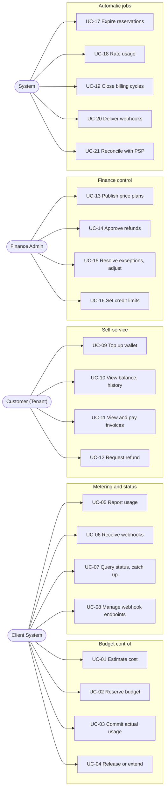

| ID | Role | Use case |
| --- | --- | --- |
| UC-01 | Client System | Estimate the cost of a workload before running it |
| UC-02 | Client System | Reserve budget before enqueuing work; proceed or not based on the answer |
| UC-03 | Client System | Commit actual usage when work finishes |
| UC-04 | Client System | Release an unused reservation, or extend a running one |
| UC-05 | Client System | Report usage by REST, Kafka topic or signed webhook |
| UC-06 | Client System | Receive signed status webhooks and apply its own policy |
| UC-07 | Client System | Query balance, standing, reservation and invoice status; catch up on missed events |
| UC-08 | Client System | Register endpoints, choose event types, rotate secrets, redeliver |
| UC-09 | Customer | Top up a wallet through the PSP |
| UC-10 | Customer | View balance, holds and transaction history |
| UC-11 | Customer | View invoices and pay outstanding ones |
| UC-12 | Customer | Request a refund |
| UC-13 | Finance Admin | Draft and publish a price plan version |
| UC-14 | Finance Admin | Approve or reject a refund |
| UC-15 | Finance Admin | Resolve reconciliation exceptions and quarantined usage; post adjustments |
| UC-16 | Finance Admin | Set account mode and credit limit |
| UC-17 | System | Expire reservations past their TTL and release the hold |
| UC-18 | System | Rate streaming usage into charges |
| UC-19 | System | Close billing cycles and issue invoices |
| UC-20 | System | Deliver webhooks with retry and delivery tracking |
| UC-21 | System | Reconcile Ledger against PSP records daily |

### 3.3 Functional requirements

| ID | Requirement |
| --- | --- |
| FR-01 | A Finance Admin registers Client Systems; each Client System has its own namespace of products and meters. |
| FR-02 | A price plan version is immutable once published and supports time-based, usage-based, workload-based, event-based, subscription and hybrid pricing. |
| FR-03 | Estimating cost returns an amount and the plan version used, and changes no state. |
| FR-04 | Reserving checks available balance atomically and either records a hold or returns `insufficient_balance`. |
| FR-05 | Committing rates actual usage with the plan version pinned at reservation, deducts the cost and releases the remainder of the hold in one transaction. |
| FR-06 | Releasing returns the whole hold to available balance without creating a charge. |
| FR-07 | Extending changes a reservation's TTL and may raise its held amount, subject to the same balance check as FR-04. |
| FR-08 | A reservation with no commit before its TTL is released automatically and `reservation.expired` is published. |
| FR-09 | A commit that arrives after expiry, within the late-commit window, posts the actual cost and publishes `reservation.late_committed`. |
| FR-10 | Usage is accepted by REST, Kafka topic and signed webhook; retries of the same `event_id` from one Client System are counted once. |
| FR-11 | Streaming usage is rated into charges; usage settled by a reservation commit is never charged a second time. |
| FR-12 | Each billing account is prepaid or postpaid, in one currency, with a configurable credit limit and low-balance threshold. |
| FR-13 | A customer tops up a wallet through a PSP; the wallet is credited only after a verified PSP result. |
| FR-14 | Every money movement is an append-only balanced journal; a correction is a new reversing journal. |
| FR-15 | Every charge stores the rating snapshot (plan version, quantities, tiers applied) needed to explain its amount. |
| FR-16 | Subscriptions charge a fixed fee per billing cycle, with proration on mid-cycle change. |
| FR-17 | Closing a cycle issues an immutable invoice that lists every charge in the period. |
| FR-18 | Payments go through a PSP adapter; a PSP callback changes state only after signature verification. |
| FR-19 | A refund requires Finance Admin approval above a configured amount, and cannot exceed the payment's refundable amount. |
| FR-20 | A status API returns balance, available amount, standing, reservation, invoice and payment state. |
| FR-21 | Every published event states a fact in the past or a current state; an event that instructs an action fails the build. |
| FR-22 | Clients register webhook endpoints per event type; deliveries are HMAC-signed, retried with backoff, tracked per attempt and can be redelivered. |
| FR-23 | A Client can read an account's events from a cursor to recover anything webhooks missed. |
| FR-24 | Every write command accepts an `Idempotency-Key`; a replay returns the first result and a changed body returns `409`. |
| FR-25 | A tenant's data is unreachable from another tenant's context, and a Client System reaches only tenants granted to it. |
| FR-26 | Ledger is reconciled daily against PSP records; each difference becomes a tracked exception. |
| FR-27 | Every admin action and every state change on money objects is recorded in an audit log. |
| FR-28 | Journals and invoices are exported to ERP. |
| FR-29 | A web portal serves customers (top up, balance, invoices, refunds) and Finance Admins (plans, limits, approvals, reconciliation). |
| FR-30 | Billing exposes no API, event or integration that starts, renews, throttles, suspends or terminates a resource. |
| FR-31 | A wallet's balance and held amount at any past time can be reconstructed and explained from an append-only movement log. |
| FR-32 | A Demo Client System exercises estimates, reservations, usage, webhooks and the catch-up feed through the public contract only; it runs in development, CI and staging, and is never deployed to production. |
| FR-33 | Every pricing mode and charge model runs through the Demo Client on both a prepaid and a postpaid account, from usage through charge to invoice, and is checked against expected amounts fixed independently of Billing's rating code. |

### 3.4 Non-functional requirements

| ID | Requirement | Target |
| --- | --- | --- |
| NFR-01 | Money correctness | 0 invariant violations (section 19.4) after contention and process-kill runs (EXP-01, EXP-05, EXP-06) |
| NFR-02 | Reserve and commit latency | p95 ≤ 100 ms, p99 ≤ 250 ms at 500 reservations per second (EXP-03) |
| NFR-03 | Hot-account latency | p95 ≤ 150 ms at 50 reservations per second on one account (EXP-02) |
| NFR-04 | Idempotent effect | 1 effect from 10 concurrent retries, with a process killed mid-flight (EXP-04) |
| NFR-05 | Usage ingest | 5,000 events per second for 1 hour, acknowledged p95 ≤ 50 ms; 0 lost and 0 over-counted with 10% duplicates (EXP-08) |
| NFR-06 | Usage-to-charge freshness | Charge posted within rating interval + 2 minutes, p95 (EXP-08) |
| NFR-07 | Outbox relay | p99 ≤ 2 s from commit to Kafka at 1,500 events per second; 0 per-account order inversions within a module (EXP-07) |
| NFR-08 | Webhook delivery | First attempt p95 ≤ 5 s after commit; 0 events lost with workers killed (EXP-10) |
| NFR-09 | Endpoint isolation | A dead endpoint raises healthy endpoints' first-attempt p95 by ≤ 10% (EXP-11) |
| NFR-10 | Tenant isolation | 0 rows returned across tenants, including queries with the filter removed (EXP-12) |
| NFR-11 | Availability | 99.9% monthly for reservation API; 99.95% for usage ingest, measured by SLO monitors, failover verified by EXP-14 |
| NFR-12 | Durability | RPO 0 and RTO ≤ 5 minutes for every PostgreSQL store on primary loss (EXP-14) |
| NFR-13 | Rating precision | 0 minor units of cumulative rounding drift over a billing cycle (EXP-09) |
| NFR-14 | Reconciliation | 100% of injected PSP differences and tampered journals detected within 24 hours (EXP-13) |
| NFR-15 | Architecture conformance | 0 violations on the main branch; every injected violation fails the build (EXP-15) |
| NFR-16 | Audit retention | Journals, invoices and audit log retained 10 years (default, see section 22.2) and verified against daily digests (EXP-13) |
| NFR-17 | Hot-wallet isolation | A burst on one wallet, with the standby slowed, raises other accounts' reserve p95 by ≤ 10% and holds at most 15 connections (EXP-02) |
| NFR-18 | Scale-out | Moving a logical shard to another cluster needs no API or event change, and blocks writes on that shard for ≤ 30 s (EXP-16) |
| NFR-19 | Environment parity | All environments install from one chart set; the mini profile comes up from clean in ≤ 15 minutes on 8 vCPU and 16 GB, and passes the smoke suite (EXP-17) |
| NFR-20 | Billing-type coverage | 12 of 12 matrix cells and every scenario of section 11.8 pass, with 0 minor units of difference from the fixtures and 0 invariant violations, in ≤ 15 minutes on the mini profile (EXP-18) |

These load numbers are design targets. They are recalibrated to the experiment machine when EXP-02, EXP-03 and EXP-08 run, and the measured values replace them.

## 4. Overall architecture and technology

Billing is a modular monolith on Java 25 and Spring Boot 4: one codebase and one artifact, run as several process roles, with PostgreSQL as the only source of truth for money. Correctness rests on local transactions inside one module; splitting Wallet, Reservation and Charge across services would turn each commit into a saga with a window where money is held nowhere. The Client's only coupling is the API and event contract, so Billing can change internally without any Client noticing.

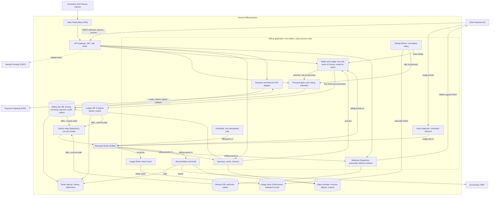

The main flow: a Client reserves through the gateway; Wallet & Ledger asks Pricing for an amount, then commits the hold, a movement row and an outbox row in one transaction on the account's shard; the relay reads the outbox row from the WAL and puts it on Kafka; the Webhook Dispatcher delivers it to subscribers.

### 4.1 Components

1. **API Gateway.** A small separate Spring Cloud Gateway application in the same repository. Validates JWTs, applies per-client and per-tenant rate limits, and routes. It holds no business logic, and limits are in-memory because they protect capacity rather than decide correctness.
2. **Event Ingestion.** Accepts inbound REST batches, Kafka topic messages and signed webhooks from Clients; normalizes all three into one usage or client-event contract (section 11.1).
3. **Usage Metering.** Two parts that scale differently: Usage Writer moves events from Kafka to ClickHouse and scales with consumer lag, and Rating Worker keeps rating cursors and turns streaming usage into charges, and scales with the number of accounts due (section 10).
4. **Pricing Engine.** A pure rating function over immutable plan versions. Performs no writes during rating, so it can be called before any lock is taken (section 9).
5. **Wallet & Ledger.** The only module that writes balances, holds, charges, journals and postings. Contains Shard Router, Wallet Gate, Reservation Manager, Balance Policy, Posting Engine, Idempotency Guard and Outbox Writer (sections 6, 7 and 8).
6. **Invoicing.** Subscriptions, billing cycles, invoices and receivables. Posts fees through Wallet & Ledger, and keeps its own projection of charges (section 14).
7. **Payment & Refund.** PSP adapters, payment and refund state machines, PSP callback verification (section 13).
8. **Webhook Dispatcher.** Subscriptions, payload envelope, signing, delivery workers and delivery tracking (section 11.2).
9. **Scheduler.** Publishes job messages. Every job is idempotent, so a duplicate fire wastes work and harms nothing (section 15.3).
10. **Reconciliation & Audit.** Compares Ledger to PSP records, keeps the audit log, writes tamper-evidence digests and exports to ERP (sections 15.1, 15.2 and 15.4).
11. **Web Portal.** A React SPA for customers and Finance Admins, calling the same public API through the gateway (section 18).
12. **Data and messaging.** PostgreSQL 18 for all transactional state, as three logical stores (section 16.1) with one schema per module, behind PgBouncer. ClickHouse for usage. Kafka for events and jobs. Debezium as the outbox relay. S3-compatible object storage with object lock for invoices, digests and exports.

Modules call each other only through a public `api` package; no module reads another module's schema.

The Demo Client System (section 11.7) is not a component of Billing. It is one of the "Client Systems (N)" in the figure, so the architecture does not change for it.

### 4.2 Cross-cutting principles

- **Ledger is the only writer of money.** Pricing computes, Invoicing and Payment request, and only Wallet & Ledger changes a balance. A bug in any other module cannot create an unbalanced journal.
- **One transaction touches one module.** Reserve, commit, refund hold and charge all live inside Wallet & Ledger, so each is a single local transaction. Effects across modules travel by idempotent call or event, which forces every crossing to tolerate a crash between steps. Each module has its own outbox table, so there is no exception to this rule, and any store can move to its own cluster.
- **Billing states facts and Clients decide.** Events and statuses never name a resource action. Losing every webhook delays a Client's reaction; it can never cause Billing to stop a resource.
- **PostgreSQL decides and everything else follows.** Kafka, ClickHouse and webhooks all carry derived or provisional information. Losing Kafka delays events; losing ClickHouse delays streaming charges; neither blocks a reservation nor changes a balance incorrectly.
- **Every effect is idempotent by business key.** At-least-once delivery is assumed on every path, and a unique database constraint on the business key turns a duplicate into a no-op.
- **Capacity grows without touching a contract.** Roles, stores and shards each scale independently, so growth means more replicas, a store moved to its own cluster or a shard moved to a new one. No Client sees any of these (section 19.6).
- **The database clock decides expiry.** Every TTL comparison uses `clock_timestamp()` taken inside the transaction after the lock, so clock skew across application instances cannot let a commit and an expiry both win.

### 4.3 Technology

Versions are the latest stable line on the date of this document, checked against each project's site: [Spring Boot 4.1.2](https://spring.io/projects/spring-boot), [Debezium 3.7](https://debezium.io/documentation/reference/stable/transformations/outbox-event-router.html), [PostgreSQL 18](https://www.postgresql.org/docs/current/functions-uuid.html), which [Debezium 3.7 lists as compatible](https://debezium.io/releases/).

| Layer | Technology |
| --- | --- |
| Language and runtime | Java 25 (LTS), virtual threads, [`ScopedValue`](https://openjdk.org/jeps/506) for tenant context, sealed types and pattern matching for command results |
| Application framework | Spring Boot 4.1, Spring Framework 7, Spring MVC, Spring Security OAuth2 Resource Server, Spring for Apache Kafka |
| Modularity | Spring Modulith 2.1 (`ApplicationModules.verify()`, module integration tests, generated documentation) |
| Domain vocabulary | jMolecules (`jmolecules-ddd`, `jmolecules-events`, `jmolecules-hexagonal-architecture`, `jmolecules-cqrs-architecture`, `jmolecules-archunit`) |
| Null safety | JSpecify `@NullMarked` on every package, checked by NullAway on Error Prone at error level |
| Architecture tests | ArchUnit, Spring Modulith verification, jMolecules rules |
| Persistence | Spring Data JDBC for aggregates, `JdbcClient` for read models and locking SQL, Flyway per module schema, HikariCP |
| Database | PostgreSQL 18 (`uuidv7()`, partitioning, row-level security), synchronous standby |
| Connection pooling | PgBouncer 1.21 or later in transaction mode, through the CloudNativePG `Pooler` resource (section 19.7) |
| Usage store | ClickHouse (`ReplacingMergeTree`) with ClickHouse Keeper, official Java client |
| Object storage | S3-compatible with object lock; MinIO in development |
| Messaging | Apache Kafka 4 (KRaft), Debezium 3.7 PostgreSQL connector with Outbox Event Router on Kafka Connect |
| Caching | Caffeine, in process, for immutable plan versions. No Redis: nothing needs a shared cache, and adding one would add a store that must not decide anything |
| Edge | Spring Cloud Gateway (Server WebMVC), Bucket4j |
| Scheduling | Spring `@Scheduled` in the adapter layer, ShedLock on PostgreSQL |
| Resilience | Resilience4j circuit breakers for PSP and webhook endpoints |
| Identity | Any OIDC provider. Keycloak in development; the provider for production is an open point (section 22.2) |
| Observability | Micrometer, OpenTelemetry, Prometheus, Grafana, Loki, Tempo |
| Web Portal | React, TypeScript, Vite, TanStack Query, i18next, client generated from OpenAPI |
| Demo Client | Java 25, Spring Boot 4.1 with Spring MVC, `JdbcClient` and Spring for Apache Kafka, Java client generated from OpenAPI, Spring Security for its login, one static HTML page with no framework, its own PostgreSQL database; a JUnit 5 runner for the coverage matrix |
| Test | JUnit 5, AssertJ, Testcontainers, jqwik (property tests), Gatling (load), Toxiproxy (faults), WireMock (PSP and client endpoints), Playwright (end to end), `oasdiff` (contract) |
| Build and delivery | Gradle Kotlin DSL, container images, Helm, KEDA for lag-based autoscaling, CloudNativePG and Strimzi operators. Kubernetes in production, k3d for development and CI, Docker Compose for dependencies only (section 19.8) |

### 4.4 Process roles

One artifact starts in the role named by `billing.role`. Domain and application code is identical in all roles; a role only selects which inbound adapters activate. The monolith therefore scales per workload without becoming separately versioned services.

| Role | Active inbound adapters | Scales with |
| --- | --- | --- |
| `api` | REST controllers, PSP callback endpoint | Requests per second |
| `ingest` | Usage REST, inbound webhook, inbound Kafka | Usage events per second |
| `usage-writer` | Usage consumer | `usage.raw.v1` consumer lag |
| `rating` | Rating jobs | Accounts due for rating |
| `worker` | Event consumers for Ledger and Invoicing, expiry jobs | `billing.events.v1` and `billing.jobs.v1` consumer lag |
| `webhook-subscriber` | Event subscriber | Event rate |
| `webhook-delivery` | Delivery workers | Due deliveries |
| `scheduler` | Job publishers | Fixed at 2 for failover |
| `reconcile` | Reconciliation, digests, ERP export | Fixed at 1, restarted on failure |

### 4.5 Relationship to the C4 diagrams

`c4.html` is kept in step with this document and is the reference for system boundaries and containers. This table records how its diagrams map to the implementation.

| Diagram item | Reading in this design |
| --- | --- |
| C2 containers | Logical modules and process roles of one artifact, per section 4.4 |
| C2 Ledger DB, Billing Ops DB and Delivery DB | Logical stores that start in one PostgreSQL cluster and can each move to their own (section 19.6) |
| C2 Ledger DB drawn as N shards | 1,024 logical shards, on one physical cluster in production at first |
| C2 Pricing Engine | Wallet & Ledger and Rating Worker call it in process; it never writes during rating |
| C3 edge from Reservation Manager to Posting Engine | Only commit writes postings. Hold and release are memo entries, recorded in `wallet_movement` (sections 6.6 and 6.8) |
| C2 Kafka topic list `reservation.*`, `charge.*`, … | Event types within one topic, `billing.events.v1`, keyed by `account_id` (section 8.3) |
| C3 Webhook "5xx, 408, 429, timeout, connection error → retrying; other 4xx → dead" | Section 11.3 |
| Deployment diagram | PgBouncer, operators and environments are infrastructure, so they appear there and not in C2 (sections 19.1, 19.7 and 19.8) |
| Not drawn in C2 | Identity Provider, reachable from the gateway as in C1; object storage for invoices and digests; PSP settlement reports read by Reconciliation |
| Not drawn in C1 or C2 | Demo Client System, one instance of the Client Systems box, present only on development and staging (section 11.7) |

## 5. Code architecture and rule enforcement

Every architectural rule in this section is a test that fails the build; a rule that only lives in a document erodes the first time a deadline is tight.

### 5.1 Modules and layers

Each module is a Spring Modulith application module with the same four-part structure. Dependencies point inward only: adapters depend on the application, the application depends on the domain, and the domain depends on nothing outside itself.

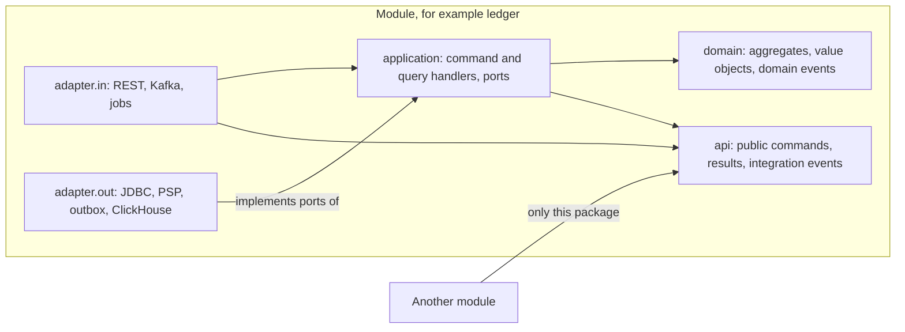

The figure shows two boundaries: within a module, arrows point to the domain; between modules, `api` is the only entrance.

| Layer | Contains | May depend on | Must not depend on |
| --- | --- | --- | --- |
| `domain` | Aggregates, entities, value objects, domain events, domain services | `java.*`, jMolecules, JSpecify, `shared.kernel` (`Money`, `TenantId`) | Spring, JDBC, Jackson, Kafka, `application`, `adapter` |
| `application` | `@CommandHandler` use cases, query handlers, secondary ports (`UnitOfWork`, `WalletGate`, `WalletRepository`, `Outbox`) | `domain`, own `api`, other modules' `api` interfaces, jMolecules, JSpecify | Spring, JDBC, Jackson, Kafka, `adapter` |
| `adapter.in` | Controllers, Kafka listeners, job triggers, request and response DTOs | `application`, own `api`, Spring | `domain` entities in a response, `adapter.out` |
| `adapter.out` | Spring Data JDBC repositories, row records, mappers, PSP and HTTP clients | `application` ports, `domain`, Spring | `adapter.in`, another module's anything except `api` |
| `api` | Public use-case interface, command and result records, integration event records | `java.*`, JSpecify, `shared.kernel` | Own `domain` types, Spring |

**The application layer has no Spring.** `@Transactional` is forbidden everywhere. Handlers receive a `UnitOfWork` port and state the transaction boundary explicitly, implemented in `adapter.out` over `TransactionTemplate`:

```java
@CommandHandler
public ReservationResult handle(ReserveBudget cmd) {
    var quote = pricing.estimate(cmd.toEstimateRequest());      // pure, before any connection
    return walletGate.enter(cmd.walletId(), ReservationResult::busy, () ->   // bounded waiters
        unitOfWork.in(cmd.scope(), () ->                        // picks the shard, sets the tenant
            idempotency.once(cmd.key(), cmd.requestHash(), () -> {
                var wallet = wallets.lockById(cmd.walletId());  // SELECT ... FOR NO KEY UPDATE
                return switch (wallet.hold(quote.amount(), cmd.ttl())) {
                    case Held h          -> saved(wallet, h, cmd);
                    case Insufficient i  -> ReservationResult.rejected(i.available());
                };
            })));
}
```

The reasons for an explicit boundary are concrete: a hold rejected for insufficient balance must commit (its idempotency record is the response a retry will see), so failures are returned as sealed result values and never thrown for expected outcomes; an annotation also hides where the wallet lock begins and ends.

### 5.2 Tactical DDD

Aggregates are small and each transaction changes one wallet. Aggregates reference each other by typed identifier, never by object.

| Building block | jMolecules marker | Rule | Examples |
| --- | --- | --- | --- |
| Aggregate root | `@AggregateRoot` / `AggregateRoot<T, ID>` | The only entry for changing its state; methods protect invariants | `Wallet`, `Reservation`, `Journal`, `Payment`, `Invoice`, `PricePlan` |
| Entity | `@Entity` | Lives inside one aggregate | `Posting`, `InvoiceLine`, `PriceComponent` |
| Value object | `@ValueObject` | Immutable record that validates itself on construction | `Money`, `Quantity`, `Tier`, `IdempotencyKey`, `AccountId` |
| Identifier | `Identifier` | Typed record around a UUIDv7, so a `WalletId` cannot be passed where a `ReservationId` belongs | `WalletId`, `JournalId` |
| Domain event | `@DomainEvent` | Past-tense record raised by an aggregate method | `ReservationCommitted`, `BalanceBecameInsufficient` |
| Domain service | `@Service` (jMolecules) | Stateless logic spanning aggregates, without I/O | `PostingEngine`, `RatingFunction` |
| Repository | `@Repository` (jMolecules) | A port in `application`, one per aggregate root | `WalletRepository` |
| Factory | `@Factory` | Creates an aggregate only in a valid state | `Journal.balanced(lines)` |

A bounded context maps one-to-one to a module. Vocabulary differs by context on purpose: a Charge in `ledger` is a money fact; the same event in `invoicing` becomes an `InvoiceLine`. `shared.kernel` is intentionally tiny: `Money`, `Currency`, `TenantId`, `AccountId` and the event envelope. Growth in this package is a review flag, because everything it contains couples all modules.

### 5.3 CQRS

Commands go through aggregates and queries go directly to read models; both share a database, and no event sourcing is used.

| Aspect | Command side | Query side |
| --- | --- | --- |
| Marker | `@Command`, `@CommandHandler` | `@QueryModel` |
| Model | Aggregates loaded and saved through repositories | Records built by SQL through `JdbcClient`, never aggregates |
| Consistency | Primary, transactional | Balance, reservation, payment status read the primary; history, statements and analytics read a replica or ClickHouse |
| Dispatch | Direct method call on an interface; no command bus | Direct method call |

**What is deliberately absent.** No Axon or similar framework: a bus adds an indirection the compiler cannot follow, and in-process dispatch needs none. No event sourcing as a storage model: the options are analyzed in section 6.9. No separate read database in this phase: a read replica and ClickHouse cover the load, and read models stay behind a query port if this changes.

Across modules, a read model is owned by the consumer: Invoicing keeps its own projection of `charge.posted` rather than reading `ledger` tables (section 14.1).

### 5.4 Persistence mapping: options and rationale

Option C is chosen: pure domain objects, with row records and explicit mappers in `adapter.out`. Options A and B were considered first; this section records why they were rejected.

**The problem.** Spring Data JDBC maps annotated classes, while a strict domain must not import Spring. Spring Data JDBC also rewrites an aggregate's child collections on save, which is dangerous around append-only money data.

#### Option A: Annotate domain classes directly

Domain classes carry `@Table`, `@Id` and `@Version` from Spring Data.

- **Pros**: least code; no mapping layer.
- **Cons**: breaks the "domain has no Spring" rule; the build rule would need an exception on day one, which defeats the point of a strict rule.
- **Verdict**: rejected.

#### Option B: jMolecules ByteBuddy plugin

The plugin generates persistence annotations and boilerplate at build time from jMolecules markers, leaving source code clean.

- **Pros**: pure source, little code, a well-known approach with JPA.
- **Cons**: the [jMolecules integrations README](https://github.com/xmolecules/jmolecules-integrations) documents the ByteBuddy plugin for Spring and JPA and does not describe Spring Data JDBC. Relying on it would mean building on undocumented behavior for the data that matters most, and bytecode generation makes persistence behavior invisible in source.
- **Verdict**: rejected for this phase; reconsidered if Spring Data JDBC support becomes documented (section 22.2).

#### Option C: Row records and explicit mappers (chosen)

`WalletRow` is a record annotated for Spring Data JDBC, and `WalletMapper` converts it to and from `Wallet`. Locking and conditional statements use `@Query` or `JdbcClient`.

- **Pros**: the domain compiles with no framework; schema changes stay in one package; the SQL of each critical path is visible; mapping is checked by ordinary tests.
- **Cons**: one record and one mapper per aggregate, about 40 lines each.
- **Verdict**: chosen.

#### Comparison and rationale

| Option | Domain free of Spring | Behavior visible in source | Code volume | Verdict |
| --- | --- | --- | --- | --- |
| A: annotate domain | No | Yes | Lowest | Rejected |
| B: ByteBuddy plugin | Yes in source | No | Low | Rejected |
| C: rows and mappers | Yes | Yes | Medium | Chosen |

1. **The strict-layer requirement eliminates option A.** Its first rule would need an exception.
2. **Money paths need visible SQL, which eliminates option B.** Wallet locks and journal inserts must be readable and testable as written.
3. **The cost of option C is small here.** About 15 aggregates need a mapper, and each is trivial.
4. **The choice is verified**: EXP-15 confirms that a Spring import in `domain` fails the build.

Two Spring Data JDBC rules follow from its save behavior. `Wallet` and `Reservation` have no child collections, so a save is one `UPDATE`. `Journal` and its `Posting` children are insert-only, and the database role cannot update or delete them (section 6.2).

### 5.5 Enforcement in the build

| Rule | Check | Fails when |
| --- | --- | --- |
| Module boundaries, no cycles | `ApplicationModules.of(BillingApplication.class).verify()` | A module reaches into another module's internals, or two modules form a cycle |
| Layer direction | ArchUnit rules plus `jmolecules-archunit` | `domain` imports `application`; `application` imports `adapter` |
| Framework-free core | ArchUnit: `..domain..` and `..application..` must not depend on `org.springframework..`, `tools.jackson..`, `java.sql..`, `org.apache.kafka..` | Any such import |
| Aggregate rules | `JMoleculesDddRules.all()` | An aggregate holds a direct reference to another aggregate, or an entity escapes its aggregate |
| No `@Transactional` | ArchUnit | The annotation appears anywhere |
| One schema per module | Test over `information_schema` and Flyway locations | A cross-schema foreign key, or a migration writing outside its module's schema |
| Null safety | `@NullMarked` on every `package-info.java` by ArchUnit; NullAway at error level on compile | A package without the marker, or a possible null dereference |
| Descriptive events | Contract test over the event catalog (section 8.4) | An event name that contains a directive verb |
| RLS coverage | Test over `pg_policies` | A table with a `tenant_id` column has no enabled and forced policy (section 12.3) |
| Shard routing | ArchUnit: only the Shard Router adapter may reach a `DataSource` | A repository or handler opens a connection on its own |
| No session state | CI runs integration tests through PgBouncer in transaction mode | A statement relies on session-level state (section 19.7) |
| Demo Client stays outside | Gradle dependency test on `demo-client` and its runner; test over rendered chart values | Either depends on `billing` or `shared.kernel`, or `values-staging.yaml` or `values-prod.yaml` sets `webhook.internal_endpoint_allowlist`, or `values-prod.yaml` lowers a floor of section 19.8, enables `FakePsp` or installs the `demo-client` chart (sections 11.7 and 11.8) |
| Every billing type has a cell | Test over the enums in `api/openapi` and the matrix fixtures | A charge model or account mode has no cell, or the fixtures miss one of the six pricing modes (section 11.8) |

Spring Modulith also generates module and dependency diagrams from these same rules at build time, which keeps the C3 level of documentation from drifting. EXP-15 injects one violation of each rule and confirms that the build fails.

## 6. Wallet and Ledger

A wallet's balance changes only inside a transaction that holds its row lock and writes a balanced journal; nothing else in the system can change money.

### 6.1 Model and chart of accounts

A **billing account** is the payer: one tenant, one currency, one mode. It has exactly one **wallet**, which holds the balance. A **ledger account** is a bookkeeping line in the double-entry books: each wallet has one customer ledger account, and the system has shared ones.

| Ledger account | Nature | Per | Meaning |
| --- | --- | --- | --- |
| `customer_wallet` | Liability when positive, receivable when negative | Billing account | What Billing owes the customer, or the customer owes Billing |
| `psp_clearing` | Asset | PSP and currency | Money held at or in transit from a PSP |
| `revenue` | Income | Client System and currency | Earned from services |
| `adjustment` | Expense | Currency | Promotional credit and goodwill adjustments |

Every business event maps to one fixed journal template. A template is code, so an operator cannot invent an unbalanced entry.

| Event | Debit | Credit | Source key |
| --- | --- | --- | --- |
| Top-up or invoice payment succeeded | `psp_clearing` | `customer_wallet` | `payment:<payment_id>` |
| Reservation committed | `customer_wallet` | `revenue` | `reservation:<reservation_id>` |
| Streaming usage rated | `customer_wallet` | `revenue` | `rating:<cursor_id>:<seq>` |
| Subscription fee | `customer_wallet` | `revenue` | `cycle:<cycle_id>:<subscription_id>` |
| Refund to payment method succeeded | `customer_wallet` | `psp_clearing` | `refund:<refund_id>` |
| Charge reversed | `revenue` | `customer_wallet` | `reversal:<journal_id>` |
| Manual adjustment | `adjustment` | `customer_wallet` | `adjustment:<adjustment_id>` |

### 6.2 Invariants

| Object | Invariant | Enforced by |
| --- | --- | --- |
| Journal | Total debits equal total credits, in one currency | `Journal.balanced()` factory; deferred constraint trigger as the last line |
| Journal | One business fact posts at most once | `UNIQUE (account_id, source_type, source_id)` |
| Journal, Posting | Never updated or deleted | `REVOKE UPDATE, DELETE` from the application role, insert-only repository |
| Posting | Amount is strictly positive; direction is `D` or `C` | `CHECK` constraints |
| Wallet | `balance` equals credits minus debits of its customer ledger account | Updated in the transaction that writes the journal; verified by section 19.4 |
| Wallet | `held` equals the sum of `held_amount` over its `ACTIVE` reservations and refund holds | Updated in the transaction that changes them; verified by section 19.4 |
| Wallet | `held >= 0` | `CHECK` constraint |
| Wallet movement | Every change to `balance` or `held` writes one row, whose `wallet_version` is gapless and whose `*_after` values equal the wallet after the change | Same transaction as the change; verified by section 19.4 |
| Reservation | Leaves `ACTIVE` exactly once | Status guard under the wallet lock, and `UPDATE … WHERE status = 'ACTIVE'` |
| Charge | Exactly one journal per charge, written together | Same transaction; `UNIQUE (journal_id)` |

### 6.3 Posting Engine

Posting is one code path for every money movement, which means one place to review:

```sql
-- Step 1: the wallet lock serializes all money writes on this account.
SET LOCAL lock_timeout = '500ms';
SELECT id, balance, held, credit_limit, low_threshold, standing, version,
       clock_timestamp() AS db_now
FROM ledger.wallet
WHERE id = :wallet_id
FOR NO KEY UPDATE;

-- Step 2: a duplicate business fact inserts 0 rows. The caller then returns the existing journal.
INSERT INTO ledger.journal (id, account_id, tenant_id, source_type, source_id, currency, posted_at)
VALUES (uuidv7(), :account_id, :tenant_id, :source_type, :source_id, :currency, :db_now)
ON CONFLICT (account_id, source_type, source_id) DO NOTHING
RETURNING id;

-- Step 3: the postings. The factory has already proved debits = credits.
INSERT INTO ledger.posting (journal_id, line_no, ledger_account_id, account_id, tenant_id, direction, amount, posted_at)
VALUES (:journal_id, 1, :wallet_ledger_account, :account_id, :tenant_id, 'D', :amount, :db_now),
       (:journal_id, 2, :revenue_ledger_account, :account_id, :tenant_id, 'C', :amount, :db_now);

-- Step 4: the materialized balance. A version mismatch is a bug, since the lock is held: ROLLBACK.
UPDATE ledger.wallet
SET balance = :new_balance, held = :new_held, standing = :new_standing, version = version + 1
WHERE id = :wallet_id AND version = :version;

-- Step 5: the movement log, for this and every other change to balance or held (section 6.8).
INSERT INTO ledger.wallet_movement
    (wallet_id, wallet_version, tenant_id, kind, balance_delta, held_delta,
     balance_after, held_after, source_type, source_id, occurred_at)
VALUES (:wallet_id, :version + 1, :tenant_id, :kind, :balance_delta, :held_delta,
        :new_balance, :new_held, :source_type, :source_id, :db_now);
```

Steps 2–5 run under the lock from step 1, so no other transaction can read a wallet whose balance is behind its journal.

`FOR NO KEY UPDATE` excludes other writers of the wallet exactly as `FOR UPDATE` does, but does not block the `FOR KEY SHARE` lock taken by an insert whose foreign key refers to the wallet. No wallet key ever changes, so the stronger lock would add blocking and no protection.

**System accounts keep no running balance.** All charges credit `revenue`, so a materialized revenue row would be a global lock that every account contends on. System-side balances are computed from postings and rolled up daily (`ledger.daily_rollup`). Only customer wallets have a materialized balance.

A journal touches one customer wallet by construction, so transactions never lock two wallets and cannot deadlock on them. Moving credit between wallets is not offered in this phase.

### 6.4 Balance model: prepaid and postpaid

Prepaid and postpaid are the same wallet with different parameters, so reservation, charge and event code has no mode branches:

```latex
\text{available} = \text{balance} - \text{held} + \text{credit\_limit}
```

| Aspect | Prepaid | Postpaid |
| --- | --- | --- |
| `credit_limit` | 0 by default; a small overdraft is allowed | Set by a Finance Admin |
| Normal `balance` | Positive | Negative: the running amount owed |
| Funded by | Top-ups before use | Invoice payments after use |
| Invoice at cycle close | Statement, `PAID` on issue, since the wallet already covered it | Payable, `ISSUED` until paid |
| Rating interval for streaming usage | 5 minutes | 60 minutes |

Example: a postpaid account has `credit_limit = 10,000,000`, `balance = -2,500,000` and `held = 500,000`, giving `available = 7,000,000`. The ERP export maps a negative balance to receivables and a positive balance to customer credit, so the statutory view stays correct with one internal model.

Available balance is a check at hold time, not a floor on `balance`. Usage already delivered must be recorded even when funds ran out: streaming charges and overage commits can drive `available` below zero. That produces a fact (`balance.insufficient`) and a receivable, and the Client decides what to do.

### 6.5 Concurrency on a wallet: options and rationale

Option B is chosen: a short pessimistic row lock on the wallet. Options A, C, D and E were considered first.

**The problem.** At 50 reservations per second on one account, two holds regularly read the same available balance. Both passing the check spends the same money twice. The domain rule "available = balance − held + credit limit" also has to stay in the domain, per section 5.1.

#### Option A: Read, check in application, then write

- **Pros**: simplest.
- **Cons**: two concurrent holds both pass the check and both write. This is the bug the module exists to prevent.
- **Verdict**: rejected; kept as the **baseline** of EXP-01.

#### Option B: `SELECT … FOR NO KEY UPDATE`, decide in the aggregate (chosen)

The wallet row is locked, loaded into the `Wallet` aggregate, the aggregate decides, and the row is written back.

- **Pros**: the rule lives in one Java method; every money flow is serialized by one mechanism, which also removes commit-versus-expiry races (section 7.4); no retry logic.
- **Cons**: one extra round trip compared to a conditional update; hot accounts queue.
- **Verdict**: chosen. The lock is held for roughly 6 statements and a synchronous commit, about 8 ms, which caps one wallet near 125 transactions per second and leaves the 50 per second target at 40% utilization. Pricing runs before the lock, so a slow rating cannot extend it. Waiters are bounded by the Wallet Gate described below.

#### Option C: Single conditional `UPDATE`

```sql
UPDATE ledger.wallet SET held = held + :amount
WHERE id = :id AND balance - held + credit_limit >= :amount;
```

- **Pros**: correct under concurrency; one fewer round trip.
- **Cons**: the rule moves into SQL and duplicates the domain model; standing transitions and thresholds also need the old values, which adds `RETURNING` logic. The gain is about 1 ms per transaction on a path whose target is 100 ms.
- **Verdict**: rejected. Correct, and used as a comparison in EXP-02.

#### Option D: Optimistic version check with retry

- **Pros**: no lock wait on uncontended accounts.
- **Cons**: on the hot accounts that matter, conflicts cause retry storms, and each retry repeats work under load.
- **Verdict**: rejected; compared in EXP-02.

#### Option E: Single writer per account through a Kafka partition

- **Pros**: no database lock; very high throughput per account.
- **Cons**: a reservation must answer the Client synchronously, so each request waits on a round trip through the broker; this also adds a request-reply system whose failure blocks all money writes.
- **Verdict**: rejected. It contradicts "PostgreSQL decides".

#### Comparison and rationale

| Option | Correct | Rule in domain | Hot-account behavior | Complexity | Verdict |
| --- | --- | --- | --- | --- | --- |
| A: read-check-write | No | Yes | Over-holds | Lowest | Baseline |
| B: `FOR NO KEY UPDATE` | Yes | Yes | Queues, bounded by Wallet Gate | Low | Chosen |
| C: conditional `UPDATE` | Yes | No | Queues | Low | Comparison |
| D: optimistic retry | Yes | Yes | Retry storm | Medium | Comparison |
| E: Kafka single writer | Yes | Yes | High throughput | High | Rejected |

1. **Correctness eliminates option A.**
2. **The synchronous answer and "PostgreSQL decides" eliminate option E.**
3. **The strict domain rule favors B over C.** One Java method holds the rule, and the cost is one round trip.
4. **Hot accounts favor B over D.** A queue degrades predictably; a retry storm does not.
5. **The choice is verified by measurement**: EXP-01 for correctness, EXP-02 for the saturation point against C and D.

**Bounding waiters: the Wallet Gate.** Choosing a lock leaves one failure to design out. A request waiting for the lock holds a database connection, and a rate limit does not bound how many wait at once. Suppose a slow standby stretches a transaction from 8 ms to 30 ms: the wallet then clears about 33 transactions per second against an allowed 100, the queue grows, and one account takes every connection of the `api` pool, stalling every other tenant. Virtual threads make this easier to reach, because no thread limit sheds load before the pool does.

The `WalletGate` port, implemented with one semaphore per wallet in each `api` replica, admits a request before it takes a connection:

| Parameter | Default | Meaning |
| --- | --- | --- |
| `wallet_gate_permits` | 5 per replica | Requests per wallet that may hold or wait for a connection; over the limit returns `503 account_busy` with `Retry-After` at once |
| `lock_timeout` | 500 ms | Set per transaction with `SET LOCAL`; the backstop if the gate is bypassed or the lock is slow |
| `idle_in_transaction_session_timeout` | 5 s | Set on the database role; PostgreSQL ends a transaction whose application has stalled while holding a lock |

With 3 replicas one wallet holds at most 15 connections, a quarter of the 60-connection `api` pool (section 19.7). At 8 ms per transaction the longest wait is about 120 ms, which fits NFR-03. As `api` replicas are added, permits per replica come down so the total stays at or below 25% of the pool. A commit first reads its reservation to learn the wallet, in a brief transaction that takes no lock, and that mapping never changes, so it is cached.

The gate limits one wallet. It does not help when a slow standby slows every wallet together, which is the price of RPO 0 (section 19.3). EXP-02 measures other accounts' latency during a burst on one wallet (NFR-17).

### 6.6 Holds as memo entries: options and rationale

Option A is chosen: a hold is a memo entry on the wallet and a reservation row, and writes no postings. This refines the C3 diagram (section 4.5).

**The problem.** A hold restricts what can be spent without moving any money. Should it appear in the double-entry books?

#### Option A: Memo hold (chosen)

`wallet.held` and `reservation` record the hold; postings appear only at commit. This is how card issuers treat authorizations: a memo post reduces available balance and leaves ledger balance untouched until settlement.

- **Pros**: the books contain only real money movements, so ERP needs no filtering; 2 postings per settled reservation; a released reservation leaves no ledger noise.
- **Cons**: `held` is derived from reservations rather than postings, so it needs its own invariant check and its own history, which `wallet_movement` provides (section 6.8).
- **Verdict**: chosen.

#### Option B: Double-entry hold

Move funds from `customer_wallet` to `customer_held` at hold, and move them back or to revenue at settlement.

- **Pros**: one uniform formula covers balance and holds.
- **Cons**: 6 postings per settled reservation, or 51 million per day instead of 17 million at the sustained load of section 2.1; released and expired holds leave entries that never reflected money moving; the export must strip them.
- **Verdict**: rejected.

#### Option C: Pending journal status

Journals get a `PENDING` status that becomes `POSTED`.

- **Pros**: one journal per reservation.
- **Cons**: a mutable journal breaks append-only, the rule that makes the ledger auditable.
- **Verdict**: rejected.

#### Comparison and rationale

| Option | Append-only | Postings per settled reservation | Books contain only money | Verdict |
| --- | --- | --- | --- | --- |
| A: memo hold | Yes | 2 | Yes | Chosen |
| B: double-entry hold | Yes | 6 | No | Rejected |
| C: pending journal | No | 2 | No | Rejected |

1. **Append-only eliminates option C.**
2. **A tripled write volume with no accounting benefit eliminates option B.**
3. **The remaining risk of option A is drift between `held` and reservations.** The check in section 19.4 covers it, and EXP-05 runs it after process kills.

### 6.7 Standing and balance events

A wallet carries a `standing`, recomputed inside the lock after every change. An event is published only on a **transition**, because rejecting 50 reservations per second must not produce 50 webhooks per second. Each rejected reservation already receives its answer synchronously.

| Standing | Condition | Event on entering |
| --- | --- | --- |
| `NORMAL` | `available >= low_threshold` | `balance.restored`, when coming from `LOW` or `INSUFFICIENT` |
| `LOW` | `0 < available < low_threshold` | `balance.low` |
| `INSUFFICIENT` | `available <= 0` | `balance.insufficient` |

A rejected reservation can also leave `available` positive, for example 200,000 available against a request for 500,000. Standing does not change, since one large request says nothing lasting about the wallet. `balance.insufficient` is still published, with `requested_amount` in its data, at most once per 5 minutes per wallet (`wallet.insufficient_notified_at`).

Standing is a description. Whether `INSUFFICIENT` stops new work, allows a grace period or only raises a warning is the Client's own policy.

### 6.8 Wallet movement log

Every change to `balance` or `held` appends one row to `ledger.wallet_movement` in the same transaction, so the state of a wallet at any past moment can be read rather than inferred. Postings alone cannot do this, because holds write none (section 6.6).

| Kind | `balance_delta` | `held_delta` | Written by |
| --- | --- | --- | --- |
| `HOLD`, `EXTEND` | 0 | Positive | Reservation Manager, or a refund request |
| `RELEASE`, `EXPIRE` | 0 | Negative | Reservation Manager, or a refund closing without a payout |
| `COMMIT`, `LATE_COMMIT` | Negative or 0 | Negative or 0 | Reservation Manager |
| `CHARGE` | Negative | 0 | Posting Engine, for streaming usage and fees |
| `CREDIT` | Positive | 0 | Posting Engine, for top-ups, payments, adjustments and reversals |
| `REFUND` | Negative | Negative | Posting Engine, when a refund succeeds |

The wallet at time `T` is the row with the highest `wallet_version` at or before `T`:

```sql
SELECT balance_after, held_after, wallet_version
FROM ledger.wallet_movement
WHERE wallet_id = :wallet_id AND occurred_at <= :t
ORDER BY occurred_at DESC, wallet_version DESC
LIMIT 1;
```

`wallet_version` is the wallet's own version after the change, assigned under the lock, so a missing row shows up as a gap and section 19.4 detects it. The log is read for explanation and audit only: current state always comes from `wallet`, and nothing replays the log to build it.

The cost is one more insert under the lock and about 17 million rows per day at the sustained load, partitioned by month. EXP-02 measures the hot path with this insert in place.

### 6.9 Event sourcing: options and rationale

Option A is chosen: current state in `wallet` and `reservation`, money in an append-only ledger, and an append-only movement log. Options B and C were considered first.

**The problem.** Auditors and support need the full history behind any balance. Event sourcing offers that by making the event stream the source of truth, so it is the obvious alternative to weigh.

#### Option A: State tables, append-only ledger and movement log (chosen)

- **Pros**: a hold reads one row; a unique constraint guards each business fact; history comes from `journal`, `posting` and `wallet_movement`; schema changes are ordinary migrations.
- **Cons**: state and log are written separately in one transaction, so a bug could make them disagree, which section 19.4 checks for.
- **Verdict**: chosen.

#### Option B: Full event sourcing on every aggregate

Each aggregate's state is rebuilt from its event stream, with snapshots and projections.

- **Pros**: history and state cannot disagree; a new read model can be rebuilt from all history.
- **Cons**: a balance check needs a current answer, so a synchronous projection must be updated in the same transaction, and that projection is the `wallet` table again. Appending with an expected stream version is optimistic concurrency, which section 6.5 option D rejected for hot wallets, and adding a lock to avoid it removes the concurrency benefit. A stream guarantees uniqueness only within itself, so source keys and `client_reference` still need their own constraints. Every event version must stay readable for the 10-year retention. Axon would break the framework-free rule of section 5.1, and a home-grown event store is one more critical component to maintain. Replaying with corrected logic is also not usable for money, because a charge already posted is a fact to reverse, not to recalculate.
- **Verdict**: rejected.

#### Option C: Event sourcing on Wallet and Reservation only

- **Pros**: smaller scope, on the aggregates whose history matters most.
- **Cons**: these are the hot aggregates, so it takes on all of option B's concurrency and projection costs at exactly the most sensitive point.
- **Verdict**: rejected.

#### Comparison and rationale

| Option | Reading a balance | Hot-wallet behavior | History | Long-term cost | Verdict |
| --- | --- | --- | --- | --- | --- |
| A: state and logs | One row | Queues, bounded | Complete, checked | Migrations | Chosen |
| B: full event sourcing | Projection | Retries, or a lock | Complete, by construction | Event versions for 10 years, event store | Rejected |
| C: on hot aggregates | Projection | Retries, or a lock | Complete for those two | Same, at the hot path | Rejected |

1. **The synchronous balance check removes most of the benefit.** Option B has to keep the same `wallet` row, as a projection.
2. **Hot wallets favor the existing lock**, for the reasons of section 6.5.
3. **Option A already provides the required history**, without replay: section 6.8 answers "what was available at time T".
4. **The choice is verified**: EXP-05 runs the checks of section 19.4 after process kills, and EXP-02 measures the cost of the log.

This would be reconsidered if a regulation required state to be rebuilt from its source of truth, or if new read models over all history became routine; the existing event and movement logs cover neither case fully.

## 7. Balance Reservation

A reservation holds budget before the Client enqueues work and settles it exactly once, at actual cost, so the Client knows the money exists before spending compute and the customer pays only for what ran.

### 7.1 Main flow

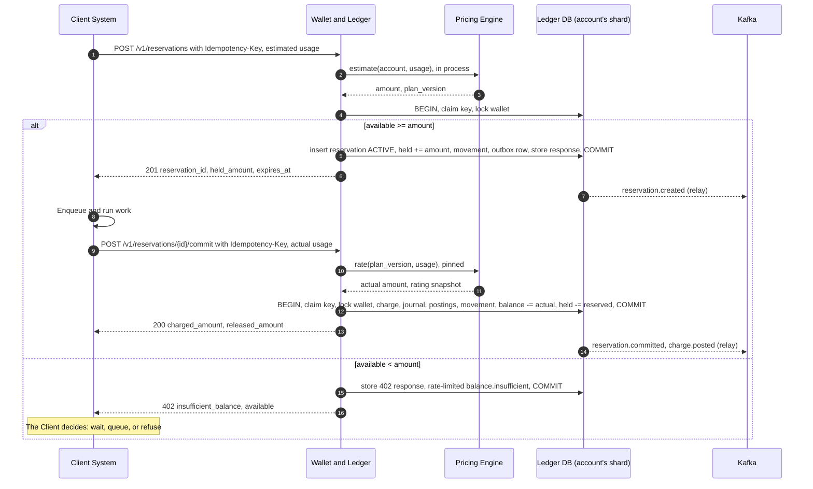

The flow shows that Billing does not touch the queue: the Client enqueues only after the `201`, and the reaction to `402` is the Client's own.

Step by step:

1. The Client sends estimated usage, or an explicit `max_amount` it is willing to hold.
2. Pricing returns an amount and the plan version in effect. This runs before the lock and usually needs no database access (section 9.3).
3. The Wallet Gate admits the request (section 6.5). The transaction then claims the idempotency key, locks the wallet and asks the aggregate to hold.
4. The reservation stores the pinned `plan_version_id`, so a price change while work runs cannot change the cost.
5. On commit, Pricing rates actual usage with that pinned version.

### 7.2 Lifecycle

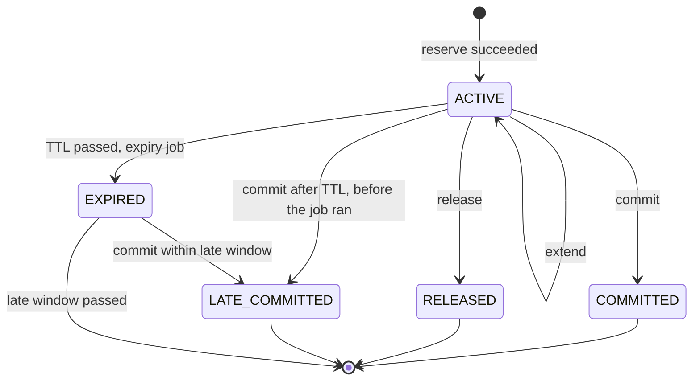

A rejected request creates no reservation; only the stored idempotent response records it.

| From | To | Triggered by | Effect |
| --- | --- | --- | --- |
| (none) | `ACTIVE` | `POST /reservations`, sufficient available | `held += amount`; `reservation.created` |
| `ACTIVE` | `ACTIVE` | `POST /reservations/{id}/extend` | New `expires_at`; `held += increase` subject to the balance check; `reservation.extended` |
| `ACTIVE` | `COMMITTED` | `POST /reservations/{id}/commit`, before `expires_at` | `held -= held_amount`; `balance -= charged`; charge and journal; `reservation.committed`, `charge.posted` |
| `ACTIVE` | `LATE_COMMITTED` | Commit after `expires_at`, before the expiry job ran | `held -= held_amount`; `balance -= charged`; charge and journal; `reservation.late_committed`, `charge.posted` |
| `ACTIVE` | `RELEASED` | `POST /reservations/{id}/release` | `held -= held_amount`; `reservation.released` |
| `ACTIVE` | `EXPIRED` | Expiry job, `expires_at` passed | `held -= held_amount`; `reservation.expired` |
| `EXPIRED` | `LATE_COMMITTED` | Commit within `late_commit_window` | `balance -= charged`; charge and journal; `reservation.late_committed`, `charge.posted`; may push `available` negative |

**Parameters** (per Client System; values are proposed defaults)

| Parameter | Default | Meaning |
| --- | --- | --- |
| `default_ttl` | 1 hour | Hold lifetime when the request does not specify one; allowed range is 1 minute to 24 hours |
| `max_total_lifetime` | 7 days | Upper bound across all extensions |
| `late_commit_window` | 7 days | How long after expiry a commit is still accepted |
| `overage_policy` | `ALLOW` | `ALLOW` charges full actual cost; `CAP_AT_HOLD` charges the held amount and records the excess as `absorbed_amount` |
| `estimate_buffer_pct` | 10% | Margin added to the estimate when the Client gives no `max_amount` |

Example: a job estimated at 1,000,000 holds 1,100,000 with the buffer. The account shows `available` down by 1,100,000 while it runs. It finishes at 870,000: `balance` falls by 870,000, `held` falls by 1,100,000 and `available` regains 230,000.

### 7.3 Settlement rules

- **Actual under hold.** Charge the actual amount and release the remainder (the example above).
- **Actual over hold.** With `ALLOW`, charge the actual amount even if `available` goes negative, because the service was delivered and the record must say so. With `CAP_AT_HOLD`, charge the held amount and report `absorbed_amount`, which suits Clients that promise a fixed ceiling.
- **Zero usage.** A commit with zero usage produces no charge, which matches a release but records why.
- **Commit after expiry.** Accepted within the window, because the work ran and rejecting would turn a late message into free service. Publishing `reservation.late_committed` tells the Client and Finance what happened. After the window, the commit returns `409 reservation_closed`, and a Finance Admin handles the rest as an adjustment.
- **Long-running work.** A rental of unknown length uses a chain of short reservations: the Client commits each slice and reserves the next, or calls `extend`. A failed reservation for the next slice is a fact the Client uses to decide about the resource. Partial commit on one reservation is deferred (section 2.3).

### 7.4 Races

**The wallet row lock is the only arbiter**, and every flow that changes a reservation takes it first. Reservation status is then read and tested under the lock, with a conditional `UPDATE` as a second guard.

| Flows racing | Who wins | Loser sees |
| --- | --- | --- |
| Two holds over the last balance | First to get the lock | `402 insufficient_balance` with the current `available` |
| Commit and expiry job | First to get the lock | If expiry won: the commit proceeds as a late commit. If commit won: the job finds `COMMITTED` and does nothing |
| Commit and release | First to get the lock | `409 reservation_not_active` with the current status |
| Two commits with different keys | First to get the lock | `409 reservation_not_active`; the second's amounts are ignored |
| Same commit retried concurrently | The first inserter of the idempotency key | Blocks on the unique index, then replays the stored response (section 8.1) |
| Price plan published during a job | No race | The reservation pinned its version |
| Refund hold and new reservation | First to get the lock | The loser sees the lower `available` |

Commit against expiry is the race with money on both sides:

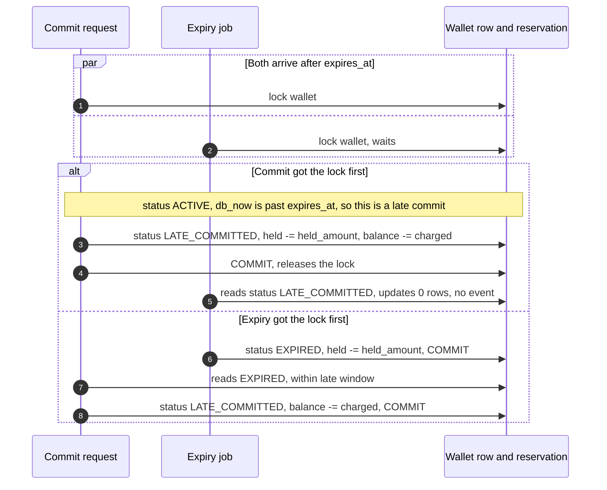

Both paths end with the same balance, the same hold and one charge; they differ only in whether `reservation.expired` was published first. The time test uses `db_now`, so the outcome does not depend on whether the job has run. No gap remains: every path to `held` goes through the lock, `journal` has a unique source key, and the check in section 19.4 is the last safety net. EXP-06 runs this race repeatedly with the commit and the expiry forced to overlap.

### 7.5 Expiry

Expiry is decided by the database row. The scheduled sweep only finds candidates, so a lost job message delays a release and cannot cause a wrong one.

```sql
-- Every 30 seconds on each physical shard, repeated until it returns fewer than 500 rows.
-- SKIP LOCKED never waits. expiry_enqueued_at stops a backlog being republished for 5 minutes.
UPDATE ledger.reservation SET expiry_enqueued_at = now()
WHERE id IN (
    SELECT id FROM ledger.reservation
    WHERE status = 'ACTIVE' AND kind = 'BUDGET' AND expires_at < clock_timestamp()
      AND (expiry_enqueued_at IS NULL OR expiry_enqueued_at < now() - interval '5 minutes')
    ORDER BY expires_at
    LIMIT 500
    FOR UPDATE SKIP LOCKED
)
RETURNING id, account_id, tenant_id;
```

The repeat is what makes this scale. A single batch every 30 s would cap expiry at about 17 per second, while just 5% of 500 reservations per second is 25, so the backlog would grow without end.

```sql
-- In the handler, per reservation, under the wallet lock. 0 rows: another flow already won.
UPDATE ledger.reservation
SET status = 'EXPIRED', closed_at = :db_now
WHERE id = :id AND status = 'ACTIVE' AND expires_at < :db_now;
```

The sweep publishes one message per reservation to `billing.jobs.v1`, keyed by `account_id`, and Ledger's Event Consumer handles each one. Going through Kafka gives per-account ordering and back-pressure: an expiry backlog cannot compete for connections with live reservations. A hold can stay past its TTL by the length of the backlog; that costs only temporarily lower `available`, never money, and it is alerted on at 5 minutes behind (section 19.2).

## 8. Idempotency and event publication

A retried request has the effect of the first one, and no event ever leaves Billing for a change that did not commit; both properties come from writing the marker in the same database transaction as the change.

### 8.1 Idempotency Guard

The first statement of a write transaction claims the key. Claim and business change commit or roll back together, so there is no "in progress" state and no lock that can outlive a dead process.

```sql
INSERT INTO ledger.idempotency_key (client_id, key, request_hash, created_at)
VALUES (:client_id, :key, :request_hash, now())
ON CONFLICT (client_id, key) DO NOTHING
RETURNING key;
-- 1 row: first request, continue, and store the response before COMMIT.
-- 0 rows: an earlier transaction committed this key. Read it and compare the hash.
```

Under `READ COMMITTED`, a concurrent `INSERT` with the same key waits on the unique index until the first transaction ends. If that transaction commits, the second inserts 0 rows and replays the response; if it rolled back, the second inserts its row and becomes the first request.

| Case | Behavior |
| --- | --- |
| New key | Execute; store status and body in the same transaction |
| Same key, same hash, finished | Replay the stored status and body, with header `Idempotent-Replayed: true` |
| Same key, same hash, in flight | Wait on the unique index, up to `lock_timeout`, then replay |
| Same key, different hash | `409 idempotency_key_reused` |
| Process dies before COMMIT | The claim disappears with the transaction; a retry runs as new |
| Business rejection such as `402` | Stored and replayed. A key is one attempt: after topping up, the Client retries with a new key |
| Validation error or `5xx` | Not stored. Validation runs before the claim, and a `5xx` rolled back |

The lock order is the key first, then the wallet. A transaction claims only one key, so two transactions cannot wait on each other's key and wallet in a cycle.

Keys are retained 7 days. The table is deliberately not partitioned by time: PostgreSQL requires a unique constraint on a partitioned table to include the partition key, so a weekly partition would let the same key exist twice. A nightly job deletes expired rows in small batches instead. **Business state is the second layer** and has no expiry: `reservation (client_id, client_reference)` is unique and a settled reservation cannot settle again, so a retry arriving after 7 days still cannot double charge.

With several physical shards a key is unique within its shard. The same key used for two accounts on different shards is not detected as reuse, but it causes no harm: the two requests are independent, on different accounts.

Operations that call a PSP cannot hold a transaction across the network, and use a persisted state machine instead (section 13.1).

### 8.2 Transactional outbox

Every state change inserts its events into its own module's `outbox` table in the same transaction, through the `Outbox` port. If the transaction rolls back the event never existed; if it commits the event will be delivered. All outbox tables share one shape, and the writer is shared code in `eventing`, with no shared table: a common table would tie every module to one cluster and block the moves of section 19.6.

```sql
INSERT INTO ledger.outbox
    (id, tenant_id, account_id, event_type, api_version, occurred_at, payload)
VALUES (uuidv7(), :tenant_id, :account_id, 'reservation.committed', '2026-11-01', :db_now, :payload);
```

Each table is partitioned by month and kept 30 days, which allows a replay after a relay failure; it is not otherwise read at runtime. The logical replication publication uses `publish_via_partition_root = true`, so the relay sees one table regardless of the partition a row lands in.

### 8.3 Outbox relay: options and rationale

Option B is chosen: Debezium reads the WAL. Options A and C were considered first.

**The problem.** Events from one module must reach Kafka in commit order per account, at 1,500 events per second, with under 2 s of delay. Order matters: a Client that sees `reservation.committed` before `reservation.created` builds wrong state.

#### Option A: Polling publisher

A job selects unpublished rows ordered by ID, publishes and marks them.

- **Pros**: no extra infrastructure.
- **Cons**: IDs are assigned before commit. A slow transaction can commit a lower ID after a poll passed it, which means either a missed event or a safety delay added to every event. Marking rows also adds updates to a hot table.
- **Verdict**: rejected; kept as the **baseline** of EXP-07.

#### Option B: Debezium CDC with Outbox Event Router (chosen)

One PostgreSQL connector per cluster reads the WAL through a replication slot and routes each outbox insert to Kafka. The [Outbox Event Router](https://debezium.io/documentation/reference/stable/transformations/outbox-event-router.html) takes the message key from `table.field.event.key`, set to `account_id`, and a fixed `route.topic.replacement` sends all event types to one topic.

- **Pros**: WAL order is commit order, so the ordering problem disappears; no polling load; matches the C2 diagram.
- **Cons**: Kafka Connect to operate; an unhealthy connector holds WAL on the primary and can fill its disk, which needs an alert and a size cap (section 19.3). Delivery is at least once, so consumers still deduplicate.
- **Verdict**: chosen.

#### Option C: Spring Modulith event externalization

Modulith's event publication registry persists events and forwards them to Kafka.

- **Pros**: least code; native to the framework in use.
- **Cons**: publishes after commit from the application, so ordering across instances relies on the application rather than the WAL. The application layer would also depend on the framework's event mechanism.
- **Verdict**: rejected for money events. Modulith stays for module verification and documentation.

#### Comparison and rationale

| Option | Commit-order guarantee | Extra infrastructure | Load on primary | Verdict |
| --- | --- | --- | --- | --- |
| A: polling | Only with a safety delay | None | Polling and updates | Baseline |
| B: Debezium CDC | Yes, from the WAL | Kafka Connect | WAL reading | Chosen |
| C: Modulith externalization | No | None | Registry updates | Rejected |

1. **Per-account ordering eliminates A and C** without an added delay that would break NFR-07.
2. **Kafka Connect is a small cost here**, since Kafka is already required for usage and events.
3. **The choice is verified by measurement**: EXP-07 reports lag and inversions against the polling baseline.

**Topics**

| Topic | Key | Partitions | Retention | Content |
| --- | --- | --- | --- | --- |
| `billing.events.v1` | `account_id` | 128 | 30 days | All domain events; one topic, so a module's events keep their order across event types of one account |
| `billing.jobs.v1` | `account_id` | 64 | 7 days | Expiry and rating jobs |
| `usage.raw.v1` | `account_id` | 96 | 7 days | Normalized usage events |
| `client.inbound.v1` | `client_id` | 12 | 7 days | Kafka channel for Client Systems (section 11.1) |

All topics use replication factor 3, `min.insync.replicas=2` and `acks=all`. The partition count of `billing.events.v1` is fixed for its version, because the feed cursor depends on it (section 11.6). It starts high because idle partitions cost little and changing it later needs a new topic version; the counts cover the growth target of section 2.1.

**Order scope.** Events of one account from one module arrive in commit order. Events from different modules have no guaranteed order, for example `payment.succeeded` and `balance.credited`, because each store has its own relay once stores are separated. The contract says this from the first release, so no Client comes to depend on an order that growth would later remove. Each event states a complete fact, and a Client dedupes by `id`.

### 8.4 Event contract and the descriptive rule

Every event uses one envelope:

```json
{
  "id": "01973a2e-7f10-7c3a-9d51-3b7f6a1c2e44",
  "type": "reservation.committed",
  "api_version": "2026-11-01",
  "occurred_at": "2026-11-06T09:14:22.418Z",
  "tenant_id": "01972f00-11aa-7000-8000-0000000000a1",
  "account_id": "01972f00-22bb-7000-8000-0000000000b2",
  "data": {
    "reservation_id": "res_1a3_01973a2d11117000800000000000c3d4",
    "client_reference": "job-88213",
    "held_amount": 1100000,
    "charged_amount": 870000,
    "released_amount": 230000,
    "currency": "VND",
    "plan_version_id": "01972f55-9999-7000-8000-00000000e5f6"
  }
}
```

**Payloads are complete snapshots**, so a Client does not call back to learn what happened and a retried delivery still states the original fact.

**Event catalog**

| Group | Events |
| --- | --- |
| Reservation | `reservation.created`, `reservation.extended`, `reservation.committed`, `reservation.released`, `reservation.expired`, `reservation.late_committed` |
| Balance | `balance.credited`, `balance.low`, `balance.insufficient`, `balance.restored` |
| Charge | `charge.posted`, `charge.reversed` |
| Payment | `payment.pending`, `payment.succeeded`, `payment.failed`, `payment.expired` |
| Refund | `refund.requested`, `refund.approved`, `refund.rejected`, `refund.succeeded`, `refund.failed` |
| Invoice | `invoice.issued`, `invoice.paid`, `invoice.overdue`, `invoice.voided` |
| Subscription and cycle | `subscription.activated`, `subscription.fee_unpaid`, `subscription.canceled`, `billing_cycle.closed` |
| Usage and plans | `usage.quarantined`, `price_plan.published` |
| Webhook | `webhook_endpoint.disabled`, `webhook_delivery.dead` |

**The rule.** An event name is `<entity>.<past participle or state>`. A Client that wants to suspend on `invoice.overdue` writes that policy itself, and two Clients can react differently to the same fact. A contract test walks the catalog and fails the build on either of two conditions:

1. The entity is not one of Billing's own objects (the groups in the table above). `resource.*` fails here, whatever follows the dot.
2. The name matches the directive pattern below.

```
(terminate|suspend|stop|start|shutdown|renew|throttle|deprovision|kill|_requested$)
```

`refund.requested` passes: it reports a customer's action on a Billing object, and asks no Client to do anything. `resource.terminate_requested` fails both conditions.

### 8.5 Internal consumers

Modules consume `billing.events.v1` in their own consumer groups, and each consumer is idempotent through a business key:

| Consumer | Handles | Idempotent because |
| --- | --- | --- |
| Ledger Event Consumer | `payment.succeeded`, `refund.succeeded`, expiry jobs | Journal source key; status guard on reservations |
| Invoicing projection | `charge.posted`, `charge.reversed`, `payment.succeeded` | `UNIQUE (charge_id)` in the projection; conditional invoice status change |
| Webhook Event Subscriber | All subscribed events | `UNIQUE (event_id, subscription_id)` on deliveries |
| Metering analytics writer | `reservation.committed`, `reservation.late_committed` | `event_id` derived from reservation and line, deduplicated by `ReplacingMergeTree` |
| Reconciliation | `payment.*`, `refund.*` | Upsert by business ID |

Offsets commit only after the database transaction commits. A crash between the two reprocesses the message, and the unique key turns it into a no-op. A message that fails 5 times with a non-transient error goes to `<topic>.<group>.dlq` with an alert, so a poison message cannot stall a partition forever; failures from a database outage block and retry instead, since skipping would lose order for no reason.

## 9. Pricing Engine

Pricing is a pure function from a plan version and a quantity to an amount: it writes nothing during rating, so the same input always gives the same result, today or during an audit years from now.

### 9.1 Model

| Concept | Meaning |
| --- | --- |
| `Product` | What a Client System sells; namespaced per Client System, such as `gpu.a100` |
| `Meter` | A measured quantity of a product, with a unit, an aggregation (`SUM`, `MAX`, `COUNT`) and declared dimensions, such as `gpu_seconds` with dimension `region` |
| `PricePlan` | A named plan, with a sequence of versions |
| `PricePlanVersion` | An immutable list of price components with an `effective_from` |
| `PriceComponent` | One priced line: meter or flat fee, charge model, tiers, included quantity, dimension filter, minimum and maximum |
| `PriceAssignment` | Which plan applies to which account and product; falls back to the Client System's default plan |

**All six pricing modes are one model.** They differ only in where the quantity comes from, not in how money is computed:

| Mode | How it is expressed | Quantity source |
| --- | --- | --- |
| Time-based | Component on a `*_seconds` meter, with `billing_increment_seconds` | Duration reported at commit or in usage |
| Usage-based | Component on a `SUM` meter, per unit or tiered | Usage events |
| Workload-based | Components for each resource of a job, with dimension filters (GPU model, priority) | Estimated at reserve, actual at commit |
| Event-based | Component on a `COUNT` meter | Usage events, one per occurrence |
| Subscription | `FLAT` component with a `cycle` | One per billing cycle, with proration (section 14.1) |
| Hybrid | Several components in one version: a flat fee, an included quantity and overage tiers | Any of the above |

### 9.2 Rating function

Given a quantity `q` after subtracting any included quantity, tiers with bounds `l_i` and `u_i`, and unit prices `p_i`:

```latex
\begin{aligned}
\text{PER\_UNIT:}\quad & A(q) = p \cdot q \\
\text{GRADUATED:}\quad & A(q) = \sum_i p_i \cdot \max\bigl(0,\ \min(q, u_i) - l_i\bigr) \\
\text{VOLUME:}\quad & A(q) = p_k \cdot q, \quad l_k < q \le u_k \\
\text{PACKAGE:}\quad & A(q) = p \cdot \lceil q / s \rceil \\
\text{FLAT:}\quad & A = f
\end{aligned}
```

GRADUATED prices each tier's slice at its own rate; VOLUME prices all units at the rate of the tier the total lands in; PACKAGE charges whole blocks of size `s`.

**Parameters** (on each component)

| Parameter | Meaning |
| --- | --- |
| `included_quantity` | Subtracted from `q` before tiers |
| `minimum_amount`, `maximum_amount` | Clamp the result per cycle |
| `billing_increment` | Quantity rounds up to this step, for example 60 s |
| `rounding` | `HALF_UP` by default; applied once, to the cumulative amount (section 10.3) |

Unit prices are `numeric(30,12)` because a price like 0.00000125 per token must be exact. Amounts become integer minor units only at the last step, so `Money` never holds a fraction and `RatingFunction` is the only code that touches `BigDecimal`.

The function is property-tested with jqwik: `A` never decreases as `q` grows; GRADUATED and PER_UNIT agree for a single tier; splitting `q` into any two parts and rating the cumulative totals gives the same final amount (EXP-09).

### 9.3 Estimation

`POST /v1/estimates` and the first step of a reservation call the same function, so an estimate and a charge cannot disagree on method.

- **Input.** Account, product and estimated usage per meter, including dimensions. A workload is priced on its own quantities, at estimate and at commit. Cumulative tiers across a cycle apply to streaming usage only (section 22.1), so Pricing needs no state from Metering.
- **Output.** Amount, currency, `plan_version_id`, a line breakdown and `is_estimate: true`. An estimate promises nothing and holds nothing.
- **Cost.** Plan versions are immutable, so a Caffeine cache keyed by version ID never needs invalidating. The assignment lookup has a 30 s cache; a stale assignment yields a plan that was valid seconds ago, which the commit keeps as its pinned version.

### 9.4 Versions and effective time

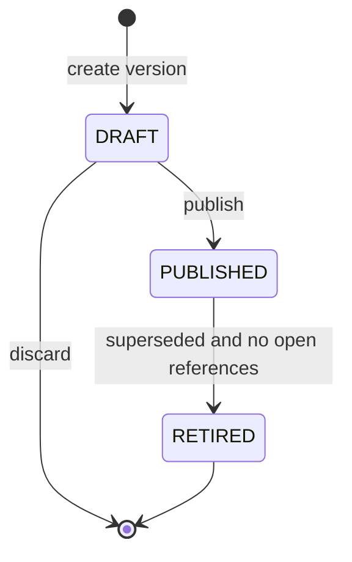

| From | To | Triggered by | Effect |
| --- | --- | --- | --- |
| `DRAFT` | `PUBLISHED` | Finance Admin publishes, with `effective_from` not in the past | Becomes immutable; `price_plan.published` |
| `PUBLISHED` | `RETIRED` | A later version is effective and no open reservation or cycle references it | Hidden from new assignments; kept forever for explanation |

A plan change never rewrites history. A reservation keeps its pinned version; a billing cycle keeps the version effective at cycle start, and a mid-cycle plan change takes effect in the next cycle unless the admin selects proration. A `charge` stores `plan_version_id` and a JSON rating snapshot, so its amount can be explained even after a plan is retired.

### 9.5 What is not offered

**No scripting or expression language in price definitions.** An embedded Groovy or SpEL rule is flexible, but cannot be property-tested in general, can run unbounded inside a rating job and makes an invoice dispute a code review. Five charge models with tiers, dimensions and clamps cover the required modes; a new model is code, reviewed once. A restricted expression language is a Later candidate if a real plan cannot be expressed.

**No discount or coupon engine in this phase.** A promotion is a manual `adjustment` credit (section 6.1) or a separate plan version.

## 10. Usage Metering

Usage is durable once acknowledged, and a quantity turns into money only through a cumulative rating that can run any number of times; duplicates and late events change neither the total charged nor the rounding.

### 10.1 Ingestion flow

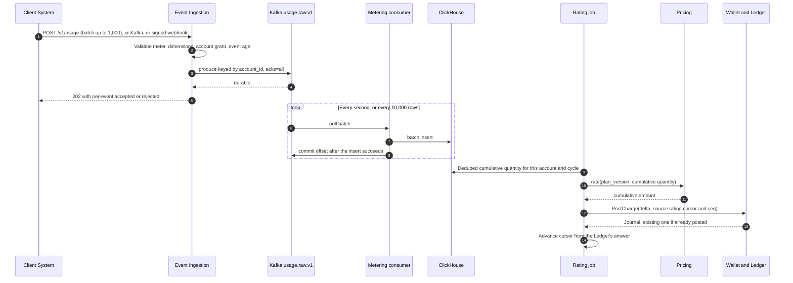

The point of the sequence is the acknowledgment: `202` means the event is durable in Kafka. No database write happens in the request, which is how the ingest path sustains 5,000 events per second, and why it stays available while ClickHouse is down.

Usage event contract:

```json
{
  "event_id": "job-88213-tick-0042",
  "account_id": "01972f00-22bb-7000-8000-0000000000b2",
  "meter": "gpu.a100.gpu_seconds",
  "quantity": 60,
  "occurred_at": "2026-11-06T09:14:00Z",
  "dimensions": {"region": "hn-1"},
  "resource_ref": "vm-5521",
  "reservation_id": null
}
```

`event_id` is unique per Client System, and an event's fields never change across retries. Ingest assigns `dimension_key` from the meter's declared dimensions, so a Client cannot create unbounded price groups with free-form attributes.

### 10.2 Deduplication: options and rationale

Option C is chosen: ClickHouse `ReplacingMergeTree`, deduplicated at read time with `FINAL`, with money correctness guarded separately by the ledger. Options A, B and D were considered first.

**The problem.** A retry from a Client or a replay from Kafka delivers the same event twice. Counting it twice over-charges a customer. Volume is 86 million events per day.

#### Option A: PostgreSQL table with a unique index

- **Pros**: exact deduplication at write.
- **Cons**: 86 million indexed inserts per day and 2.6 billion rows per month in the same cluster as the ledger; ingest load would compete with money transactions, which breaks the isolation of the core.
- **Verdict**: rejected.

#### Option B: Deduplicate in the stream with a Redis or Bloom filter

- **Pros**: duplicates stop before storage.
- **Cons**: a Bloom filter has false positives, and each one silently drops a real event and under-charges; an exact set for a 72-hour horizon holds 260 million keys in memory, and adds a new store that must be right. A crash between insert and mark still lets duplicates through.
- **Verdict**: rejected.

#### Option C: `ReplacingMergeTree` read with `FINAL` (chosen)

```sql
CREATE TABLE usage.event (
    tenant_id UUID, account_id UUID, client_id UUID, meter_id UUID, dimension_key String,
    event_id String, occurred_at DateTime64(3, 'UTC'), quantity Decimal(38, 9),
    reservation_id Nullable(UUID), resource_ref String, ingested_at DateTime64(3, 'UTC')
) ENGINE = ReplicatedReplacingMergeTree(ingested_at)
PARTITION BY toYYYYMM(occurred_at)
ORDER BY (tenant_id, account_id, meter_id, dimension_key, toStartOfHour(occurred_at), client_id, event_id);
```

[ClickHouse documents](https://clickhouse.com/docs/guides/replacing-merge-tree) that background merges give eventual correctness only and work within a partition, and that a plain `SELECT` can return duplicates while `FINAL` completes deduplication during the query. Rating therefore always reads with `FINAL`, narrowed by primary key to one account and a bounded time range:

```sql
SELECT meter_id, dimension_key, sum(quantity) AS quantity
FROM usage.event FINAL
WHERE tenant_id = :tenant AND account_id = :account
  AND occurred_at >= :from AND occurred_at < :watermark
  AND reservation_id IS NULL
GROUP BY meter_id, dimension_key
SETTINGS do_not_merge_across_partitions_select_final = 1;
```

The setting is safe because the partition key comes from `occurred_at`, which the contract makes immutable for an event.

- **Pros**: exact at read, regardless of merge progress; high write throughput; one store for rating and analytics.
- **Cons**: `FINAL` costs more than a plain read, kept small by the narrow range (section 10.3); a retry with a changed `occurred_at` is not recognized as a duplicate; dashboards must read a separate rollup instead of `FINAL`.
- **Verdict**: chosen.

#### Option D: Aggregate in the stream (Flink or Kafka Streams)

- **Pros**: windows and exact state within the processor.
- **Cons**: a stateful stream system to operate, for a job a SQL query can do; changed logic means reprocessing state.
- **Verdict**: rejected for this phase.

#### Comparison and rationale

| Option | Exact | Load on ledger database | New infrastructure | Verdict |
| --- | --- | --- | --- | --- |
| A: PostgreSQL unique index | Yes | High | None | Rejected |
| B: Redis or Bloom filter | No | None | Redis | Rejected |
| C: `ReplacingMergeTree` + `FINAL` | Yes, at read | None | ClickHouse (already in C2) | Chosen |
| D: Stream processor | Yes | None | Flink cluster | Rejected |

1. **Isolating the core eliminates option A.** Usage load must not reach the money database.
2. **Under-charging silently eliminates option B.**
3. **Option C is exact where exactness matters**, at rating. A background merge can lag without any financial effect.
4. **The choice is verified by measurement**: EXP-08 ingests with 10% duplicates and compares charged quantity to a known total.

### 10.3 Cumulative rating

Each rating computes the **total** for the cycle and charges the difference from what was already charged. Rating per window and rounding each window's amount would be simpler, but it fails on three counts: a graduated tier needs the cumulative position anyway; a per-token price rounds to zero every window and loses the revenue; a late event would need a special path.

```latex
\begin{aligned}
Q_n &= \text{frozen\_quantity} + \text{FINAL query over } [\text{frozen\_until},\ \text{watermark}) \\
A_n &= \operatorname{round}\bigl(A(Q_n)\bigr) \\
\Delta_n &= A_n - A_{n-1}
\end{aligned}
```

The cursor, one row per account, component and cycle, stores `seq`, `cum_quantity`, `cum_amount`, `frozen_until` and `frozen_quantity`.

1. The Scheduler publishes a rating job for each account with new usage in the interval (a `DISTINCT account_id` query on `ingested_at`).
2. The worker reads the cursor and calculates `Q`, `A` and `Δ`, with a watermark of now minus 2 minutes, which allows consumer lag to settle.
3. If `Δ` is above 0, it calls `PostCharge` with source `rating:<cursor_id>:<seq+1>` and the new cumulative values in the charge metadata.
4. Ledger posts in its own transaction, or finds the existing journal with that source and returns it.
5. The worker advances the cursor with the values **from the Ledger's answer**, conditional on `seq`:

```sql
UPDATE metering.rating_cursor
SET seq = :next_seq, cum_quantity = :ledger_cum_quantity, cum_amount = :ledger_cum_amount
WHERE id = :id AND seq = :current_seq;
```

A crash after step 4 and before step 5 is safe. The next run recomputes, reuses the same source key, finds the journal and takes that journal's cumulative values. New usage is simply picked up by the following run. The transaction boundaries follow section 4.2: Ledger and cursor commit separately, and the source key makes up for the gap.

Rating never produces a negative delta in this phase. If a correction would lower the total, the cursor records the difference and a Finance Admin issues a reversal, since an automatic refund from a metering bug would be worse than a reviewed one.

**Freezing keeps `FINAL` cheap.** Everything older than the lateness horizon can no longer change, so `frozen_until` moves up with it and `frozen_quantity` absorbs the total. Each query therefore scans at most 72 hours for one account.

Back-of-the-envelope: a hot account at 50 events per second produces about 13 million events in 72 hours, all on one sort-key prefix, and EXP-08 measures that query; the median account is far smaller. With 10,000 accounts, at most 33 rating queries per second run at a 5-minute interval, and only for accounts with new usage.

**Exposure on prepaid accounts.** Streaming charges follow usage, so a prepaid account can overspend by what it uses in one interval, about 5 minutes of usage. Clients that cannot accept this use reservations instead. This is the trade-off of metering asynchronously at 5,000 events per second.

### 10.4 Late events

| Event age at ingest | Behavior | Reason |
| --- | --- | --- |
| Up to `lateness_horizon` (72 hours) | Stored and rated normally | Re-aggregation sees it in the next run |
| Older than the horizon | `metering.usage_quarantine`, `usage.quarantined` event | Frozen quantities no longer include it; a Finance Admin decides |
| Timestamp more than 5 minutes in the future | Rejected per event as `occurred_at_in_future` | A wrong clock must not freeze windows or skew cycles |

An event in a cycle whose invoice was already issued is rated in the currently open cycle and marked with its true service period. An issued invoice never changes (section 14.2).

### 10.5 Reservation usage must not be charged twice

Usage reported at commit is settled by the reservation's charge. A metering consumer reads the usage lines in `reservation.committed` and writes them to ClickHouse for analytics, with `reservation_id` set and `event_id` derived from the reservation and line. The rating query's `reservation_id IS NULL` filter excludes them.

A Client that sends both streaming usage and a commit for the same work, with `reservation_id` set on the usage events, is also safe: those events are stored for analytics and never rated. A Client that omits `reservation_id` from streaming events for reserved work has told Billing they are separate usage, and is charged for both; the integration guide states this rule, and EXP-08 covers the correct case.

## 11. Integration: Event Ingestion and Webhook Dispatcher

Billing is reachable through three inbound channels that converge on one contract, and speaks outward through three that describe the same facts: REST status, a catch-up feed and signed webhooks. A Client can lose any one outbound channel and still reach the truth.

### 11.1 Inbound channels

| Channel | Used for | Authentication | Durable when |
| --- | --- | --- | --- |
| REST `POST /v1/usage` | Usage batches | OAuth2 client credentials | `202` returned, after Kafka `acks=all` |
| Kafka `client.inbound.v1` | High-volume Clients that already run Kafka | mTLS and per-client ACLs on the listener | The Client's produce is acknowledged |
| Signed webhook `POST /v1/inbound/{client_id}` | Clients that can only send webhooks | HMAC with the same scheme as section 11.4, using a separate inbound secret | `2xx` returned, after Kafka `acks=all` |
| REST reservations and commit | Budget control | OAuth2 client credentials, `Idempotency-Key` | Response received; synchronous only, as a hold needs an immediate answer |

All usage paths pass through one `IngestUsage` handler, which rejects with a per-event reason, so a Client's choice of channel changes transport and nothing else. A commit by Kafka is deliberately not offered: a Client needs the answer, and the event channel is one-way.

### 11.2 Webhook Dispatcher

Dispatch is split in two so that a slow Client can never stall the event stream: the subscriber only records what must be delivered, and workers deliver from the database.

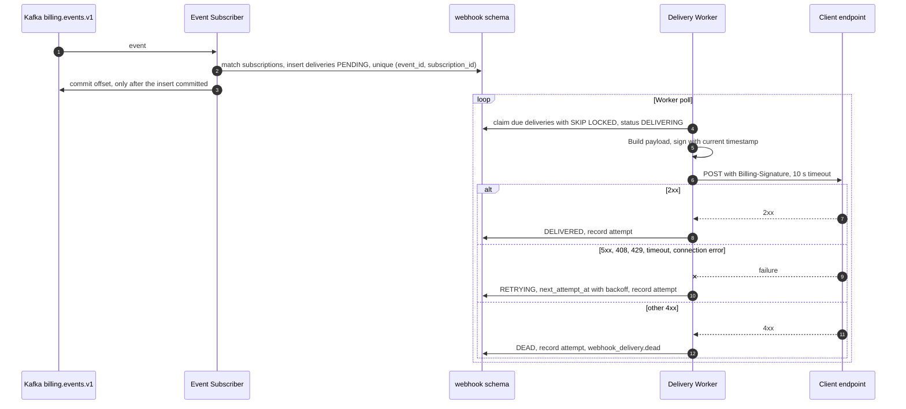

Each event is persisted as a delivery before its offset commits, so a worker or subscriber death loses nothing, and the unique key makes reprocessing a no-op.

```sql
-- SKIP LOCKED: workers never wait on one another.
-- The lease is what makes a crashed worker's delivery visible again.
UPDATE webhook.delivery d
SET status = 'DELIVERING', lease_until = now() + interval '60 seconds', attempt_count = attempt_count + 1
WHERE d.id IN (
    SELECT id FROM webhook.delivery
    WHERE status IN ('PENDING', 'RETRYING') AND next_attempt_at <= now()
       OR status = 'DELIVERING' AND lease_until < now()
    ORDER BY next_attempt_at
    LIMIT 200
    FOR UPDATE SKIP LOCKED
)
RETURNING d.id, d.subscription_id, d.event_id, d.attempt_count;
```

The HTTP call runs outside any transaction, on a virtual thread. A worker that dies mid-call leaves a `DELIVERING` row whose lease expires, so the delivery is retried. The Client may therefore receive an event twice, and dedupes by `id`.

### 11.3 Delivery lifecycle

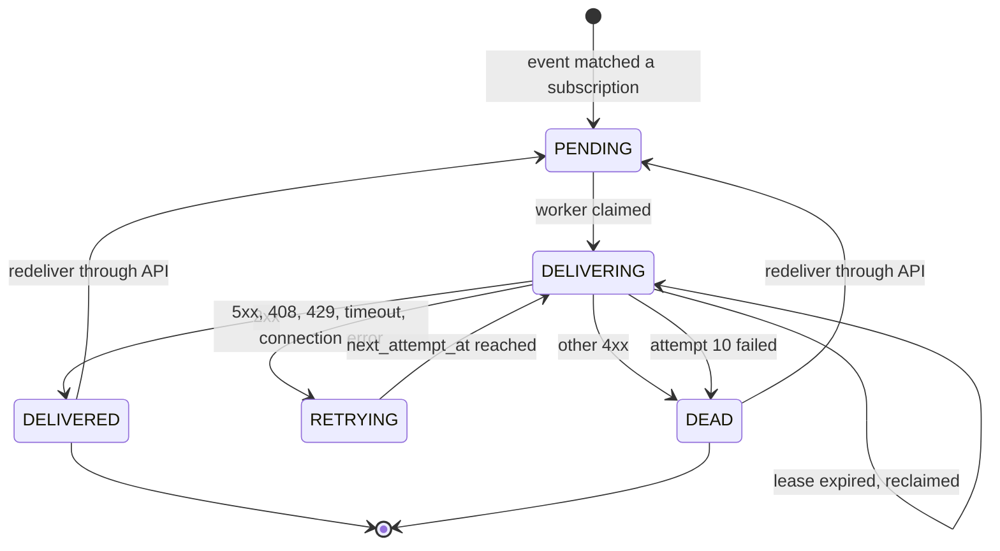

| From | To | Triggered by | Effect |
| --- | --- | --- | --- |
| (none) | `PENDING` | Event matched a subscription | Delivery row inserted |
| `PENDING`, `RETRYING` | `DELIVERING` | Worker claim | Lease set, attempt counted |
| `DELIVERING` | `DELIVERED` | `2xx` | Attempt recorded |
| `DELIVERING` | `RETRYING` | `5xx`, `408`, `429`, timeout, connection error | `next_attempt_at` set; honors `Retry-After` up to 1 hour |
| `DELIVERING` | `DEAD` | Any other `4xx` | `webhook_delivery.dead` published; visible in the portal |
| `DELIVERING` | `DEAD` | Attempt 10 failed with a retryable error | `webhook_delivery.dead` published |
| `DELIVERING` | `DELIVERING` | Lease expired | Another worker reclaims it |
| `DEAD`, `DELIVERED` | `PENDING` | `POST /webhook-deliveries/{id}/redeliver` | Attempts reset; same event `id` |

**Retry schedule.** After attempt 1 through 9: 1 min, 5 min, 15 min, 1 h, 3 h, 6 h, 12 h, 24 h, 24 h, each with ±20% jitter, which spreads recovery load. That covers about 70 hours, long enough to outlast a weekend outage. Then the delivery is dead, and the event stays readable from the feed (section 11.6).

**`webhook_delivery.dead` is delivered to other endpoints only.** A dead endpoint cannot receive news of its own failure, so the portal shows it, and a Client with a second endpoint can subscribe.

### 11.4 Signature

Each attempt signs the exact bytes sent, with a fresh timestamp:

```
signed_payload = timestamp + "." + raw_body
signature      = hex(HMAC-SHA256(secret, signed_payload))
header         = Billing-Signature: t=1762420462,v1=5257a869...,v1=9a1f03bd...
```

| Rule | Reason |
| --- | --- |
| Clients verify with constant-time comparison over the raw bytes | A re-serialized body changes the signature; plain comparison leaks through timing |
| Clients reject timestamps older than 5 minutes | Stops replay of a captured request; re-signing on each attempt means a legitimate retry is always fresh |
| Each subscription has its own secret | One leaked secret exposes one endpoint |
| Rotation keeps both secrets valid for 24 hours, with two `v1` values in the header | A Client can update its verifier without losing deliveries |
| Secrets are stored encrypted with AES-256-GCM, under a key from the secret manager | HMAC needs the plaintext, so hashing is impossible; a database dump alone reveals nothing |

### 11.5 Isolating endpoints and SSRF

A dead endpoint must not delay a healthy one:

| Mechanism | Implementation |
| --- | --- |
| Per-endpoint concurrency | At most 10 in-flight requests; a claim skips endpoints at their limit |
| Circuit breaker | 20 consecutive failures opens the breaker for 60 s, then one trial; its deliveries are pushed forward without using an attempt |
| Short timeout | 10 s; a slow endpoint holds only a virtual thread, not a platform thread or a database connection |
| Auto-disable | 7 days with no success disables the endpoint and publishes `webhook_endpoint.disabled`; events remain available in the feed |
| Back-of-the-envelope | 2,000 deliveries per second at 200 ms needs 400 in-flight requests, which virtual threads carry easily; the database claim load is 10 batches of 200 per second |

Endpoint URLs are a server-side request forgery surface, since a Client chooses where Billing sends requests. Registration requires `https`. Each delivery resolves the host, rejects private, loopback and link-local ranges including cloud metadata addresses, connects to the checked address and follows no redirects, which closes DNS rebinding.

The one exception is `webhook.internal_endpoint_allowlist`, which exempts the exact hosts it names from the `https` and private-range checks. It is empty by default, and only `values-mini.yaml` sets it, to reach the webhook target inside the local cluster: a WireMock stub, and from S8 the Demo Client (section 11.7). A build test fails if staging or production values set it (section 5.5).

### 11.6 Catch-up feed

Webhooks can fail for days, so a Client needs a way to reconcile that does not depend on them.

`GET /v1/accounts/{id}/events?after=<cursor>&limit=500` returns an account's events in order. Events are stored by a consumer in `webhook.event_log`, indexed by `(account_id, kafka_offset)`. One account's events all land in one partition of `billing.events.v1`, so the Kafka offset is monotonic for that account and gives a gapless cursor, within the order scope of section 8.3. The opaque cursor encodes the topic version and the offset. Retention is 90 days.

The recommended Client pattern is to treat webhooks as a low-latency hint: apply each event once by `id`, and periodically read the feed from the last cursor. The standing and balance status endpoints give current truth for anything older.

### 11.7 Demo Client System

The Demo Client System reaches Billing only through the public contract, so whatever a demo shows is what a real integration gets, and Billing contains no code that knows the demo exists.

It plays a small rental company named `demo-rental`, which sells one simulated service per pricing mode. It owns its jobs, queue and reaction policy, as any Client does, but runs no real resource: a job is a timer that produces usage numbers. From S8 it also serves as the webhook target of the smoke suite (EXP-17) and the driver of the coverage matrix (section 11.8). It does not count toward the 20 Client Systems of section 2.1.

| Pricing mode | Simulated service | Product and meter | Billing contract used |
| --- | --- | --- | --- |
| Time-based | VM rental of unknown length | `vm.small`, `vm_seconds` | Reserve, extend, then commit (UC-02 to UC-04) |
| Workload-based | GPU job | `gpu.a100`, `gpu_seconds` per `region` | Estimate, reserve, then commit or release (UC-01 to UC-04) |
| Usage-based | Inference stream | `llm.small`, `llm.small.tokens` | Usage batches with no reservation (UC-05) |
| Event-based | Document OCR | `ocr.basic`, `ocr.basic.pages` with `COUNT` | One usage event per page (UC-05) |
| Subscription | Storage plan | `storage.basic`, `storage.plus` | `POST /v1/subscriptions`, `PATCH`, `DELETE` |
| Hybrid | API platform plan | `platform.pro`, `platform.pro.requests` | A subscription plus usage events (UC-05) |
| All | | | Signed webhooks, account status, catch-up feed, registering its own endpoint (UC-06 to UC-08) |

Every service runs against either a prepaid or a postpaid account, chosen per job or stream, and usage can go out through REST, the Kafka topic or a signed inbound webhook, all three channels of section 11.1.

**Boundaries**

| Rule | Reason |
| --- | --- |
| A separate Gradle project and a separate chart, depending only on the client generated from `api/openapi` and the schemas in `api/events`; a build test forbids `billing` and `shared.kernel` (section 5.5) | One shortcut into Billing internals would make the demo prove nothing about the contract |
| Its own database and role in the environment's PostgreSQL cluster, with no grant on Billing's databases | Job and queue data belong to the Client (section 2.3), and Billing never sees them |
| To Billing it is a row in `client_system` with a grant, and no Billing code branches on it | The demo runs the same code paths as a real Client |
| Installed by `make mini-up` and by the staging release, and never on production; a build test fails if production values refer to its chart (section 5.5) | It sells nothing real, and its fault switches break things on purpose |
| The page and `/demo/*` require an OIDC login with the role `demo_operator`; only the webhook receiver is open, and it verifies every signature | Staging is reachable beyond one laptop, and a stranger must not be able to submit jobs or flip a switch |
| No payment path; funding goes through the portal as a Customer | Paying is the Customer's action (UC-09), and a Client never holds that role |

**Job lifecycle.** VM and GPU jobs share one lifecycle. A job's state follows only the synchronous answers from Billing, so a job advances even if every webhook is lost.

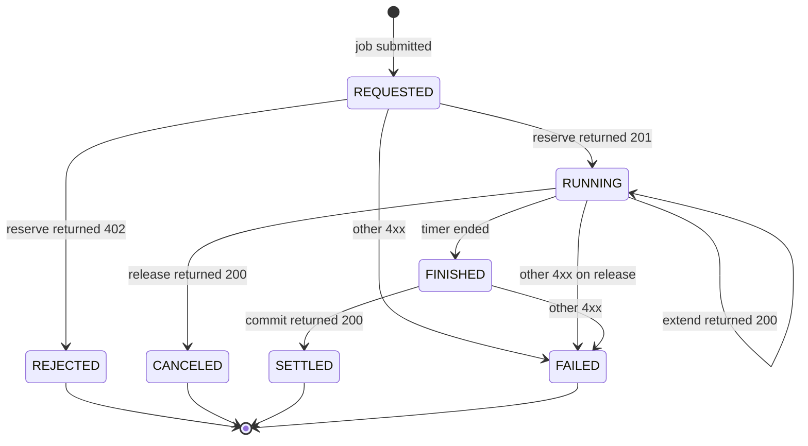

| From | To | Triggered by | Effect in the Demo Client |
| --- | --- | --- | --- |
| (none) | `REQUESTED` | Job submitted | Row and pending reserve call stored together, then the estimate and reserve run |
| `REQUESTED` | `RUNNING` | Reserve returned `201` | Timer starts; `reservation_id` stored |
| `REQUESTED` | `REJECTED` | Reserve returned `402` | Nothing runs; the page shows requested and available amounts |
| `RUNNING` | `RUNNING` | Extend returned `200` | New `expires_at` and held amount stored; a VM job extends at the halfway point of its timer |
| `RUNNING` | `FINISHED` | Timer ended | Pending commit call stored with the actual usage |
| `RUNNING` | `CANCELED` | Release returned `200` after a cancel on the page | Timer stops |
| `FINISHED` | `SETTLED` | Commit returned `200` | Page shows charged and released amounts |
| `REQUESTED`, `RUNNING`, `FINISHED` | `FAILED` | Any `4xx` other than `402`, `429` | Shown on the page and fails the smoke suite, because it means the integration is wrong |

Each call's `Idempotency-Key` derives from the job (`<job_id>-reserve`, `<job_id>-extend-<n>`, `<job_id>-commit`, `<job_id>-release`), and `client_reference` is the job ID. The pending call is stored before it is sent, and a loop resends it with the same key after a crash, a timeout, `429` or `503`, honoring `Retry-After`. A `REJECTED` job stays rejected, and submitting again creates a new job with a new key, because Billing stores and replays a `402` under the old key (section 8.1).

**Metered streams and subscriptions.** The inference, OCR and API platform services have no reservation, so they have no job lifecycle: a stream is only running or paused. Its `event_id` is `<stream_id>-<seq>`, and a batch is stored before it is sent, so a resend carries identical fields, as section 10.1 requires. Subscription calls take their key from the Demo Client's own subscription record.

**Receiving facts.** The receiver verifies the signature and timestamp over the raw bytes (section 11.4), inserts the event under a unique `id` and returns `200` only after the insert. A duplicate returns `200` and is not applied again. A second loop reads the feed from its stored cursor and applies events through the same insert. The page counts events by channel and duplicates dropped, which makes at-least-once delivery visible. At startup the Demo Client registers its own endpoint if none exists (UC-08) and stores the secret in its database.

**Reaction policy.** The policy lives in the Demo Client's configuration and can be switched on its page, so two runs can react differently to one fact while Billing does the same thing in both (FR-30).

| Fact | Reaction |
| --- | --- |
| `402 insufficient_balance` | The job becomes `REJECTED` and nothing runs |
| Any `balance.*` event | Reads `GET /v1/accounts/{id}` and acts on the current `standing` |
| `standing` is `INSUFFICIENT` | Policy `stop-streaming` pauses the account's metered streams until `standing` changes; policy `keep-streaming` (default) only shows a warning |
| `standing` is `LOW` | Shows a warning |
| A VM or GPU job is running | It always finishes, because its budget is already held |
| `subscription.fee_unpaid` | Shows the plan as unpaid until a `charge.posted` for its fee arrives |
| `invoice.overdue` | Shows a warning; under `stop-streaming` it also refuses new jobs on that account until `invoice.paid` arrives |

It reads `standing` instead of acting on the event itself for two reasons: a retried webhook can arrive after a newer one, and `balance.insufficient` also reports one oversized request while money remains (section 6.7).

**Fault switches.** These exist only in the Demo Client, so they make the Client misbehave and leave Billing untouched.

| Switch | Effect | What it shows |
| --- | --- | --- |
| Webhook outage | The receiver returns `503` | Delivery states and retries; jobs still run; the feed still brings every event |
| Commit storm | The next job sends its commit 10 times concurrently with one key | One charge, with the other responses replayed (NFR-04) |
| Duplicate usage | Resends 10% of usage events with the same `event_id` and identical fields | The charged quantity stays exact (FR-10) |
| Withheld commit | A job with a 60 s TTL sends its commit only after the reservation has expired | `EXPIRED`, then `LATE_COMMITTED`, with one charge (FR-09) |

**Parameters** (Demo Client configuration; values are proposed defaults)

| Parameter | Default | Meaning |
| --- | --- | --- |
| `time_scale` | 100 | Simulated seconds per real second, so a job of 3,132 `gpu_seconds` runs for about 31 s, long enough to see the hold on screen |
| `usage_batch_interval` | 5 s | How often a metered stream sends a batch |
| `pending_call_retry_interval` | 5 s | How often pending calls are resent |
| `feed_poll_interval` | 60 s | How often the feed is read |

**Setup.** `make mini-up` installs the `demo-client` chart after Billing. The staging release installs the same chart. A post-install seed job calls the admin API as the Finance Admin `demo-finance`, from the seeded Keycloak realm on mini and from a service account in the staging realm, whose secret lives on staging's path in the secret manager. It creates the tenant, one prepaid and one postpaid VND account on the default monthly cycle, the `demo-rental` Client System with its products and meters, the grant and the published price plans of section 11.8, whose 1,000,000 VND per GPU hour yields the amounts of section 17.2. A `409` on any of these counts as already done, so the job can run again safely. Each realm also holds the `demo-rental` client credentials, a Customer user, `demo-customer`, for the portal, and an operator with `demo_operator`, and the chart adds a Kafka user with mTLS and an ACL on `client.inbound.v1`. The smoke suite and Playwright drive the Demo Client through its own `/demo/*` REST API, which the page also uses.

**Reaching the Demo Client.** On mini, Billing delivers to it over plain HTTP at an in-cluster address, which section 11.5 forbids for every other endpoint, so `values-mini.yaml` names that one host in `webhook.internal_endpoint_allowlist`. On staging the allow-list stays empty: the receiver has a public DNS name and TLS at the ingress, so delivery passes the same `https` and SSRF checks as any real Client, and staging tests those checks as well.

### 11.8 Coverage of billing types

Every pricing mode runs through the Demo Client on both account modes and is checked against results written by hand, so a Billing defect fails a test and cannot move the expected value with it.

**The matrix.** Six pricing modes by two account modes give 12 cells, and all five charge models of section 9.2 appear among them. Each cell creates its own account, so its numbers do not depend on what ran before. Inputs are chosen to land where charge models disagree: 70,000 requests under the VOLUME plan cost 480,000 for usage, and would cost 580,000 if the code applied GRADUATED by mistake.

| Mode | Seeded plan | Input in the first cycle | Expected |
| --- | --- | --- | --- |
| Time-based | PER_UNIT, 20 VND per second, `billing_increment` 60 s | Estimate 3,600 s holds 79,200; extend adds 20,000; commit 1,030 s, which rounds up to 1,080 s | Charged 21,600; released 77,600 |
| Workload-based | PER_UNIT by `region`: `hn-1` 1,000,000 and `hn-2` 1,200,000 per GPU hour | Estimate 3,600 s and 1,800 s holds 1,760,000; commit 3,132 s and 1,800 s | Charged 1,470,000; released 290,000 |
| Usage-based | GRADUATED: first 1,000,000 tokens at 0.02 VND, the rest at 0.01 VND | 1,500,000 tokens, with duplicates on | Charged 25,000 |
| Event-based | PACKAGE: 5,000 VND per 100 pages | 250 pages, with duplicates on | Charged 15,000 |
| Subscription | FLAT per cycle: `storage.basic` 300,000, `storage.plus` 600,000 | Create `storage.basic`, then change to `storage.plus` with proration | `prorate(300,000, activated_at) + prorate(300,000, changed_at)`; next cycle's fee is 600,000 |
| Hybrid | FLAT 500,000 per cycle; 10,000 requests included; VOLUME overage: up to 50,000 at 10 VND, above that at 8 VND | 70,000 requests after creating the subscription | `prorate(500,000, activated_at) + 480,000`; next cycle's fee is 500,000 |

Proration depends on when a call lands, so those expected values come from a formula over the time the API returned, not from a fixed number:

```latex
\text{prorate}(f, t) = \operatorname{round}_{\text{HALF\_UP}}\!\left(f \cdot \frac{\text{cycle\_end} - t}{\text{cycle\_length}}\right)
```

| Account mode | Setup | After the usage | At cycle close |
| --- | --- | --- | --- |
| Prepaid | Customer tops up 10,000,000 through `FakePsp` (section 13.2) | `balance` is 10,000,000 minus the cost | Statement, `PAID` on issue; `invoice.issued`, `invoice.paid` |
| Postpaid | `credit_limit` 10,000,000, no top-up | `balance` is minus the cost | `ISSUED`; Customer pays through `FakePsp`, then `PAID` and `balance` is 0 |

Each cell passes only if all of these hold:

1. Each charge equals the expected amount, to 0 minor units, and its rating snapshot names the seeded plan version.
2. `balance`, `held` and `available` match, and `held` ends at 0.
3. The invoice lists every charge in the cycle, and its total equals their sum.
4. The feed holds the cell's expected event types, each applied once by the Demo Client.
5. After all cells finish, the invariant checks of section 19.4 return no rows.

**Scenarios outside the matrix.** These cover the branches that one successful run per cell does not reach.

| Scenario | Steps | Expected |
| --- | --- | --- |
| Beyond funds | Reserve more than `available`, on each account mode | `402`; job `REJECTED`; no charge |
| Release | Cancel a running job | `RELEASED`; `held` restored; no charge |
| Expiry and late commit | Withheld commit switch on | `EXPIRED`, then `LATE_COMMITTED`, with one charge |
| Reserved work also streamed | Send usage with `reservation_id` set, then commit | Charged once, by the commit (section 10.5) |
| Replay | Commit storm switch on | One charge; nine responses with `Idempotent-Replayed: true` |
| Fee on an empty wallet | Create a subscription on an unfunded prepaid account, then top up | `subscription.fee_unpaid` and no charge; after `balance.restored`, the fee posts once |
| Overdue | Leave a postpaid invoice unpaid past its terms | `invoice.overdue` exactly once |
| Three channels | Send one usage fixture through REST, the Kafka topic and a signed inbound webhook, on three accounts | Three identical charges |
| Refund | Customer requests a refund of a top-up; Finance Admin approves | `refund.succeeded`; `balance` falls by that amount; the journal balances |

**Compressing time.** A monthly cycle cannot be tested in minutes, so the cycle length and payment terms are ordinary account settings, with floors that mini and staging lower and production keeps (section 19.8). The cells run on 5-minute cycles through the same close job and invoice code as production. Usage is sent in the first minute, so with a 30 s rating interval and the 2-minute watermark of section 10.3 it is rated within about 3 minutes 30 seconds, before a close that comes no earlier than 5 minutes 30 seconds.

A fake clock is rejected: section 4.2 lets only the database clock decide expiry, and replacing it would add the demo branch that section 11.7 forbids. Backdating rows is rejected as well, since a write outside the contract would prove nothing about the contract.

**Runner.** `make demo-test` runs `demo-client/conformance`, a JUnit project separate from the Demo Client. It drives `/demo/*` as the Client's operator, and calls the public API as `demo-customer` to pay and as `demo-finance` to create accounts and approve refunds. The Demo Client itself never holds those two identities. The last step runs the checks of section 19.4 with read-only database access, which only the runner has. Cells run in parallel and poll with a timeout rather than sleep. CI runs it on mini at each merge, and `make demo-test ENV=staging` runs it after each staging release.

Staging lives on, so a run must clean up after itself: a 5-minute cycle left running would issue about 288 invoices per account per day. At the end of a run, the runner cancels its subscriptions and sets each account's `cycle_length` back to monthly, and it keeps the accounts as synthetic data. Accounts are named `run-<id>`, and each run starts by doing the same for any that an interrupted run left on a short cycle.

Fixtures are plain files of hand-calculated numbers, reviewed like code. The project has no dependency on `billing` (section 5.5), so it cannot reuse `RatingFunction` to compute what `RatingFunction` should have returned. A test reads the `charge_model` and account mode enums from `api/openapi` and fails if any value has no cell, so a type added later cannot go untested. Pricing modes are not an enum, because section 9.1 expresses them all through one model, so each fixture names its mode and the same test requires all six.

**What this does not prove.** The results hold on the mini profile only, which leaves these to other checks:

| Not proven here | Covered by |
| --- | --- |
| Throughput, latency and failover | EXP-03, EXP-08 and EXP-14, at production size |
| Calendar months: anchors at month end, leap years | Unit and property tests on the cycle calculator |
| The 72-hour freeze horizon of rating, and late events past it | EXP-08 |
| `CAP_AT_HOLD`, which is set per Client System | Module integration tests |
| A real PSP's behavior | Failure tests at S5, then the PSP sandbox on staging; the matrix uses `FakePsp` on staging too, so a sandbox outage cannot fail a pricing check |

## 12. Multi-tenancy

Isolation between tenants is enforced by PostgreSQL itself, so a query that forgets its tenant filter returns nothing rather than another customer's money.

### 12.1 Tenancy model

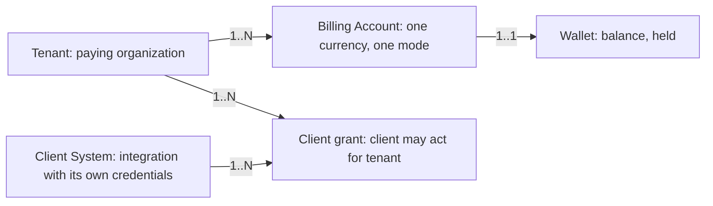

The diagram separates two axes that are easy to mix up. **Tenant** isolates money: whose wallet it is. **Client System** isolates integration: which service is acting. A tenant using GPU compute and storage has one wallet, charged by two Client Systems, and neither Client System can read the other's reservations.

| Actor | Token | Tenant context comes from | Sees |
| --- | --- | --- | --- |
| Client System | OAuth2 client credentials, `client_id` | The requested account's tenant, after checking the `client_grant` | Its own reservations, usage and subscriptions; balance and standing for granted accounts |
| Customer | OIDC user token with a `tenant_id` claim | The claim | Everything of its own tenant, across Client Systems |
| Finance Admin | OIDC user token with `finance_admin` role | Named explicitly per request, recorded in the audit log | One tenant at a time |
| System job | No token; internal role | The event or row being processed | One tenant per unit of work, except for candidate scans |

A Client System never supplies a tenant ID: Billing derives it from the account, and only after checking the grant, so a forged value has nowhere to go. That lookup reads the `platform` schema, which maps IDs and holds no financial data.

### 12.2 Isolation model: options and rationale

Option A is chosen: one shared schema with `tenant_id` on every row and PostgreSQL row-level security. Options B and C were considered first.

**The problem.** 10,000 tenants, most small, on one operator's platform. A cross-tenant leak in a financial system is the worst non-money failure.

#### Option A: Shared schema, `tenant_id`, RLS (chosen)

- **Pros**: one migration for all tenants; a hot table indexes by `tenant_id` and partitions as designed; connection count is independent of tenant count.
- **Cons**: one logical database shared; noisy neighbors need separate control (section 12.4); a missing policy leaks, which the build checks for.
- **Verdict**: chosen.

#### Option B: Schema per tenant

- **Pros**: strong logical separation; simple per-tenant backup.
- **Cons**: 10,000 schemas times about 40 tables is 400,000 tables, which strains the catalog and planner, and each Flyway migration runs 10,000 times. Spring Data JDBC also has no built-in schema routing.
- **Verdict**: rejected.

#### Option C: Database per tenant

- **Pros**: strongest separation.
- **Cons**: connection pools and operations multiply by 10,000; WAL-based relay needs a connector per database.
- **Verdict**: rejected. It remains a possibility for one regulated tenant, as a separate deployment.

#### Comparison and rationale

| Option | Fits 10,000 tenants | Migration cost | Isolation enforced by | Verdict |
| --- | --- | --- | --- | --- |
| A: shared + RLS | Yes | One run | Database policy | Chosen |
| B: schema per tenant | No | 10,000 runs | Search path | Rejected |
| C: database per tenant | No | 10,000 runs | Instance | Rejected |

1. **Scale eliminates B and C.**
2. **RLS gives A a database-level guarantee** that a filter in application code alone would not.
3. **The choice is verified by measurement**: EXP-12 removes filters on purpose and measures RLS overhead.

### 12.3 Enforcement

Five layers, each independent of the others:

1. **Bound context.** The request adapter binds `TenantContext` in a `ScopedValue`, whose binding ends with its scope, so a reused thread cannot carry a tenant into the next request as a forgotten `ThreadLocal` can.
2. **Transaction hook.** A subclass of `JdbcTransactionManager` overrides `prepareTransactionalConnection` and sets the context on every transaction. `true` makes it transaction-local, so a pooled connection carries nothing over, and PgBouncer's transaction mode works unchanged:

   ```sql
   SELECT set_config('app.tenant_id', :tenant_id, true);
   ```

3. **Policy on every table with tenant data.** Reads outside a transaction do not exist in this design, because every read handler goes through `UnitOfWork`; and with the setting absent, the policy compares to `NULL` and returns zero rows, so the failure is closed.

   ```sql
   ALTER TABLE ledger.wallet ENABLE ROW LEVEL SECURITY;
   ALTER TABLE ledger.wallet FORCE ROW LEVEL SECURITY;
   CREATE POLICY tenant_isolation ON ledger.wallet
     USING (tenant_id = (SELECT current_setting('app.tenant_id', true))::uuid)
     WITH CHECK (tenant_id = (SELECT current_setting('app.tenant_id', true))::uuid);
   ```

4. **Two database roles.** `billing_app` is subject to RLS and owns nothing. `billing_system`, with `BYPASSRLS`, is used only by a separate `DataSource` that one small port interface reaches (`CrossTenantScan`), and only returns `(tenant_id, id)` candidates for jobs. Each candidate is then processed by a normal handler in its own tenant context. An ArchUnit rule limits who can use the port.
5. **Client scope.** Handlers for Client Systems add `client_id` to the query, and a mismatch returns `404` so that the existence of another Client's reservation is not disclosed.

Kafka messages carry `tenant_id`, and each listener binds the context per message. ClickHouse has no RLS in this design: all access goes through one `UsageStore` adapter, whose query signature requires a `TenantId`.

### 12.4 Noisy neighbors

| Resource | Limit | Behavior at limit |
| --- | --- | --- |
| API calls | Per client and per tenant token bucket at the gateway; defaults of 500 and 100 per second | `429` with `Retry-After` |
| Reservations per account | 100 per second by default | `429` before a connection is taken |
| Waiters per wallet | Wallet Gate: 5 per `api` replica (section 6.5) | `503 account_busy` with `Retry-After`, before a connection is taken |
| Wallet lock | `lock_timeout` of 500 ms | `503 account_busy` with `Retry-After` |
| Database connections | One PgBouncer pool per role (section 19.7) | That role queues; other roles are unaffected |
| Usage ingest | 2,000 events per second per client by default | `429` for that batch |
| Rating | One job at a time per account, by partition key | Later jobs wait, others proceed |
| Webhook | Per-endpoint limits (section 11.5) | Deliveries wait |

Limits exist at the gateway for capacity protection, and are divided among gateway replicas, so the effective limit is approximate. That imprecision is acceptable because no limit decides correctness.

## 13. Payment and Refund

A wallet is credited only after a verified PSP result, and a PSP call is made only after its intent is durable, so a crash at any point leaves a state that can be resumed by asking the PSP.

### 13.1 Payment

A PSP call cannot share a database transaction, so the guard of section 8.1 is not enough here. The payment row is written first and its ID doubles as the PSP's idempotency reference: a retry reuses it rather than creating a second payment.

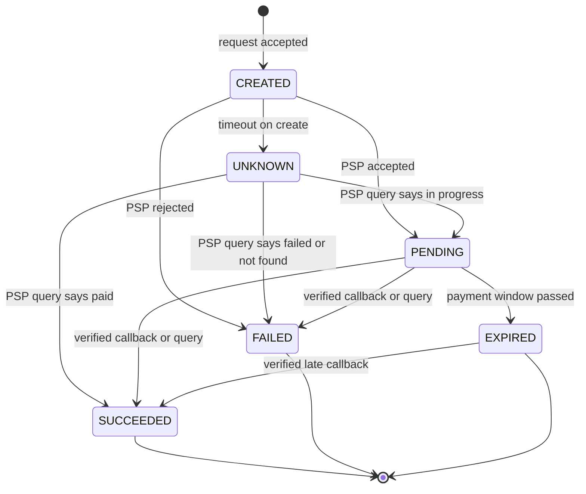

| From | To | Triggered by | Effect |
| --- | --- | --- | --- |
| (none) | `CREATED` | Customer starts a top-up or invoice payment | Row written and committed before any PSP call |
| `CREATED` | `PENDING` | PSP accepted | `psp_reference` stored; checkout URL returned; `payment.pending` |
| `CREATED` | `FAILED` | PSP rejected | `payment.failed` |
| `CREATED` | `UNKNOWN` | Timeout or connection error on create | Polling job asks the PSP using the payment ID |
| `UNKNOWN` | `PENDING`, `SUCCEEDED`, `FAILED` | Result of the PSP query | As for the direct transition |
| `PENDING` | `SUCCEEDED` | Verified callback or query | `payment.succeeded`; Ledger credits the wallet |
| `PENDING` | `FAILED` | Verified callback or query | `payment.failed` |
| `PENDING` | `EXPIRED` | Payment window passed and PSP confirms no success | `payment.expired` |
| `EXPIRED` | `SUCCEEDED` | Verified callback after expiry | `payment.succeeded`; the money really arrived, so it must be credited |

Callbacks race with polling and with each other, and the payment row is the arbiter:

```sql
-- 0 rows: another path already moved it on; acknowledge the PSP and do nothing else.
UPDATE payment.payment SET status = 'SUCCEEDED', psp_reference = :ref, settled_at = now()
WHERE id = :id AND status IN ('CREATED', 'PENDING', 'UNKNOWN', 'EXPIRED');
```

The callback endpoint verifies the signature before parsing, stores the raw payload in `payment.psp_event`, deduplicated on the PSP's event ID, applies the transition, and returns `2xx`. The `payment.succeeded` outbox row is in the same transaction; Ledger's consumer posts the credit with source key `payment:<payment_id>`, so a duplicate event cannot credit twice. A customer sees the top-up within the relay lag of NFR-07. A browser redirect from the PSP only triggers a query, because a return URL proves nothing.

### 13.2 PSP adapter

`PaymentGateway` is a secondary port, and each PSP is one adapter in `adapter.out`. What a PSP must provide to be supported:

| Capability | Why it is required |
| --- | --- |
| Client-supplied reference on create, returning the same payment on retry | Makes `CREATED` → `UNKNOWN` resumable without double charging |
| Signed result callback | A callback is the trigger for crediting money |
| Query status by reference | Resolves `UNKNOWN` and lost callbacks |
| Refund by payment reference, ideally with an idempotency reference | Makes refund retries safe |
| Settlement report | Input to reconciliation (section 15.1) |

Actual PSP behavior is not assumed in this document; the first PSP and its verified capabilities are listed under open points (section 22.2). A `FakePsp` adapter, with scripted failures and its own settlement report so that Reconciliation sees no false exceptions, drives tests and the demo. It is enabled on mini and staging, next to the PSP sandbox on staging, and a build test keeps it out of production (section 5.5). A Resilience4j circuit breaker opens on repeated PSP failure, so a PSP outage costs fast `503`s on new payments and leaves other flows alone.

### 13.3 Refund

Money to be refunded is held at request time, so a customer cannot spend the same funds while the refund waits for approval.

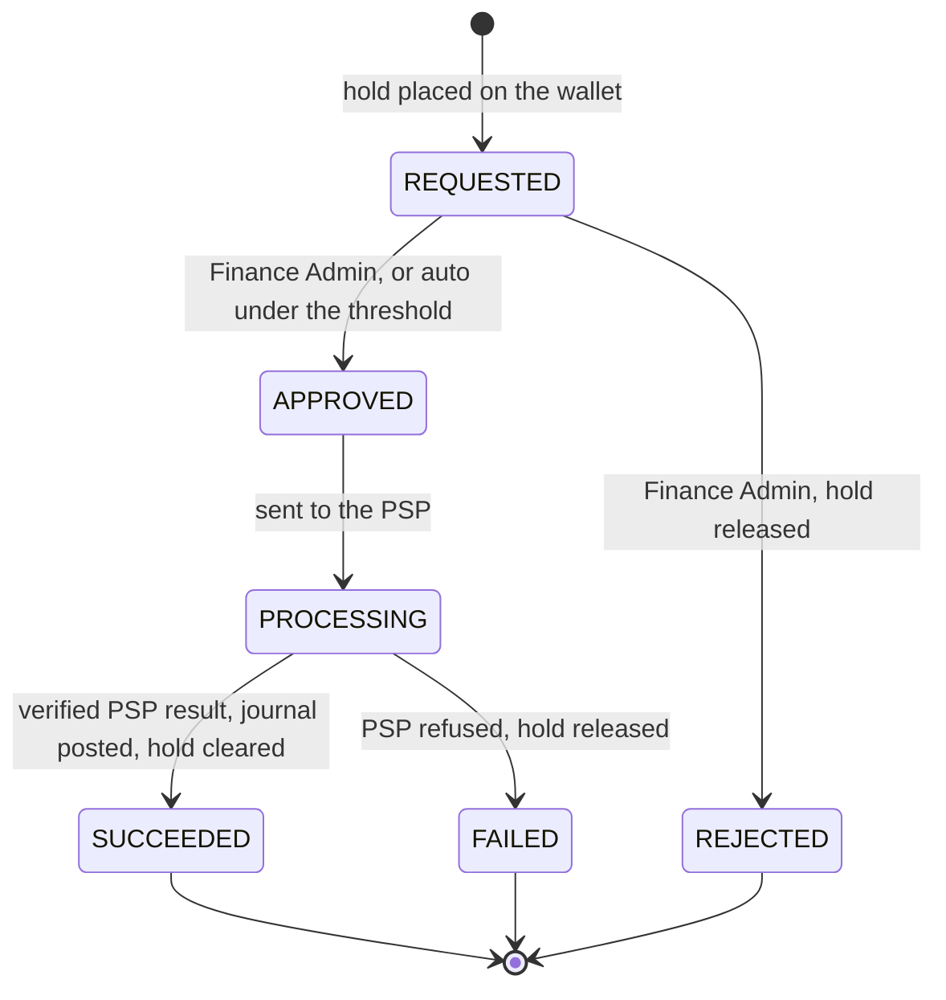

| From | To | Triggered by | Effect |
| --- | --- | --- | --- |
| (none) | `REQUESTED` | Customer or admin request | `payment.refunded_amount` raised conditionally; Ledger places a `kind = 'REFUND'` hold, with no TTL; `refund.requested` |
| `REQUESTED` | `APPROVED` | Admin, or automatic under `refund_auto_approve_limit` | `refund.approved` |
| `REQUESTED` | `REJECTED` | Admin | Hold released and refundable amount restored; `refund.rejected` |
| `APPROVED` | `PROCESSING` | Worker calls the PSP, using the refund ID as reference | PSP reference stored |
| `PROCESSING` | `SUCCEEDED` | Verified result | `refund.succeeded`; Ledger clears the hold and posts `customer_wallet` to `psp_clearing` |
| `PROCESSING` | `FAILED` | PSP refusal | Hold released and refundable amount restored; `refund.failed` |

The refundable amount cannot be exceeded, even by concurrent requests:

```sql
-- 0 rows: the refund would exceed the payment. Return 409 refund_exceeds_payment.
UPDATE payment.payment SET refunded_amount = refunded_amount + :amount
WHERE id = :id AND status = 'SUCCEEDED' AND refunded_amount + :amount <= amount;
```

If the wallet's `available` is below the amount, because the funds were already spent, the hold fails and the refund is refused with `409 insufficient_balance`; refunding a charge is a separate admin action through `charge.reversed`, which first returns the money to the wallet.

Across modules this runs as an idempotent saga: Payment raises `refunded_amount` in its own transaction, then calls Ledger with source `refund-hold:<refund_id>`. A crash between the two is resumed by a job that scans `REQUESTED` refunds with no recorded hold, and a hold failure compensates by restoring `refunded_amount`.

## 14. Invoicing and Subscription

An invoice is an immutable statement of charges that the Ledger already recorded: it requests money and never computes or moves any.

### 14.1 Billing cycles and subscriptions

A billing cycle belongs to an account, runs monthly by default and is anchored at the account's creation day. Its length is the account setting `cycle_length`, with a production floor of 1 day (section 19.8). A subscription attaches a plan's `FLAT` components to an account.

**At cycle start**, the job posts each subscription fee through `PostCharge`, with source `cycle:<cycle_id>:<subscription_id>`, which makes re-running it harmless. On a prepaid account whose `available` cannot cover the fee, the fee is still posted only if the plan's `fee_on_insufficient` is `ALLOW`. With the default `SKIP`, no charge is posted and `subscription.fee_unpaid` is published, and the job retries when `balance.restored` arrives. Billing states the fact; whether the service continues is the Client's decision. A mid-cycle change prorates by the seconds remaining, as a new charge or a reversal. A subscription created mid-cycle pays its first fee prorated the same way, under the same source key and the same `fee_on_insufficient` rule, and later cycles pay the full fee.

**At cycle close**, after `cycle_end + invoice_grace` (6 hours by default), Invoicing builds the invoice from its own projection of `charge.posted` events (section 5.3). Events can lag, so closing first checks completeness:

1. Sum uninvoiced charges in the projection, for service periods that start before `cycle_end`.
2. Ask Ledger through its public API for the total for the same scope.
3. If the two differ, the consumer is behind: retry in 1 minute, and alert after 15.
4. If they match, write the invoice and mark the included charges in one transaction, conditional on status.

This closes the race between cycle close and a charge in flight. A charge that arrives later simply remains uninvoiced and goes on the next invoice, with its true service period shown.

### 14.2 Invoice lifecycle

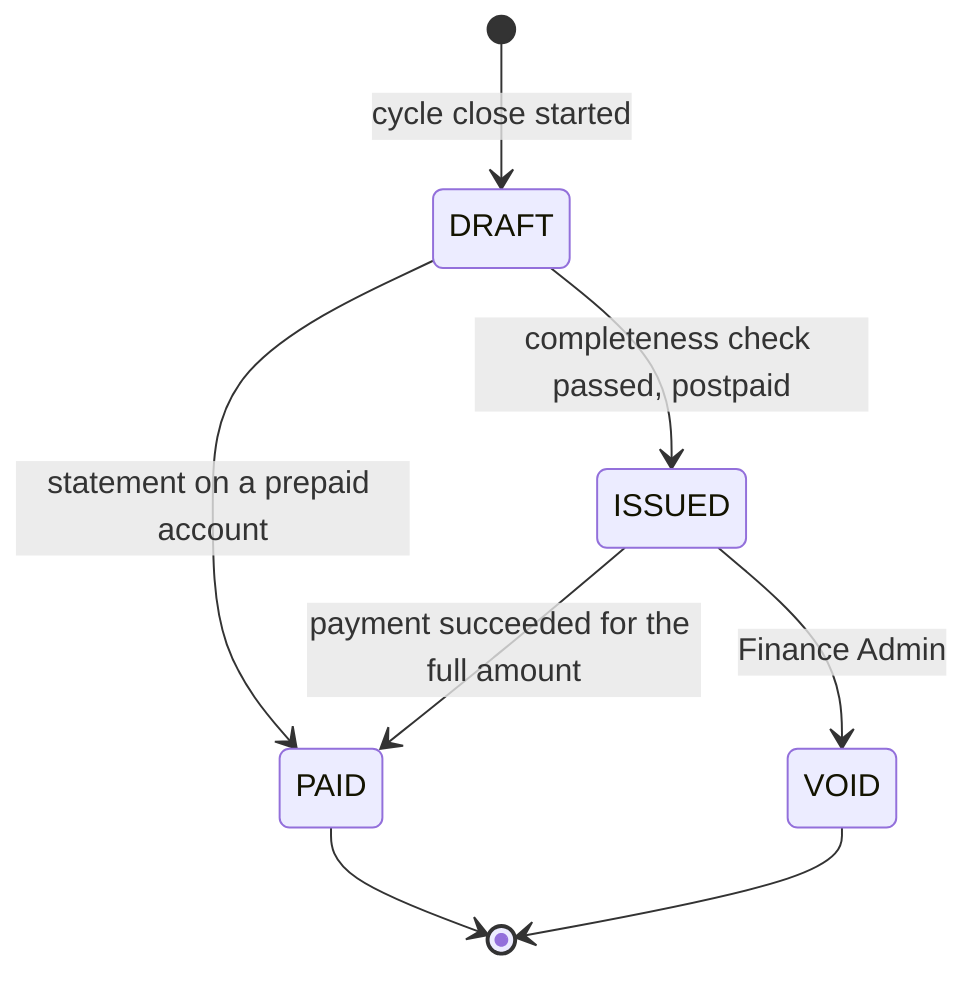

| From | To | Triggered by | Effect |
| --- | --- | --- | --- |
| `DRAFT` | `ISSUED` | Close on a postpaid account | Number assigned; PDF stored; `invoice.issued` |
| `DRAFT` | `PAID` | Close on a prepaid account | Number assigned; `invoice.issued`, `invoice.paid` |
| `ISSUED` | `PAID` | `payment.succeeded` covers the remaining amount | `invoice.paid` |
| `ISSUED` | `VOID` | Finance Admin, with a reason | Charges return to uninvoiced; `invoice.voided` |

- **Immutable once issued.** Corrections are a reversal on the ledger and a line on the next invoice; a wrong issued invoice is voided and replaced, so a document a customer has seen never silently changes.
- **Overdue is derived**, not a stored state: `status = 'ISSUED' AND due_at < now()`. `due_at` is the issue time plus the account's `payment_terms`, 14 days by default with a production floor of 1 day (section 19.8). The Scheduler publishes `invoice.overdue` once per invoice, recording `overdue_notified_at` so that it fires exactly once. A Client may treat that as "record debt", "stop renewals" or nothing at all.
- **Numbering.** A per-tenant counter row, updated in the issuing transaction, gives gapless numbers. Contention is negligible, since a tenant issues few invoices per cycle.
- **Partial payment.** `amount_paid` accumulates; the invoice stays `ISSUED` until it is fully covered.

### 14.3 What differs by mode

Both modes run the same close job. A prepaid invoice is a statement whose charges were already paid from the wallet. A postpaid invoice is a request for payment: paying it moves `psp_clearing` to `customer_wallet`, which raises the negative balance back toward zero. Wallet code does not change between the modes (section 6.4).

## 15. Reconciliation, Audit and Scheduler

These modules verify the core rather than extend it: Reconciliation trusts neither the Ledger nor the PSP, Audit records who did what, and Scheduler only triggers work that is safe to repeat.

### 15.1 Reconciliation

Daily, per PSP and currency, Reconciliation compares three sources: the PSP's settlement report, `payment.payment` and `refund`, and `psp_clearing` postings.

| Difference | Meaning | Handling |
| --- | --- | --- |
| PSP paid; Billing `PENDING` or `UNKNOWN` | Lost callback | Automatic: query the PSP and apply the normal transition |
| PSP paid; no Billing payment | Unknown payment | Exception for a Finance Admin; no automatic credit, as the owner is unknown |
| Billing `SUCCEEDED`; PSP has no record | False success, the serious case | Exception with high severity and an immediate alert |
| Amounts differ | Fee or partial capture | Exception; if a known PSP fee, a configured rule posts it |
| Billing payment without postings, or the reverse | Internal bug | Alert with high severity; section 19.4 fires the same check |

Each difference becomes a `reconciliation.exception` row with a state (`OPEN`, `RESOLVED`, `IGNORED`), an owner and a reason. A resolution that moves money goes through a manual `adjustment` journal, so the fix is itself recorded and auditable. The report's coverage depends on what each PSP provides (section 22.2).

### 15.2 Audit

- **Audit log.** An append-only `audit.log` records actor, tenant, action, object, before and after values, trace ID and IP, for every admin action and every money-object state change. Each module writes these as events to its own outbox, in the transaction of the change, and the Audit consumer stores them, which keeps the rule of section 4.2. The application role can only insert.
- **Tamper evidence.** Revoking `UPDATE` stops the application but not a database superuser. Each day a job computes a SHA-256 digest over that day's journals, postings, wallet movements and audit rows, chained to the previous day's digest, and writes it to object storage with object lock. Verification recomputes the digests and compares them (EXP-13). A chain per journal would add a hash under each wallet lock, for evidence that is only checked daily.
- **Explainability.** Any balance can be explained from its movements and postings, each posting from its journal, each journal from its source key, and each charge from its rating snapshot.
- **Retention.** Journals, postings, wallet movements, invoices and audit log are kept 10 years by default (section 22.2). Old `posting` and `wallet_movement` partitions move to cheaper storage and stay queryable.

### 15.3 Scheduler

Jobs fire from `@Scheduled` methods in the `scheduler` role, guarded by ShedLock. ShedLock only avoids wasted work: every handler is idempotent, so a double fire or a clock jump is harmless, and two running schedulers do not need a perfect lock.

| Job | Interval | Effect | Idempotent because |
| --- | --- | --- | --- |
| Reservation expiry | 30 s, drained per shard | Publishes expiry jobs | Status guard (section 7.5) |
| Usage rating | 5 min (prepaid), 60 min (postpaid) | Publishes rating jobs | Source key and cursor (section 10.3) |
| Cycle start and close | 1 min | Starts fees, closes cycles | Source key, conditional status |
| Overdue invoices | 1 h | `invoice.overdue` | `overdue_notified_at` |
| Payment polling | 1 min | Resolves `UNKNOWN`, expires `PENDING` | Conditional status |
| Idempotency key cleanup | Nightly | Deletes expired keys in batches | Deleting twice is a no-op |
| Reconciliation and digests | Daily | Section 15.1, section 15.2 | Unique per day |
| Invariant checks | 15 min (recent), daily (full) | Section 19.4 | Read-only |

### 15.4 ERP export

A daily export writes journals and issued invoices as versioned CSV and JSON files to object storage, and calls a configurable SFTP or HTTP target through an `ErpExporter` port. Each batch has a sequence number and a control total of debits and credits, so ERP can detect a missing or truncated batch. The ERP's own format and API are an open point (section 22.2), so this module is deliberately thin and comes after the core is right.

## 16. Data model

This phase fixes the conceptual model, the partitioning and the mandatory constraints; complete DDL is written per module during implementation. Each module owns one PostgreSQL schema, and a reference across schemas is an ID with no foreign key.

### 16.1 Entities

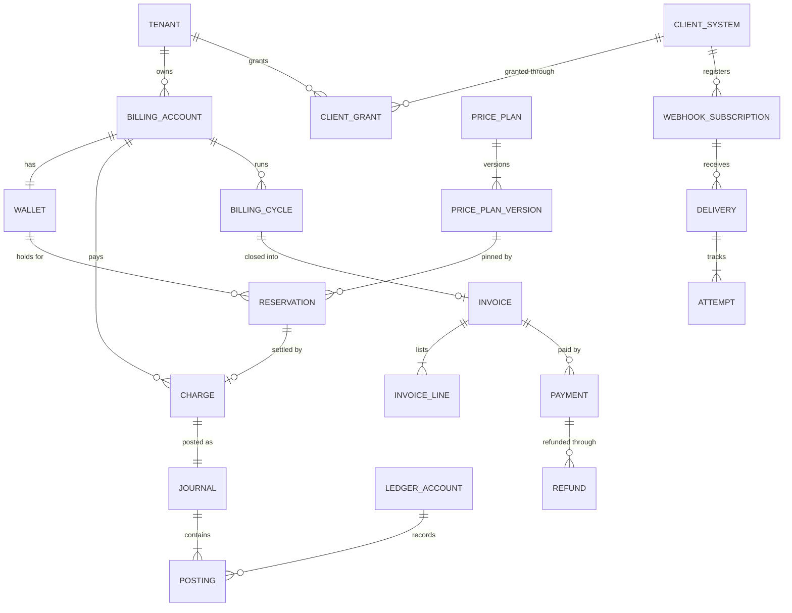

The diagram crosses schemas conceptually; in tables those references are IDs. The chain reservation, charge, journal, posting is what explains any amount.

| Schema | Table | Kind | Main content |
| --- | --- | --- | --- |
| `platform` | `tenant`, `client_system`, `client_grant`, `account_directory` | Master | Identities and access; no financial data |
| `ledger` | `billing_account`, `wallet` | Mutable, one row per account | Mode, currency, `balance`, `held`, `credit_limit`, `standing`, `version` |
| `ledger` | `ledger_account` | Reference | Chart of accounts |
| `ledger` | `reservation` | Mutable by state machine | Status, `kind`, `held_amount`, `plan_version_id`, `expires_at`, `expiry_enqueued_at`, `client_reference` |
| `ledger` | `charge` | Append-only | Amount, source, meter quantities, rating snapshot, service period, `journal_id` |
| `ledger` | `journal` | Append-only, `HASH (account_id)`, 64 partitions | Source key, currency, `posted_at` |
| `ledger` | `posting` | Append-only, `RANGE (posted_at)`, monthly | Line, ledger account, direction, amount |
| `ledger` | `wallet_movement` | Append-only, `RANGE (occurred_at)`, monthly | Kind, deltas, values after the change, `wallet_version`, source (section 6.8) |
| `ledger` | `daily_rollup` | Derived | Debit and credit per ledger account per day |
| `ledger` | `idempotency_key` | Expiring, 7 days | Caller, key, hash, stored response |
| Each module | `outbox` | Append-only, monthly, 30 days | Event envelope (section 8.2) |
| `pricing` | `product`, `meter`, `price_plan`, `price_plan_version`, `price_component`, `price_assignment` | Versioned | Plan definitions; a version is immutable once published |
| `metering` | `rating_cursor` | Mutable | `seq`, cumulative values, frozen values |
| `metering` | `usage_quarantine` | Mutable by review | Events older than the horizon |
| `invoicing` | `subscription`, `billing_cycle`, `invoice`, `invoice_line`, `invoice_charge`, `invoice_counter` | Mixed | Lines are immutable once issued; `invoice_charge` is the projection; `billing_cycle` keeps each cycle's bounds, taken from the account's `cycle_length`, and `invoice` keeps `due_at` |
| `payment` | `payment`, `refund`, `psp_event` | Mutable by state machine | State, PSP references, raw callbacks |
| `webhook` | `subscription`, `secret`, `delivery`, `attempt`, `event_log` | Mixed | Encrypted secrets; `delivery` and `attempt` partitioned by month, 90 days |
| `reconciliation` | `run`, `exception` | Mutable by review | Results and resolutions |
| `audit` | `log` | Append-only | Who did what |
| ClickHouse | `usage.event` | Append-only with merge | Section 10.2 |

**Logical stores.** Schemas are grouped into stores that can each move to their own cluster, because no transaction crosses them. All three start in one PostgreSQL cluster in production.

| Store | Schemas | Why it is separate |
| --- | --- | --- |
| Ledger DB | `ledger`, split into 1,024 logical shards | Holds all money writes, and scales by moving shards (section 19.6) |
| Delivery DB | `webhook` | Writes heavily, and shares no transaction with money, so it moves first |
| Billing Ops DB | `platform`, `pricing`, `metering`, `invoicing`, `payment`, `reconciliation`, `audit` | Lower write volume, reference and workflow data |

**Why these partition schemes.** PostgreSQL requires a unique constraint on a partitioned table to include the partition key. `journal` needs `UNIQUE (account_id, source_type, source_id)`, so it partitions by `account_id`, not time; this also makes moving accounts between clusters possible later. `posting` and `wallet_movement` need no such constraint, so they partition by month, which moves cold data to cheap storage. At 17 million rows per day and about 100 bytes each, each grows about 630 GB per year before indexes.

### 16.2 Required constraints

Constraints are part of the design: the database rejects a wrong state even when the code has a bug.

| Constraint | What it protects |
| --- | --- |
| `journal UNIQUE (account_id, source_type, source_id)` | A business fact posts at most once |
| Deferred constraint trigger on `posting`: debits = credits per journal | No unbalanced journal, even through a bug in the factory |
| `REVOKE UPDATE, DELETE` on `journal`, `posting`, `wallet_movement`, `charge`, `outbox`, `audit.log` from `billing_app` | Append-only |
| `posting CHECK (amount > 0)`, `CHECK (direction IN ('D','C'))` | No negative or ambiguous lines |
| `wallet CHECK (held >= 0)`, `CHECK (credit_limit >= 0)` | Holds cannot go negative after a double release |
| `reservation CHECK (held_amount > 0)`; status enum `CHECK` | Valid holds and states |
| `reservation UNIQUE (client_id, client_reference)` | One reservation per Client's job, beyond the key's retention |
| Partial index `reservation (expires_at) WHERE status = 'ACTIVE' AND kind = 'BUDGET'` | Fast expiry scans, and refund holds excluded by construction |
| `charge UNIQUE (journal_id)` | One journal per charge |
| `idempotency_key PRIMARY KEY (client_id, key)` | The arbiter of retries |
| `payment CHECK (refunded_amount <= amount)` | Refunds cannot exceed the payment |
| `invoice UNIQUE (tenant_id, number)`; `invoice_line UNIQUE (charge_id)` for non-void invoices | Gapless numbers; a charge on one live invoice only |
| `invoice_charge UNIQUE (charge_id)` | Projection is idempotent |
| `psp_event UNIQUE (psp, psp_event_id)` | Callback deduplication |
| `delivery UNIQUE (event_id, subscription_id)` | One delivery per event per endpoint |
| `price_plan_version`: a trigger rejects updates once `PUBLISHED` | Published prices are immutable |
| RLS enabled and forced on every table with `tenant_id` | Tenant isolation (section 12.3) |

### 16.3 Conventions

- **Money.** `bigint` in the currency's minor unit (0 decimals for VND, 2 for USD), in the `Money` value object; never floating point. Unit prices are `numeric(30,12)`, and quantities `numeric(38,9)`.
- **Time.** `timestamptz` in UTC, RFC 3339 in APIs. The database clock decides TTLs.
- **Identifiers.** UUIDv7 from `uuidv7()`, time-ordered so indexes stay compact. Ledger objects addressed without an `account_id` carry their logical shard in the public ID, as in `res_1a3_01973a2d11117000800000000000c3d4` for a reservation and `chg_…` for a charge. The shard is `hash(account_id) % 1024`, written as 3 hex digits. Clients treat IDs as opaque, and the database stores the plain UUID.
- **Soft delete.** None on money objects, which end in a terminal state instead. Master data has a `status`.
- **Migrations.** Flyway, one location per module, expand and contract so a rolling deployment always runs against a compatible schema.
- **Isolation level.** `READ COMMITTED` everywhere; correctness comes from explicit locks and unique constraints, whose behavior is easy to reason about statement by statement.

## 17. Backend API

The API is a versioned REST contract written first in OpenAPI 3.1, from which server interfaces and the portal client are generated; Client Systems use it through OAuth2 client credentials and people through OIDC. Everything the portal does, a Client could do with suitable permissions, because the portal has no private backend.

### 17.1 Endpoints

| Group | Endpoint | Description |
| --- | --- | --- |
| Estimation | `POST /v1/estimates` | Cost estimate, no state change |
| Reservation | `POST /v1/reservations` | Hold budget |
| | `GET /v1/reservations/{id}` | Current status |
| | `POST /v1/reservations/{id}/commit` | Settle actual usage |
| | `POST /v1/reservations/{id}/release` | Release unused hold |
| | `POST /v1/reservations/{id}/extend` | New TTL, optional increase |
| Usage | `POST /v1/usage` | Report a batch of up to 1,000 events |
| | `GET /v1/accounts/{id}/usage` | Aggregated usage |
| | `POST /v1/inbound/{client_id}` | Signed inbound webhook |
| Account | `GET /v1/accounts/{id}` | Balance, held, available, standing |
| | `GET /v1/accounts/{id}/transactions` | Ledger history |
| | `GET /v1/accounts/{id}/movements` | Balance and hold history, and state at a past time (section 6.8) |
| | `GET /v1/accounts/{id}/events` | Catch-up feed from a cursor |
| | `PATCH /v1/admin/accounts/{id}` | Mode, credit limit, thresholds; `cycle_length` and `payment_terms`, effective from the next cycle |
| Charge | `GET /v1/charges/{id}` | Charge with rating snapshot |
| | `POST /v1/admin/charges/{id}/reverse` | Reverse a charge |
| | `POST /v1/admin/adjustments` | Manual adjustment |
| Payment | `POST /v1/payments` | Start a top-up or invoice payment |
| | `GET /v1/payments/{id}` | Status |
| | `POST /v1/psp/{psp}/callback` | PSP result, verified by signature |
| Refund | `POST /v1/refunds` | Request a refund |
| | `POST /v1/admin/refunds/{id}/approve` | Approve |
| | `POST /v1/admin/refunds/{id}/reject` | Reject |
| Invoice | `GET /v1/invoices`, `GET /v1/invoices/{id}` | List, detail, PDF link |
| | `POST /v1/admin/invoices/{id}/void` | Void |
| Subscription | `POST /v1/subscriptions`, `DELETE /v1/subscriptions/{id}` | Create, cancel |
| | `PATCH /v1/subscriptions/{id}` | Change plan, with or without proration (FR-16); returns `changed_at` |
| Pricing | `GET /v1/products`, `POST /v1/admin/price-plans` | Catalog, draft plan |
| | `POST /v1/admin/price-plans/{id}/versions/{v}/publish` | Publish a version |
| Webhook | `POST /v1/webhook-subscriptions`, `GET`, `PATCH`, `DELETE` | Endpoints and event types |
| | `POST /v1/webhook-subscriptions/{id}/rotate-secret` | Rotate |
| | `GET /v1/webhook-deliveries`, `POST /v1/webhook-deliveries/{id}/redeliver` | History, redeliver |
| Reconciliation | `GET /v1/admin/reconciliation/exceptions`, `POST .../{id}/resolve` | Exceptions |
| Platform | `POST /v1/admin/tenants`, `POST /v1/admin/accounts` | Create a tenant, and a billing account with its wallet, mode, `credit_limit`, `cycle_length` and `payment_terms` |
| | `POST /v1/admin/client-systems` | Register a Client System with its products and meters (FR-01) |
| | `POST /v1/admin/client-grants` | Grant a Client System access to a tenant (FR-25) |

Calling a `/v1/admin/*` path needs the `finance_admin` role, and every call is audited.

### 17.2 Examples of the core endpoints

Reserve budget:

```http
POST /v1/reservations
Authorization: Bearer <client token>
Idempotency-Key: 7b1f6e0a-job-88213-reserve
Content-Type: application/json

{
  "account_id": "01972f00-22bb-7000-8000-0000000000b2",
  "client_reference": "job-88213",
  "product": "gpu.a100",
  "estimated_usage": [
    {"meter": "gpu_seconds", "quantity": 3600, "dimensions": {"region": "hn-1"}}
  ],
  "ttl_seconds": 7200
}
```

```http
HTTP/1.1 201 Created

{
  "id": "res_1a3_01973a2d11117000800000000000c3d4",
  "status": "ACTIVE",
  "held_amount": 1100000,
  "currency": "VND",
  "plan_version_id": "01972f55-9999-7000-8000-00000000e5f6",
  "expires_at": "2026-11-06T11:14:22Z",
  "account": {"available": 8900000, "standing": "NORMAL"}
}
```

Insufficient balance, in [RFC 9457](https://www.rfc-editor.org/rfc/rfc9457) problem format. It states a fact and gives the numbers, and names no action:

```http
HTTP/1.1 402 Payment Required
Content-Type: application/problem+json

{
  "type": "https://docs.billing.example/problems/insufficient_balance",
  "title": "Insufficient balance",
  "status": 402,
  "code": "insufficient_balance",
  "requested_amount": 1100000,
  "available": 400000,
  "currency": "VND",
  "standing": "LOW",
  "trace_id": "4bf92f3577b34da6a3ce929d0e0e4736"
}
```

Commit:

```http
POST /v1/reservations/res_1a3_01973a2d11117000800000000000c3d4/commit
Idempotency-Key: 7b1f6e0a-job-88213-commit

{
  "usage": [
    {"meter": "gpu_seconds", "quantity": 3132, "dimensions": {"region": "hn-1"}}
  ]
}
```

```http
HTTP/1.1 200 OK

{
  "id": "res_1a3_01973a2d11117000800000000000c3d4",
  "status": "COMMITTED",
  "held_amount": 1100000,
  "charged_amount": 870000,
  "released_amount": 230000,
  "absorbed_amount": 0,
  "charge_id": "chg_1a3_01973a3122227000800000000000d1e2",
  "account": {"balance": 9130000, "held": 0, "available": 9130000, "standing": "NORMAL"}
}
```

### 17.3 Conventions

| HTTP | `code` | When |
| --- | --- | --- |
| 400 | `validation_failed` | Body or parameters are invalid; includes per-field detail |
| 401 | `unauthenticated` | Missing or invalid token |
| 402 | `insufficient_balance` | Hold or extension exceeds `available` |
| 403 | `forbidden` | Authenticated, but the role or grant does not allow it |
| 404 | `not_found` | Missing, or owned by another Client or tenant |
| 409 | `idempotency_key_reused` | Same key with a different body |
| 409 | `reservation_not_active` | Commit, release or extend on a reservation that has settled |
| 409 | `reservation_closed` | Commit after the late-commit window |
| 409 | `client_reference_exists` | A new key with a `client_reference` that already has a reservation; the body carries the existing `id` |
| 409 | `refund_exceeds_payment`, `insufficient_balance` | Refund beyond the refundable amount, or the funds were spent |
| 410 | `cursor_expired` | Feed cursor older than retention |
| 422 | `unknown_meter`, `no_applicable_price` | Well-formed but cannot be priced |
| 429 | `rate_limited` | With `Retry-After` |
| 503 | `account_busy` | Wallet Gate full or `lock_timeout` reached on a hot wallet, with `Retry-After`; safe to retry with the same key |
| 503 | `service_unavailable` | Dependency down; safe to retry with the same key |

- **Idempotency.** `Idempotency-Key` is required on every `POST` that changes money, optional elsewhere, and valid for 7 days (section 8.1).
- **Versioning.** The path carries the major version; breaking changes create `/v2`. Webhook payloads carry `api_version`, pinned per subscription, so an upgrade happens when the Client chooses.
- **Money and time.** Amounts as integers in minor units, with `currency`; times in UTC, RFC 3339.
- **Identifiers.** Opaque strings; a Client must not parse them or assume a format (section 16.3).
- **Event order.** Guaranteed per account within a module only (section 8.3).
- **Pagination.** Opaque cursor, `limit` up to 500.
- **Tracing.** W3C `traceparent` propagates through Kafka headers, and `trace_id` appears in error bodies and webhook headers.
- **Contract.** OpenAPI in `api/openapi`, checked in CI with `oasdiff` against the last release, so an accidental breaking change fails the build.

## 18. User interface

One React SPA has two areas, Customer and Finance Admin, loaded lazily by role; it is a thin client over the public API and contains no business rules.

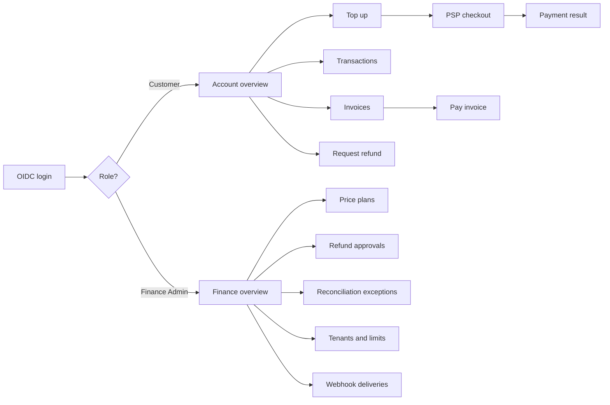

### 18.1 Screens

| Area | Screen | Content |
| --- | --- | --- |
| Customer | Account overview | Balance, held, available, standing, active holds, per-Client spending |
| | Top up | Amount, method, redirect to PSP, state until a verified result |
| | Transactions | Ledger history and wallet movements with filters, a link from each line to its charge explanation |
| | Invoices | List, detail, PDF, pay |
| | Refunds | Request and track |
| Finance Admin | Price plans | Draft editor, tier preview with a sample quantity, publish with `effective_from` |
| | Refund approvals | Queue with payment and wallet context |
| | Reconciliation | Exceptions, resolution with reason, adjustments |
| | Tenants and limits | Accounts, modes, credit limits, quarantined usage |
| | Webhook deliveries | Attempts per delivery, dead-letter list, redeliver |

The portal shows English first, with strings externalized through i18next so that Vietnamese can be added without code changes; the end-user language is an open point (section 22.2). The Demo Client's page is part of that Client (section 11.7), not of the portal, and the portal shows its reservations and charges as it would any Client's.

### 18.2 Technical notes

- **Payment result.** The return page shows "Confirming payment" and polls `GET /v1/payments/{id}`; it never assumes success from the redirect, because the PSP's verified callback decides.
- **Money formatting.** The server sends minor units and a currency, and the client formats with `Intl.NumberFormat`. The client does not calculate any amount, and the tier preview calls `POST /v1/estimates`.
- **State.** TanStack Query for server state, with a 10 s refetch on the overview; no global store.
- **Authentication.** Authorization code with PKCE, tokens in memory, silent refresh.
- **Empty, loading and error states** are defined for every list. Errors show `trace_id` for support.
- **Accessibility.** WCAG 2.2 AA on forms and tables; desktop-first for Finance Admin, responsive for Customer.

## 19. Deployment and fault tolerance

When something fails, Billing leans toward not moving money: it refuses a new hold before it risks a wrong one, and it delays events before it risks losing them.

### 19.1 Deployment

Billing runs on Kubernetes in every environment, from one set of Helm charts: production at full size, staging and development on a mini profile (section 19.8). Operators manage the stateful systems, so a database failover or a broker replacement is not a manual procedure. This section describes production.

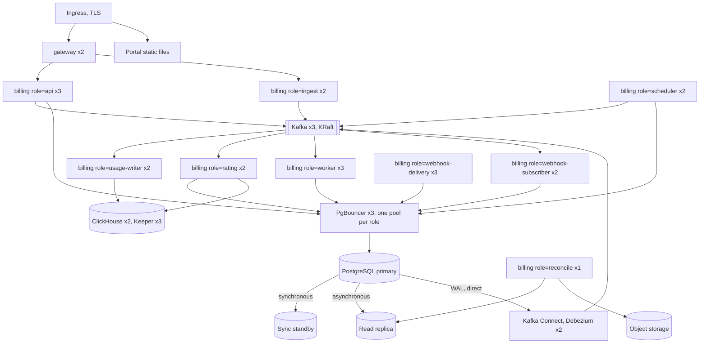

The figure shows the critical path: a reservation needs only `gateway`, `api`, PgBouncer and PostgreSQL, so no other box can fail a hold.

| Component | Deployment | Replicas | Notes |
| --- | --- | --- | --- |
| `gateway` | Deployment | 2 | Stateless |
| `billing` (`api`) | Deployment, HPA on CPU and latency | 3 | Virtual threads; connections through PgBouncer |
| `billing` (`ingest`) | Deployment, HPA on request rate | 2 | No database connection on the usage path |
| `billing` (`usage-writer`) | Deployment, KEDA on consumer lag | 2 | At most one consumer per partition |
| `billing` (`rating`) | Deployment, KEDA on consumer lag | 2 | Reads ClickHouse, posts through Ledger |
| `billing` (`worker`) | Deployment, KEDA on consumer lag | 3 | Event consumers and expiry jobs |
| `billing` (`webhook-subscriber`) | Deployment, KEDA on consumer lag | 2 | Writes deliveries only |
| `billing` (`webhook-delivery`) | Deployment, HPA on due deliveries | 3 | Virtual threads for HTTP |
| `billing` (`scheduler`) | Deployment | 2 | ShedLock; no leader required |
| `billing` (`reconcile`) | Deployment | 1 | Reads from the replica |
| PgBouncer | CloudNativePG `Pooler` | 3 | Section 19.7 |
| PostgreSQL 18 | CloudNativePG | 1 primary, 1 sync standby, 1 replica | `method: any`, `number: 1`, `dataDurability: required`; `wal_level = logical` |
| Kafka | Strimzi | 3 brokers | KRaft, RF 3, `min.insync.replicas = 2` |
| Kafka Connect | Strimzi | 2 | Debezium runs one task; the other is a standby |
| ClickHouse | Operator | 2 replicas, 3 Keeper | One shard is enough at this scale |
| Object storage | S3-compatible | Managed | Object lock on digests |

**Kubernetes rules for production**

- Stateful workloads run on their own node pool, separate from `billing`, so a burst of application pods cannot starve the database.
- Topology spread across at least 3 zones, with PodDisruptionBudgets on every component, so a node upgrade cannot take out a quorum or both replicas of a role.
- Each role has CPU and memory requests equal to its limits on the money path, so `api` latency does not depend on neighbors.
- A `preStop` delay and graceful shutdown let in-flight transactions finish and Kafka consumers hand over partitions.
- NetworkPolicies allow only the paths in the figure: for example, only PgBouncer and Debezium reach PostgreSQL.

Configuration comes from environment variables and ConfigMaps. Secrets come from an external secret manager and never live in images or the database in plain text.

Deployments are rolling. Flyway migrations run as a pre-deploy job and use expand-and-contract, so two versions can run side by side.

### 19.2 Observability

Every request, Kafka message and webhook attempt shares a trace, through OpenTelemetry. Logs are structured JSON with `trace_id`, `tenant_id` and `account_id`, and never contain secrets, tokens or full request bodies.

| Alert | Condition | Level |
| --- | --- | --- |
| Invariant violation | Any check in section 19.4 returns a row | Critical, page immediately |
| Reconciliation false success | Billing `SUCCEEDED` with no PSP record | Critical |
| Outbox relay lag | p99 above 30 s for 5 minutes | Critical |
| Replication slot WAL | Retained WAL above 50 GB | Critical |
| Reservation latency | p95 above 200 ms for 5 minutes | High |
| Hot account | `account_busy` rate above 1% on one account | Medium, and a signal for striping |
| Pool saturation | PgBouncer `cl_waiting` above 0 for 1 minute on `api` | High |
| Expiry backlog | Oldest `ACTIVE` past TTL more than 5 minutes | High |
| Usage consumer lag | Above 10 minutes of events | High |
| Rating staleness | A cursor older than 3 times its interval | High |
| Webhook dead rate | Over 5% per endpoint in 1 hour | Medium, owner notified |
| PSP circuit open | More than 5 minutes | High |
| DLQ | Any message | High |
| Cycle close stuck | Completeness check failing for 15 minutes | High |

Dashboards: money flow (holds, commits, charges), integration health per Client System, and per-endpoint webhook state.

### 19.3 Behavior under failure

| Failure | Detection | System behavior | Recovery |
| --- | --- | --- | --- |
| Billing process dies mid-transaction | Pod restart | Transaction rolls back, the idempotency claim disappears, and the row lock is released | Client retry with the same key runs as new |
| Process dies after COMMIT, before responding | Client timeout | Change is durable | Client retry replays the stored response |
| Worker dies during webhook call | Lease expiry | Row stays `DELIVERING` | Reclaimed after 60 s; may deliver twice; Client dedupes by `id` |
| PostgreSQL primary lost | Operator health check | Writes fail with `503` during failover; no committed transaction is lost, since the standby is synchronous | Failover within 5 minutes; Clients retry with the same keys |
| Synchronous standby lost | Replication monitor | With `dataDurability: required`, writes pause until a standby returns: Billing refuses to acknowledge money it could lose | The asynchronous replica can take over as the sync standby; the operator rebuilds the lost one |
| Standby slow, not lost | Commit latency alert | Every wallet slows together, because locks release only after the standby acknowledges; Wallet Gate limits each wallet's share of the pool | Investigate the standby. This is the price of RPO 0 |
| One wallet bursts | Wallet Gate rejections | That account gets fast `503 account_busy`; other accounts keep their connections | Client retries with the same key, after `Retry-After` |
| PgBouncer pod lost | Readiness probe | In-flight transactions on that pod fail and roll back; clients reconnect through the other pods | Client retries with the same key; the pod restarts |
| One Ledger cluster lost, with several clusters | Operator health check | Only accounts on its logical shards get `503`; others are unaffected | Failover of that cluster |
| Kafka unavailable | Client errors, relay errors | Reservations and commits continue; outbox accumulates and WAL grows; `POST /v1/usage` returns `503` and Clients retry | On recovery the relay catches up, in order |
| Debezium down | Lag alert | Same as above; events are delayed, not lost. Slot retains WAL | Restart. `max_slot_wal_keep_size` of 200 GB protects the primary's disk. If the slot is lost, replay from the 30-day outbox with a fresh snapshot; consumers dedupe |
| ClickHouse unavailable | Consumer errors | Usage stays in Kafka (7 days of retention); rating pauses; streaming charges are delayed; reservations and commits are unaffected | Consumers catch up; the next rating captures the whole delta |
| Read replica lost or lagging | Replica monitor | History and statements fall back to the primary at a limited rate; reconciliation waits | Operator rebuilds the replica |
| Object storage unavailable | Job errors | PDF and digests retry; invoices remain valid in the database | Retried |
| ERP target unavailable | Export errors | Batches stay in object storage with their sequence numbers | Resent in order |
| PSP unavailable | Circuit breaker | New payments return `503`; `UNKNOWN` payments wait; reservations are unaffected | Polling resolves them after recovery |
| PSP callback lost | Polling, reconciliation | Payment stays `PENDING` | Polling, then daily reconciliation |
| Client endpoint down | Delivery failures | Deliveries retry for about 70 hours; other endpoints unaffected | Redeliver or read the feed |
| Client commit never arrives | TTL | Hold is released; `reservation.expired` | A later commit is accepted within 7 days |
| Identity provider unavailable | Token errors | Valid tokens continue until they expire, because signature keys are cached; new tokens fail | On recovery |
| Kubernetes node lost | Node controller | Stateful pods fail over through their operators; other pods reschedule; PodDisruptionBudgets and topology spread keep a quorum | Automatic |
| Gateway replica lost | Readiness probe | Traffic moves to the other replica | Pod restart |
| Duplicate or out-of-order event | Business keys and status guards | No-op or absorbed | None needed |
| Clock jump on an app node | None needed | TTL decisions use the database clock | None needed |

**Billing has no failure mode that acts on a resource.** At worst a Client sees `503` or a delayed event, and it chooses a policy for that too. Clients are advised to decide in advance how to treat Billing being unreachable, since a choice of fail-open or fail-closed is a business decision of theirs.

### 19.4 Invariant checks

These run on each shard, every 15 minutes on recently changed accounts, and daily in full on the replica. Any returned row is a critical alert. The set of affected accounts stays visible, and nothing is auto-corrected: an automatic fix to a money bug would destroy the evidence.

```sql
-- Every journal balances.
SELECT journal_id FROM ledger.posting WHERE posted_at >= :since
GROUP BY journal_id
HAVING SUM(CASE direction WHEN 'D' THEN amount ELSE -amount END) <> 0;

-- A wallet's balance equals its postings.
SELECT w.id
FROM ledger.wallet w
JOIN ledger.ledger_account a ON a.account_id = w.account_id AND a.type = 'customer_wallet'
LEFT JOIN ledger.posting p ON p.ledger_account_id = a.id
WHERE w.id = ANY(:wallet_ids)
GROUP BY w.id, w.balance
HAVING w.balance <> COALESCE(SUM(CASE p.direction WHEN 'C' THEN p.amount ELSE -p.amount END), 0);

-- A wallet's held equals its active reservations.
SELECT w.id
FROM ledger.wallet w
LEFT JOIN ledger.reservation r ON r.wallet_id = w.id AND r.status = 'ACTIVE'
WHERE w.id = ANY(:wallet_ids)
GROUP BY w.id, w.held
HAVING w.held <> COALESCE(SUM(r.held_amount), 0);

-- A wallet's latest movement equals the wallet.
SELECT w.id
FROM ledger.wallet w
JOIN LATERAL (
    SELECT balance_after, held_after, wallet_version
    FROM ledger.wallet_movement m
    WHERE m.wallet_id = w.id
    ORDER BY occurred_at DESC, wallet_version DESC
    LIMIT 1
) last ON true
WHERE w.id = ANY(:wallet_ids)
  AND (w.balance, w.held, w.version) <> (last.balance_after, last.held_after, last.wallet_version);
```

These are a sample; the full list also covers:

- Each `COMMITTED` and `LATE_COMMITTED` reservation with a nonzero charge has exactly one journal.
- Each `SUCCEEDED` payment older than 5 minutes has a journal.
- Across all ledger accounts, total debits equal total credits per currency, on each shard.
- `wallet_version` has no gaps in `wallet_movement`.
- Every `charge.posted` in Invoicing's projection has a matching charge.

A wallet reading on a replica can momentarily disagree with its postings, so a daily failure is rechecked on the primary before it alerts.

### 19.5 Minimum security

- **Transport.** TLS at the edge and within the cluster; mTLS for the inbound Kafka listener.
- **Authentication.** OAuth2 client credentials for Clients, OIDC for people. JWTs are validated at the gateway and again at the application, which does not trust the network.
- **Authorization.** Role and grant checks in `adapter.in`; tenant checks by RLS (section 12.3).
- **Inbound signatures.** PSP callbacks and Client webhooks are verified on raw bytes before parsing, and with timestamp tolerance where the sender provides one.
- **Secrets.** Webhook secrets use AES-256-GCM with a key from the secret manager; rotation is by key version.
- **Webhook SSRF.** Section 11.5, including the allow-list that only the mini profile may set.
- **Data.** No card data. Customer data in events is limited to identifiers and amounts, so a webhook log leak exposes little.
- **Admin actions.** MFA at the identity provider; high-value adjustments and refunds need a second approver (`adjustment_dual_control_limit`).
- **Supply chain.** Dependency scanning and image signing in CI.

### 19.6 Scaling

The design scales by adding capacity, and every step below works without changing the API or the event contract. Four decisions make this possible, and all ship in the first release, because each is expensive to change after Clients integrate: shard-bearing public IDs, one outbox per module, the order scope of section 8.3 and high initial partition counts.

| Part | Unit of parallelism | Real limit | What to do at the limit |
| --- | --- | --- | --- |
| Hold and commit | One wallet at a time | About 125 transactions per second per wallet; primary IOPS overall | Wallet striping for one wallet; move shards to more clusters overall |
| Usage ingest | Kafka partition | 96 partitions; a partition's rate limits one account | Add `ingest` and `usage-writer` replicas up to the partition count |
| Usage storage | ClickHouse shard | One shard's merge and query capacity | Add ClickHouse shards keyed by `account_id`, so all of an account's rows, and `FINAL`, stay on one shard |
| Rating | Account, by partition | ClickHouse query capacity | Add `rating` replicas or a ClickHouse replica; lengthen the interval |
| Webhook | Virtual thread per request | Database claim rate on `delivery` | Add `webhook-delivery` replicas; move Delivery DB to its own cluster |
| Reads | Replica | Replica lag | Add replicas, read models |
| Connections | PgBouncer pool | Server connections on the primary | Add PgBouncer pods; adjust per-role pools (section 19.7) |

**Order of moves, with triggers.** These thresholds are proposals, recalibrated by EXP-03.

| Move | Trigger |
| --- | --- |
| Add stateless replicas | Autoscaling, within the primary's capacity |
| Add a read replica | Read queries are a large share of primary load |
| Move Delivery DB to its own cluster | Webhook takes a large share of primary I/O |
| Move Billing Ops DB to its own cluster | Ledger still needs headroom afterward |
| Move logical shards to a new Ledger cluster | Primary CPU or IOPS above 60% for a sustained period, after the moves above |
| Hot-wallet striping | One wallet regularly returns `account_busy` |

**Shard Router.** `hash(account_id) % 1024` gives the logical shard, and a small configuration table maps ranges of logical shards to clusters. It lives behind `UnitOfWork`, so no handler knows that shards exist. A reservation or charge ID carries its shard, so it routes without a lookup. Every money transaction touches one wallet, and therefore one shard, so a journal still balances inside its shard and no distributed transaction is needed.

**Moving a logical shard** uses logical replication of that shard's accounts to the target cluster. When it has caught up, the router blocks writes for that shard, the last changes and outbox rows drain, the map flips and writes resume. EXP-16 rehearses this, with the target of NFR-18.

**Costs of sharding.** Reads across a tenant's accounts may span shards, so the portal reads them from a replica-backed read model or merges per-shard results. Reports, reconciliation and invariant checks run per shard and then aggregate. Sharding by `tenant_id` would avoid this but would trap one very large tenant on one shard, and since every transaction touches one wallet, `account_id` is the natural key.

**What is deliberately not added.** Microservices: roles and stores already scale separately, and extraction stays possible, with Webhook Dispatcher as the first candidate. Redis and Flink: no need is large enough to justify another critical system. Cell-based or multi-region deployment: the Shard Router is a stepping stone, if that need arises.

Replicas are not added blindly: `api` is bounded by the primary's capacity, so scaling it past that only moves the queue into PostgreSQL. EXP-03 finds that point.

### 19.7 Connection pooling

PgBouncer in transaction mode sits between `billing` and PostgreSQL in every environment, and it lets many application replicas share a bounded number of server connections. Each role has its own pool, which matters as much as the connection count: webhook or rating load cannot take connections from reservations.

| Pool | Server connections | Notes |
| --- | --- | --- |
| `api` | 60, plus a reserve of 10 | Reservations and status; about 5 active at 500 reservations per second, the rest absorb waits |
| `worker` | 25 | Event consumers and expiry |
| `rating` | 10 | Charge posting |
| `webhook` | 30 | Subscriber and delivery claims |
| `system` | 10 | Scheduler sweeps and cross-tenant scans, through role `billing_system` |
| `reconcile` | 5 | On the replica, through a separate `ro` pooler |

**CloudNativePG** provides the [`Pooler` resource](https://raw.githubusercontent.com/cloudnative-pg/cloudnative-pg/main/docs/src/connection_pooling.md), which runs PgBouncer pods in front of the [`-rw` or `-ro` service](https://raw.githubusercontent.com/cloudnative-pg/cloudnative-pg/main/docs/src/service_management.md), and allows several poolers per cluster. The `-rw` service points at the primary, which is why no HAProxy is needed.

**What transaction mode requires.** [PgBouncer's feature table](https://www.pgbouncer.org/features.html) rules out session-level `SET`, `LISTEN` and session advisory locks in this mode.

| Component | Requirement |
| --- | --- |
| Tenant context | `set_config(..., true)` is already transaction-local (section 12.3) |
| `lock_timeout` | Uses `SET LOCAL`, inside the transaction; `idle_in_transaction_session_timeout` is set on the database role |
| Prepared statements | Protocol-level support, [added in PgBouncer 1.21](https://www.pgbouncer.org/changelog.html), with `max_prepared_statements` enabled |
| Debezium | Connects directly to the `-rw` service, since it needs a replication slot |
| Flyway | Connects directly: it uses a session advisory lock during migration |
| ShedLock | Compatible: its lock is a table row |
| Backups and `pg_dump` | Direct |

`query_wait_timeout` is 2 s on the `api` pool, so a saturated pool returns `503` quickly and does not build a hidden queue.

**PgBouncer does not replace the Wallet Gate.** A request waiting for a wallet lock is inside a transaction and keeps its server connection, so without the gate one wallet would still fill the pool (section 6.5).

**What is not used.** HAProxy: Kubernetes services and the operator already route to the primary; it would matter only for Patroni on virtual machines. pgcat and similar proxies: their main features are read-write splitting and sharding in the proxy, and both belong in the application here. Whether a read may go to a replica is a business decision, made by the query port of section 5.3, and a proxy cannot tell which `SELECT` needs the latest data. Routing money through a proxy's parsing would add a component with no gain over the Shard Router.

### 19.8 Environments

All environments install the same images from the same Helm charts and operators, and differ only in a values file. A chart change is thus tested on a laptop before it reaches staging, and staging differs from production in size rather than in kind, apart from the job timing and floors in the table below, which let the coverage matrix run there.

| Aspect | Development (mini) | Staging (mini) | Production |
| --- | --- | --- | --- |
| Purpose | Test charts, failures and routing on one machine | Integrate with PSP sandboxes and Client staging; rehearse releases and failover | Real money |
| Cluster | k3d: 1 server, 2 agents, about 8 vCPU and 16 GB | 3 small nodes in one zone, with a cost cap | 3 or more zones, separate node pools |
| Values file | `values-mini.yaml` | `values-staging.yaml` | `values-prod.yaml` |
| `billing` roles | All, 1 replica each, no autoscaling | All, 1 replica each, `api` 2, autoscaling on | Section 19.1 |
| PostgreSQL | 1 instance, no sync standby | Primary and sync standby, for failover rehearsal | Primary, sync standby, replica |
| Physical ledger shards | 2 databases in one instance | 2 databases in one cluster | 1 cluster at first |
| PgBouncer | 1 pod | 2 pods | 3 pods |
| Kafka | 1 dual-role node, RF 1, 8 partitions per topic | 3 small dual-role nodes, RF 3, production partition counts | 3 brokers, RF 3 |
| Debezium | 1 worker | 1 worker | 2 workers |
| ClickHouse | 1 replica, 1 Keeper | 1 replica, 1 Keeper | 2 replicas, 3 Keeper |
| Object storage | MinIO | MinIO | Managed S3-compatible |
| Identity | Keycloak with a seeded realm | Keycloak | Production provider (section 22.2) |
| PSP | `FakePsp` | PSP sandbox, and `FakePsp` for Demo Client accounts | Live PSP |
| Client Systems | Demo Client from S8 (section 11.7) | Client staging, and Demo Client from S8 | Real Clients |
| Webhook endpoint allow-list | The in-cluster webhook target's host | Empty | Empty |
| Job timing | Rating every 30 s on both account modes; `invoice_grace` 30 s; overdue job every 30 s; retry schedule one tenth of section 11.3 | Same as development, except the default retry schedule, so that Client staging integrations see real retry behavior | Defaults |
| Floors on account settings | `cycle_length` 5 minutes; `payment_terms` 1 minute | Same as development | 1 day for both |
| Observability | Prometheus and Grafana | Full stack | Full stack |
| Data | Synthetic seed | Synthetic; never a copy of production | Real |
| Secrets | Development values in Kubernetes secrets | Separate path in the secret manager | Secret manager |

The mini profile deliberately keeps 2 physical shards, even though production starts with 1: a routing bug is then found in the first week rather than on the day a cluster is added. The Demo Client's chart sits outside the one chart set: it is an external Client System installed alongside Billing on development and staging, so the Billing charts do not contain it and production never installs it.

**Two development modes.** They serve different questions, and both run the same application.

| Mode | Command | Use |
| --- | --- | --- |
| Fast loop | `make deps-up`: Docker Compose runs dependencies only, and the application runs in the IDE | Everyday coding and debugging |
| Mini Kubernetes | `make mini-up`, `make mini-test`, `make demo-test`, `make mini-down`: k3d, operators and charts with `values-mini.yaml` | Charts, probes, autoscaling config, pod kills, PgBouncer, shard routing, the demo and the coverage matrix |

**CI.** Each merge to the main branch creates a k3d cluster, installs the charts and runs the smoke suite (EXP-17) and, from S8, the coverage matrix (EXP-18), so chart drift and a broken billing type are caught at once.

**What a mini environment can and cannot prove.** Correctness, failure handling and configuration carry over, so EXP-01, EXP-04, EXP-05, EXP-06 and EXP-18 are valid there. Load numbers do not. EXP-02, EXP-03, EXP-08 and EXP-14 run on staging temporarily scaled up with `values-prod.yaml`, or on a dedicated performance cluster of the same size; the Demo Client is scaled to zero during those runs, and `values-prod.yaml` restores the default timing and floors.

## 20. Testing and evaluation

Correctness is proven by forcing the failures this system exists to survive (races, retries, process kills) and then running the invariant checks of section 19.4, not by asserting on the happy path.

### 20.1 Test strategy

| Type | Scope | Tool |
| --- | --- | --- |
| Unit | Aggregates, value objects, `RatingFunction`; no Spring context, runs in milliseconds | JUnit 5, AssertJ |
| Property | Rating laws (section 9.2); random sequences of hold, commit, release and expiry against a model wallet | jqwik |
| Architecture | Every rule of section 5.5 | ArchUnit, Spring Modulith, jMolecules |
| Module integration | One module with real PostgreSQL through PgBouncer, other modules mocked at `api` | `@ApplicationModuleTest`, Testcontainers |
| Concurrency | Races of section 7.4, with barriers to force overlap | JUnit 5, Testcontainers |
| Contract | OpenAPI compatibility, event catalog, webhook signature vectors in multiple languages | `oasdiff`, custom tests |
| Fault injection | Kills, network loss, slow dependencies | Testcontainers, Toxiproxy, WireMock, `FakePsp` |
| Load | Sections of NFR with numbers | Gatling |
| End to end | Portal top-up through webhook delivery; a Demo Client job from S8 | Playwright, mini profile on k3d |
| Billing-type coverage | Every pricing mode on both account modes, usage through invoice, against hand-written fixtures (section 11.8) | JUnit 5 runner, Demo Client, from S8; mini profile on k3d and staging |
| Deployment | Charts, probes, operators and pod kills on the mini profile | Helm, k3d |

Mocking of the database is forbidden for money paths: a mock cannot show that a lock or a unique index behaves as this design requires.

### 20.2 Experiments

| ID | Experiment | Method | Metrics | Expected |
| --- | --- | --- | --- | --- |
| EXP-01 | Contention on the last balance | 1,000 concurrent holds of 100 on a wallet with 10,000 available; baseline: read-check-write without a lock (section 6.5 option A) | Successful holds; negative `available` | Exactly 100 succeed, `available` is 0. The baseline over-holds |
| EXP-02 | Hot account saturation | Increase load on one wallet from 10 to 300 reservations per second; compare `FOR NO KEY UPDATE` with conditional `UPDATE` and optimistic retry, with `wallet_movement` in place. Then burst one wallet while the standby is slowed, with and without Wallet Gate, measuring other accounts | p95 and p99 latency, throughput, retries, `account_busy`, connections held, other accounts' p95 | `FOR NO KEY UPDATE` p95 ≤ 150 ms at 50 per second; saturation point reported for all three. With the gate: at most 15 connections and other accounts' p95 up by ≤ 10%. Without it, the pool is exhausted |
| EXP-03 | Whole-system load | 500 reservations per second over 10,000 accounts, with hold-commit mix and 1,500 events per second for 1 hour | Latency, primary CPU and IOPS, relay lag | p95 ≤ 100 ms, p99 ≤ 250 ms; report the point where the primary limits |
| EXP-04 | Idempotency storm | 10 concurrent requests with the same key, for reserve and commit, killing the process at random points; baseline: guard disabled | Holds and charges per key; invariants | 1 effect per key, 0 invariant violations. The baseline double charges |
| EXP-05 | Process-kill chaos | Random `SIGKILL` of `api` and `worker` under mixed load for 1 hour, then all checks of section 19.4 | Invariant violations; retries that ended without an answer | 0 violations |
| EXP-06 | Commit against expiry | 10,000 reservations with a commit and an expiry forced to overlap by barriers | Charges per reservation; final `held`; states | Exactly 1 charge each; `held` is 0; all states valid |
| EXP-07 | Outbox relay comparison | 1,500 events per second with long-running transactions mixed in, on Debezium against a polling baseline (section 8.3 option A) | Lag p50 and p99; per-account order inversions; primary load | Debezium p99 ≤ 2 s and 0 inversions. The polling baseline shows inversions or a delay equal to its safety window |
| EXP-08 | Usage accuracy under duplicates | 5,000 events per second for 1 hour, with 10% duplicates, 1% late, a ClickHouse restart and a Kafka consumer replay; hot-account `FINAL` timing | Charged quantity against a known total; ack latency; freshness | Quantity is exact; 0 lost; ack p95 ≤ 50 ms; charge within interval + 2 minutes, p95 |
| EXP-09 | Cumulative rating precision | One million per-token events at a price below one minor unit; compared to per-window rounding | Difference from exact total | Drift below 1 minor unit overall. The per-window baseline loses revenue, reported |
| EXP-10 | Webhook delivery under failure | Random worker kills, an endpoint returning random failures; event count known | Delivered, duplicated and lost events; first-attempt latency | 0 lost; p95 ≤ 5 s; duplicates reported |
| EXP-11 | Endpoint isolation | One endpoint times out for 1 hour, while others are healthy; baseline: no per-endpoint limit | Healthy endpoints' first-attempt p95 | Increase ≤ 10%. The baseline is degraded, reported |
| EXP-12 | Tenant isolation and RLS cost | Run every repository method with the wrong tenant, and with filters removed; compare hot-path latency with and without RLS | Rows returned; latency difference | 0 rows; overhead reported |
| EXP-13 | Reconciliation and tamper detection | Inject lost callbacks, unknown payments, amount differences and a superuser edit of a posting | Detection rate and time | 100% within 24 hours |
| EXP-14 | Primary failover | Kill the PostgreSQL primary under 500 reservations per second, then compare acknowledged results to the database | Lost acknowledged transactions; time to recover | RPO 0; RTO ≤ 5 minutes; 0 invariant violations |
| EXP-15 | Architecture conformance | Inject one violation per rule of section 5.5 on a test branch | Build outcome | Every injected violation fails the build |
| EXP-16 | Shard move rehearsal | On staging under load, move one logical shard to a second cluster and replay the invariant checks, with Clients unchanged | Write block time; failed requests; lost or duplicated events; invariants | Block ≤ 30 s; retries succeed; 0 lost events; 0 violations; no API change |
| EXP-17 | Mini profile | From a clean machine or CI runner: `make mini-up`, then the smoke suite covering reserve, commit, webhook delivery to the in-cluster target (a WireMock stub, from S8 the Demo Client) and a pod kill | Time to ready; suite result; peak CPU and memory | Ready in ≤ 15 minutes on 8 vCPU and 16 GB; suite passes |
| EXP-18 | Billing-type coverage | `make demo-test`, on mini at each merge and on staging at each release: 12 matrix cells and the scenarios of section 11.8, then the checks of section 19.4. To test the suite itself, run once with a wrong fixture amount and once with a plan seeded under the wrong charge model | Cells and scenarios passed; difference from fixtures; invariant violations; duration | 12 of 12 cells and all scenarios pass; 0 minor units of difference; 0 violations; ≤ 15 minutes. Both sabotaged runs fail |

EXP-01, EXP-04, EXP-05 and EXP-06 prove the top invariant, against baselines that show the naive design failing. EXP-02 and EXP-03 show that the wallet lock meets the load target and find its limit. EXP-07 and EXP-10 prove that no event is lost or disordered. EXP-08 and EXP-09 prove usage correctness. EXP-11, EXP-12 and EXP-14 cover isolation and durability, EXP-13 covers audit, and EXP-15 covers the strictness of the code architecture. EXP-16 proves the growth path of section 19.6 without a contract change, EXP-17 keeps the mini profile working, and EXP-18 proves that every billing type works end to end through the public contract.

## 21. Implementation plan

The order follows correctness first: the ledger runs and survives kills before anything is built on it, and each stage ends with something that runs and an experiment that measures it. Durations assume 1–2 developers and are a proposal.

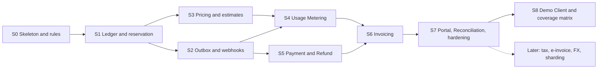

| Stage | Content | Results |
| --- | --- | --- |
| S0 (3 weeks) | Repository, module skeleton, architecture tests, OpenAPI pipeline, tenancy hook and RLS, Helm charts, mini profile on k3d, PgBouncer in CI, dependency Compose | Build enforces all rules: EXP-15. Empty modules pass; a violation fails. `make mini-up` works: EXP-17 |
| S1 (5 weeks) | Wallet, Posting Engine, movement log, Wallet Gate, Shard Router, Reservation with hold, commit, release, extend and expiry; Idempotency Guard; invariant checks | A runnable reservation API with a fixed price: EXP-01, EXP-02, EXP-04, EXP-05, EXP-06, EXP-12 |
| S2 (4 weeks) | Outbox, Debezium, Kafka, Event catalog, Webhook Dispatcher, feed; platform admin endpoints | Events reach a WireMock endpoint, and the smoke suite delivers to it: EXP-07, EXP-10, EXP-11 |
| S3 (3 weeks) | Plans, versions, rating function, estimates, plan pinning | Real prices on reservations: rating property tests |
| S4 (4 weeks) | Ingestion, ClickHouse, cumulative rating, quarantine | Streaming charges: EXP-08, EXP-09 |
| S5 (4 weeks) | PSP port, `FakePsp`, first real PSP, payment and refund state machines | Real top-ups: failure tests with Toxiproxy |
| S6 (3 weeks) | Subscriptions, cycles with `cycle_length` and `payment_terms`, invoices, projection and completeness check | Monthly invoice for both modes |
| S7 (5 weeks) | Portal, Reconciliation, Audit digests, staging and production environments, load, failover and shard-move runs, ERP export | Main system complete: EXP-03, EXP-13, EXP-14, EXP-16 |
| S8 (4 weeks) | Demo Client with all six services, receiver, feed loop, seed job, page, login, policy and fault switches; runner, fixtures, matrix and scenarios; its chart on mini and staging, and `FakePsp` on staging; the smoke suite moves from the stub to the Demo Client | Full demo on mini and staging; all 12 cells pass: EXP-18 |

Total: about 31 weeks, or 7 months, for the main system, then about 4 weeks for S8: 35 weeks, or 8 months. The main system depends on nothing from S8. Until then, module integration, property and end-to-end tests cover each pricing mode, and WireMock stands in as the Client's webhook endpoint.

**Cut order**: ERP export first, then Portal admin screens down to a CLI, then subscriptions with proration, then the Kafka inbound channel, then the catch-up feed. Cutting a Billing feature removes its cell or scenario from EXP-18 and nothing else. Within S8, the page goes first, down to its `/demo/*` API, and then the Kafka scenario; the matrix itself stays, since it is how the billing types are known to work. The shard-move rehearsal can wait for the first real need, but shard-bearing IDs and per-module outboxes cannot, because they are part of the contract. The Ledger, Reservation, Idempotency Guard, Outbox and invariant checks must not be cut, since they are the system's reason to exist and nothing can later be added to recover money lost without them.

**Demo script**, after S8, on the mini profile (`make mini-up`) or on staging

1. The seed job has created the tenant, account, Client System and grant (section 11.7). Log in to the portal as `demo-customer` and top up 10,000,000 through `FakePsp`. The portal shows the balance after the verified callback.
2. On the Demo Client's page, submit a GPU job of 3,600 estimated `gpu_seconds`. It reserves 1,100,000. The portal shows the hold and lowered `available`; the page shows `reservation.created` with a verified signature.
3. The job finishes at 3,132 `gpu_seconds`, which costs 870,000. The balance, the charge explanation and the released 230,000 appear; the journal is balanced.
4. Turn on the commit storm and run another job: the same commit goes out 10 times concurrently, with one charge and nine replayed responses with `Idempotent-Replayed: true`.
5. Submit a job larger than `available`: a `402`, one `balance.insufficient`, and the job is `REJECTED` by the Demo Client's own policy. `standing` is unchanged, so the inference stream keeps running under either policy. Billing took no action on any resource.
6. Start the inference stream with duplicate usage on. Within 3 minutes the charge appears at the exact quantity, with duplicates not counted. Switch to `stop-streaming` and submit a job that holds all of `available` through `max_amount`: `standing` becomes `INSUFFICIENT` and the stream pauses. The job settles below its hold, the remainder returns, the next balance event arrives and the stream resumes. Under `keep-streaming`, the same facts only raise a warning.
7. Turn on the webhook outage for 1 minute and run several jobs. They still run and settle; deliveries show `RETRYING` in the portal, other endpoints are unaffected, and the feed loop still brings the events. Turn it off, and the deliveries arrive within about 2 minutes; the page counts them as duplicates dropped and shows no gaps.
8. Force-delete an `api` pod under load with `kubectl`, then run the invariant checks: zero violations, on screen. Jobs caught mid-call resend with the same key and settle once.
9. Run `make demo-test`. The report lists all six pricing modes on both account modes, plus the scenarios of section 11.8, passing against the fixtures. In the portal, the prepaid cell's statement is `PAID` and the postpaid cell's invoice went from `ISSUED` to `PAID`.

On staging the script is the same, with two differences: the top-up in step 1 still goes through `FakePsp`, and the deliveries in step 7 can take about 6 minutes, because staging keeps the default retry schedule.

## 22. Risks and limitations

The largest risks are operational rather than algorithmic: this stack is heavy for a small team, and the design leans on the correct behavior of PostgreSQL, Debezium and ClickHouse, each of which has an experiment behind it.

### 22.1 Risks

| Risk or limitation | Impact | Mitigation |
| --- | --- | --- |
| Operating Kafka, Debezium, ClickHouse and CloudNativePG with 1–2 people | Outages from operations rather than code | Operators; managed services where budget allows; a reservation depends only on PostgreSQL (section 19.1), so most failures delay rather than stop; alerts in section 19.2 |
| Replication slot holds WAL during a relay outage | Primary disk fills, which stops all writes | Alert at 50 GB, cap of 200 GB, and replay from the outbox (section 19.3) |
| One wallet exceeds the 125 per second lock limit | `account_busy` on that account only | Wallet Gate and per-account limits (sections 6.5 and 12.4); EXP-02 measures the true limit; striping is designed as Later (section 2.3) |
| A slow standby slows every wallet together | Reservation latency rises across all accounts | Alert on commit latency (section 19.2); the gate protects the pool; accepted as the price of RPO 0 (section 19.3) |
| Streaming usage overspends a prepaid account by one interval | A small receivable | Stated behavior (section 10.3); Clients needing a hard ceiling use reservations |
| ClickHouse `FINAL` slows on hot accounts | Rating lag | Freezing bounds the scan to 72 hours; EXP-08 measures it; the interval can lengthen per account |
| A Client changes `occurred_at` on a retry | Event counted twice | Contract rule (section 10.1); a monitor samples repeated `event_id` values with different times |
| Workload tiers are per reservation | Cannot offer a volume discount across reservations in one cycle | Stated in section 9.3; Client can use streaming usage, or a plan change; a later cumulative counter fits the same function |
| A commit never arrives and the late window passes | Service delivered and not charged | `reservation.expired` tells the Client; Finance can adjust; metrics per Client show the rate |
| Strict architecture slows early development | More mappers and interfaces to write | Rules are in place from S0; about 40 lines per aggregate (section 5.4); a shared code template |
| One artifact: a bad release affects every role | Wider blast radius than microservices | Roles deploy progressively, `webhook-delivery` and `worker` before `api`; expand-and-contract migrations |
| Shared database between ledger and webhook | Webhook load can affect money latency | Claim queries are small and capped (section 11.5); `webhook` schema can move to its own cluster because no transaction spans it (section 19.6) |
| Shard Router and shard-bearing IDs ship before they are needed | Extra code, with one physical cluster in production | Small and behind `UnitOfWork`; the mini profile exercises it (section 19.8); changing ID format after Clients integrate would cost far more |
| Clients assume event order across modules | A Client builds wrong state after stores separate | Stated in the contract from the first release (section 8.3); events are complete facts |
| Mini profile hides production behavior | A bug appears only at full size or across zones | Staging keeps a sync standby and RF 3; load EXPs run at production size (section 19.8) |
| Running a mini Kubernetes stack is heavy on a laptop | Developers stop using it, and charts drift | The fast loop stays Compose-based; CI runs the mini profile on every merge (EXP-17) |
| The Demo Client takes a shortcut into Billing, or its allow-list reaches another environment | The demo proves nothing about the contract, or SSRF protection weakens | Build tests on its dependencies and on rendered chart values (section 5.5), injected by EXP-15; a separate chart that production never installs, and a build test on production values (section 11.7) |
| Shortened retry and rating settings make the demo look faster than production | A wrong impression of event and charge timing | Stated in section 19.8; NFR-06 and NFR-08 are measured with default values at production size |
| 5-minute cycles hide calendar defects, such as an anchor on the 31st | A cell passes while a real monthly close goes wrong | Stated in section 11.8; unit and property tests on the cycle calculator cover calendar months |
| A floor of 5 minutes on `cycle_length` reaches production | Accounts with absurdly short cycles and a flood of invoices | Only mini and staging values lower it, and a build test fails on production values (section 5.5) |
| The Demo Client runs on a shared, long-lived staging | Short-cycle accounts pile up invoices; the compressed timing affects Client staging integrations | The runner restores monthly cycles and sweeps leftovers (section 11.8); staging keeps the default retry schedule, and the rest is stated in section 19.8 |
| Defects that cross pricing modes surface only at S8, after the main system is built | Late rework, or a go-live with NFR-20 unmeasured | Module integration, property and end-to-end tests cover each mode from S3; the go-live decision is an open point (section 22.2) |
| A hand-written fixture is wrong | A false failure, or a defect accepted as correct | Fixtures are reviewed like code; EXP-18 proves that a wrong amount and a wrong charge model fail the suite |
| RLS adds overhead, or a table lacks a policy | Slower queries, or a leak | Build test on `pg_policies` (section 5.5); EXP-12 measures cost |
| A wrong rating or plan causes mass wrong charges | Customer trust and refunds | Immutable versions, snapshots, tier preview, reversals (section 9.4); a per-run sanity limit on rating deltas pauses a run and alerts |

### 22.2 Open points

Proposed values stand until confirmed.

| Point | Proposal | Decision needed from |
| --- | --- | --- |
| First PSP | Not chosen. Verify it against section 13.2 (reference idempotency, signed callback, status query, settlement report) before integrating | Owner |
| Markets and currencies | Vietnam and VND first is assumed from context; the model handles others | Owner |
| Legal retention | 10 years, to confirm with an accountant or lawyer per market | Owner |
| Tax and e-invoicing timing | Deferred; if a market requires a registered e-invoice at launch, it moves into scope | Owner |
| Cloud and Kubernetes provider | Kubernetes is decided; the provider is not. Managed PostgreSQL, Kafka and ClickHouse are worth pricing against the risk in section 22.1; a managed PostgreSQL must support logical replication slots, and would replace CloudNativePG and its `Pooler` | Owner |
| Staging budget | 3 small nodes with a cost cap, and temporary scale-up for load experiments | Owner |
| Identity provider | Keycloak self-hosted, or a managed OIDC provider | Owner |
| ERP target and format | Generic files until an ERP is named | Owner |
| Sync standby policy | When the sync standby is lost: `dataDurability: required`, which pauses writes (safer, proposed), or `preferred`, which continues with possible data loss (more available) | Owner |
| Parameter defaults | TTL 1 hour, late window 7 days, horizon 72 hours, buffer 10%, retries about 70 hours, `payment_terms` 14 days; tune with real Clients | Owner, with the first Client |
| Go-live against S8 | Go live with real money only after EXP-18 passes, since it is the only end-to-end check of every billing type | Owner |
| Staging ingress reaches itself | Billing's delivery to the Demo Client's public name depends on the cluster routing to its own ingress; confirm with the chosen provider | Developer, S8 |
| First fee of a subscription created mid-cycle | Prorated by the seconds remaining (section 14.1), and the matrix fixtures depend on this; a full first fee would be the alternative | Owner |
| Portal end-user language | English first, i18n ready; add Vietnamese if customers need it | Owner |
| jMolecules APIs | Confirm exact `jmolecules-archunit` rule APIs when S0 starts. Reconsider section 5.4 option B if Spring Data JDBC support in the ByteBuddy plugin becomes documented | Developer, S0 |
| Spring Modulith version pairing | Use the 2.1 line with Boot 4.1; confirm the matching release in the Spring Modulith compatibility notes at S0 | Developer, S0 |
| Debezium with partitioned outbox tables | PostgreSQL 18 is listed as compatible; confirm `publish.via.partition.root` behavior at S2, in EXP-07 on the real versions | Developer, S2 |
| Mini profile sizing | 8 vCPU and 16 GB is an estimate; set the real figure from EXP-17 at S0 | Developer, S0 |

## 23. Appendix: Repository layout

```
billing-system/
├── settings.gradle.kts
├── build-logic/                     # Convention plugins: Error Prone, NullAway, test setup
├── api/
│   ├── openapi/                     # OpenAPI 3.1 contract, the source of the REST API
│   └── events/                      # Event catalog, JSON Schemas, signature test vectors
├── gateway/                         # Spring Cloud Gateway application
├── billing/                         # The one artifact, run in the process roles of section 4.4
│   └── src/main/java/.../billing/
│       ├── BillingApplication.java
│       ├── shared/kernel/           # Money, Currency, TenantId, AccountId, event envelope. Kept tiny
│       ├── platform/                # Tenants, Client Systems, grants, tenancy hook, UnitOfWork, Shard Router
│       ├── ledger/                  # Wallet, Wallet Gate, Reservation, Charge, Journal, movement log, Idempotency Guard
│       │   ├── package-info.java    # @ApplicationModule, @NullMarked
│       │   ├── api/                 # LedgerApi, PostCharge, integration events
│       │   ├── domain/              # Aggregates, value objects, domain events; no Spring
│       │   ├── application/         # @CommandHandler, query handlers, ports; no Spring
│       │   └── adapter/
│       │       ├── in/rest/         # Controllers, DTOs
│       │       ├── in/kafka/        # Event Consumer
│       │       └── out/persistence/ # Row records, mappers, Spring Data JDBC, locking SQL
│       ├── pricing/                 # Plans, versions, RatingFunction. Same structure
│       ├── metering/                # Ingestion, Usage Writer, ClickHouse store, Rating Worker, rating cursor
│       ├── invoicing/               # Subscriptions, cycles, invoices, charge projection
│       ├── payment/                 # Payments, refunds, PaymentGateway port, PSP adapters
│       ├── webhook/                 # Subscriptions, delivery workers, signer, feed
│       ├── eventing/                # Shared outbox port and writer, with no table of its own
│       ├── reconciliation/          # PSP comparison, exceptions, ERP export
│       ├── audit/                   # Audit log, daily digests
│       └── scheduling/              # Scheduled job triggers
│   ├── src/main/resources/db/migration/<module>/   # Flyway, one location per schema
│   └── src/test/java/.../architecture/             # Modulith, ArchUnit, RLS coverage, event rules
├── portal/                          # React SPA
├── demo-client/                     # Demo Client System: jobs, streams, webhook receiver, feed loop, page, seed job. No dependency on billing
│   └── conformance/                 # Runner and hand-written fixtures of the coverage matrix (make demo-test)
├── deploy/
│   ├── compose/                     # Dependencies only, for the fast development loop
│   ├── helm/billing/                # One chart set: roles, Pooler, CloudNativePG, Strimzi, Debezium connector
│   │   ├── values-mini.yaml         # Development and CI on k3d
│   │   ├── values-staging.yaml
│   │   └── values-prod.yaml
│   ├── helm/demo-client/            # Installed on mini and staging, never on production
│   ├── k3d/                         # Local cluster definition, used by make mini-up
│   └── observability/               # Dashboards, alert rules
├── Makefile
├── perf/                            # Gatling simulations for EXP runs
└── docs/                            # This SDD and the doc set that follows
```

`shared/kernel` is the only package every module may import, which is why changes to it get extra review. `demo-client/` holds the Demo Client System of section 11.7, used by the smoke suite and the demo, and the runner of section 11.8. A top-level `Makefile` holds `deps-up`, the `mini-*` targets and `demo-test`.
